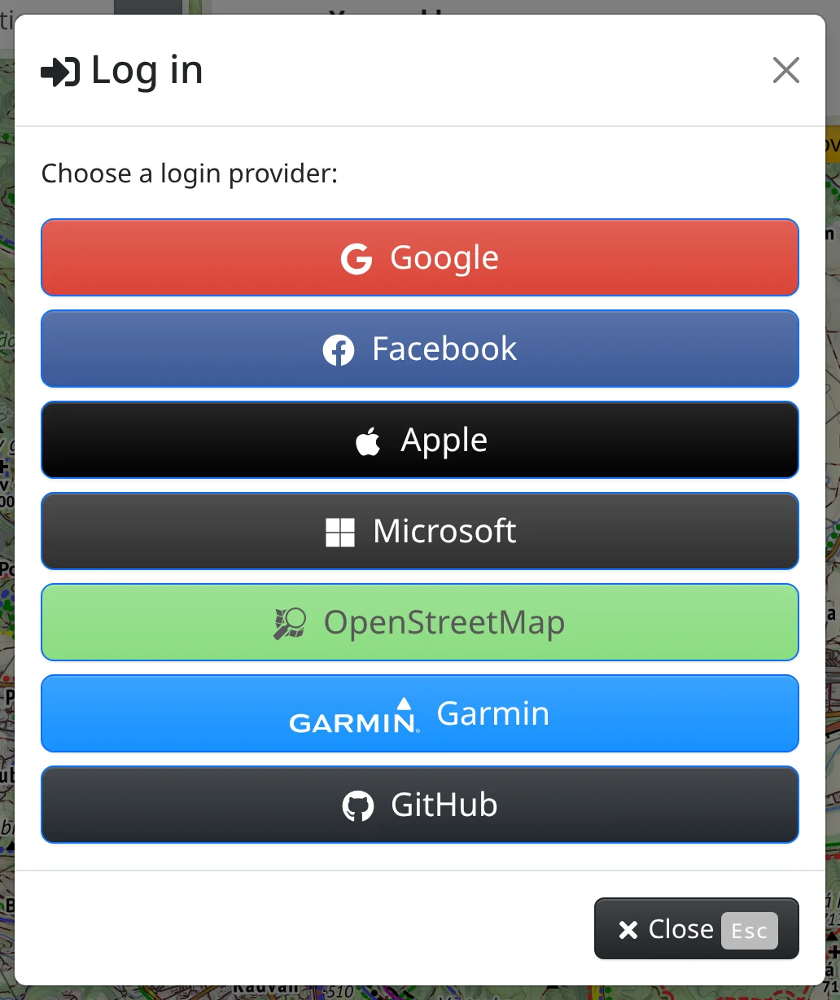

Most of Freemap works without an account. Logging in is needed to:

- save maps to your account and open them on another device – [My maps](#show=manual/my-maps),
- upload, rate and comment on photos – [Photos](#show=manual/photos),
- add your own devices for live tracking – [Live tracking](#show=manual/tracking),
- buy premium access and credits – [Premium and credits](#show=manual/premium),
- send a route to a Garmin device – [Maps in other apps and devices](#show=manual/devices).

When you are logged in, your map settings and custom maps are kept with your account rather than only in this browser.

## Logging in

Open :FaBars: **Main menu** → :FaSignInAlt: [Log in](#show=login) and choose a login provider: **Google**, **Facebook**, **Apple**, **Microsoft**, **OpenStreetMap**, **Garmin**, **Strava** or **GitHub**. Once you confirm the login with the provider, you are logged in to Freemap. Freemap has no password of its own.

**Strava** is offered only on www.freemap.sk.

Logging in requires accepting the cookies consent – until then, the provider buttons are disabled and the dialog says so. Logging in also needs a connection.

The first login with a provider creates a new Freemap account. To log in to the same account with another provider as well, connect that provider in the **Login providers** section of the account instead of logging in with it separately.

## The Account dialog

Once logged in, the main menu shows :FaUser: [Account](#show=account) (<kbd>e</kbd> <kbd>a</kbd>) in place of **Log in**. The dialog has four sections:

- :FaShoppingBasket: **Purchases** – premium access, credits and **Manage payments**, described in [Premium and credits](#show=manual/premium).
- :FaAddressCard: **Personal information**
- :FaUserCircle: **Login providers**
- :FaKey: **App tokens**

## Personal information

- **Profile picture** – :FaUpload: **Choose picture** picks an image of at most 5 MB, :FaTimes: **Remove** clears it.
- **Name** – required.
- **Email** and **About me** – optional.

Press :FaCheck: **Save** to store the changes.

## Login providers

Several providers can lead to one Freemap account. Under **Connect**, press a provider you want to add; after you confirm its login, you can log in with it too. If that provider account already belongs to another Freemap account, the two accounts are joined into one.

Under **Disconnect**, press a connected provider to remove it, after a confirmation. The last remaining provider cannot be disconnected.

## App tokens

An app token lets another application or a script use Freemap as you – for example to show the premium zooms of the Outdoor map in Locus, or to work with your photos, maps or devices through the Freemap API. A token allows only what its permissions allow, and nothing with the account itself: it cannot be used to change your personal information, login providers or purchases, nor to create other tokens. :FaInfoCircle: **What are app tokens?** in the section shows how an app sends the token.

Press :FaPlus: **New token** and fill in:

- **Note** – what the token is for, so you recognize it in the list.
- **Permissions** – tick only what the app needs: viewing or changing photos, my maps or tracked devices, and the premium zooms of the Outdoor map, the terrain shadings and the Slovak and Czech aerial imagery. The map zooms work in apps other than JOSM only if you have premium access.
- **Expires** – **Never**, in 30, 90 or 365 days, or **On a date**.

Press :FaCheck: **New token** below the form to create it. The token is shown only once: copy it with :FaClipboard: and store it – later it cannot be read again. Keep the token secret, like a password.

The list shows each token's note, permissions, creation date, expiry and when it was last used. :FaPencilAlt: **Edit token** changes the note, the permissions and the expiry; the token itself stays the same. :FaTrash: **Delete** revokes it at once, and apps using it stop working. If someone else may have got hold of a token, delete it and create a new one.

To use the Freemap maps in Locus Map or OruxMaps, you don't need to create a token by hand – the installation from :FaMobileAlt: **Maps for GPS devices** creates one when you are logged in, see [Maps in other apps and devices](#show=manual/devices).

## Logging out and deleting the account

:FaSignOutAlt: **Log out** at the bottom of the **Account** dialog logs you out on this device. It also removes from this browser the maps you made available offline and the map changes not yet sent; if there are such changes, you confirm first.

:FaEraser: **Delete account** removes the account after a confirmation, together with all your photos, photo comments and ratings, your maps and tracked devices. This cannot be undone.

Both need a connection.
