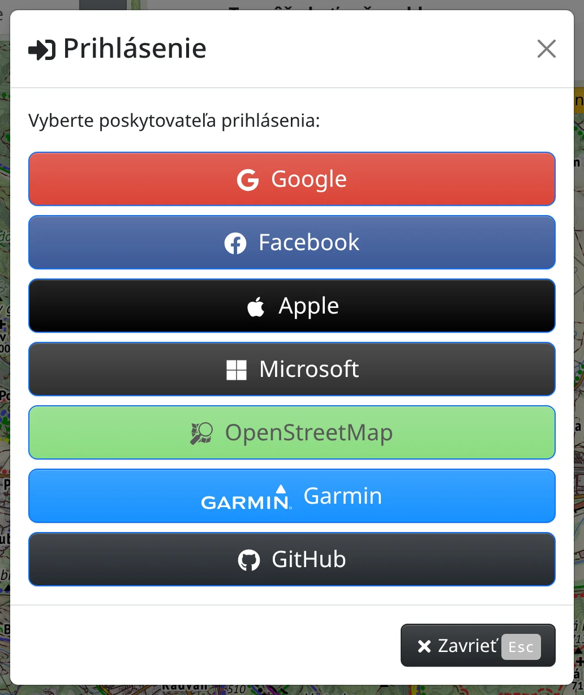

Väčšina Freemapu funguje aj bez účtu. Prihlásenie je potrebné na:

- ukladanie máp do účtu a ich otváranie na inom zariadení – [Moje mapy](#show=manual/my-maps),
- nahrávanie, hodnotenie a komentovanie fotografií – [Fotografie](#show=manual/photos),
- pridanie vlastných zariadení na sledovanie polohy – [Sledovanie](#show=manual/tracking),
- kúpu prémiového prístupu a kreditov – [Prémiový prístup a kredity](#show=manual/premium),
- poslanie trasy do zariadenia Garmin – [Mapy v iných aplikáciách a zariadeniach](#show=manual/devices).

Po prihlásení sa nastavenia mapy a vlastné mapy uchovávajú vo vašom účte, nie iba v tomto prehliadači.

## Prihlásenie

Otvorte :FaBars: **Hlavné menu** → :FaSignInAlt: [Prihlásenie](#show=login) a vyberte poskytovateľa prihlásenia: **Google**, **Facebook**, **Apple**, **Microsoft**, **OpenStreetMap**, **Garmin**, **Strava** alebo **GitHub**. Prihlásenie potom potvrdíte u poskytovateľa. Vlastné heslo Freemap nemá.

**Strava** je dostupná iba na www.freemap.sk.

Prihlásenie vyžaduje prijatie súhlasu cookies – dovtedy sú tlačidlá poskytovateľov neaktívne a v dialógu je o tom upozornenie. Na prihlásenie je potrebné aj pripojenie.

Prvé prihlásenie cez poskytovateľa vytvorí nový účet Freemap. Ak sa chcete do toho istého účtu prihlasovať aj cez ďalšieho poskytovateľa, pripojte ho v účte v časti **Poskytovatelia prihlásenia**, nie samostatným prihlásením.

## Dialóg Účet

Po prihlásení je v hlavnom menu namiesto položky **Prihlásenie** položka :FaUser: [Účet](#show=account) (<kbd>e</kbd> <kbd>a</kbd>). Dialóg má štyri časti:

- :FaShoppingBasket: **Nákupy** – prémiový prístup, kredity a **Spravovať platby**, opísané v kapitole [Prémiový prístup a kredity](#show=manual/premium).
- :FaAddressCard: **Osobné údaje**
- :FaUserCircle: **Poskytovatelia prihlásenia**
- :FaKey: **Aplikačné tokeny**

## Osobné údaje

- **Profilový obrázok** – :FaUpload: **Vybrať obrázok** vyberie obrázok s veľkosťou najviac 5 MB, :FaTimes: **Odstrániť** obrázok zruší.
- **Meno** – povinné.
- **E-Mail** a **O mne** – nepovinné.

Zmeny uložíte tlačidlom :FaCheck: **Uložiť**.

## Poskytovatelia prihlásenia

K jednému účtu Freemap môže viesť viacero poskytovateľov. V časti **Pripojiť** stlačte poskytovateľa, ktorého chcete pridať; po potvrdení prihlásenia u poskytovateľa sa môžete prihlasovať aj cez tohto poskytovateľa. Ak už k účtu tohto poskytovateľa patrí iný účet Freemap, oba účty sa spoja do jedného.

V časti **Odpojiť** stlačte pripojeného poskytovateľa a po potvrdení sa poskytovateľ odpojí. Posledného zostávajúceho poskytovateľa odpojiť nemožno.

## Aplikačné tokeny

Aplikačný token umožní inej aplikácii alebo skriptu používať Freemap vo vašom mene – napríklad zobrazovať prémiové priblíženia Outdoor mapy v Locuse alebo pracovať s vašimi fotografiami, mapami či zariadeniami cez Freemap API. Token umožňuje len to, čo povoľujú oprávnenia tokenu, a nič so samotným účtom: cez token nemožno zmeniť osobné údaje, poskytovateľov prihlásenia ani nákupy, ani vytvoriť ďalšie tokeny. :FaInfoCircle: **Čo sú aplikačné tokeny?** v tejto časti ukazuje, ako aplikácia token posiela.

Stlačte :FaPlus: **Nový token** a vyplňte:

- **Poznámka** – na čo token slúži, aby ste ho v zozname spoznali.
- **Oprávnenia** – zaškrtnite len to, čo aplikácia potrebuje: prezeranie alebo zmeny fotografií, mojich máp či sledovaných zariadení a prémiové priblíženia Outdoor mapy, tieňovaní terénu a slovenskej a českej leteckej mapy. Priblíženia máp fungujú v iných aplikáciách ako JOSM, len ak máte prémiový prístup.
- **Platnosť do** – **Bez obmedzenia**, 30, 90 alebo 365 dní, alebo **Do dátumu**.

Token vytvoríte tlačidlom :FaCheck: **Nový token** pod formulárom. Token sa zobrazí iba raz: skopírujte ho tlačidlom :FaClipboard: a uložte si ho – neskôr sa už prečítať nedá. Token uchovávajte v tajnosti, rovnako ako heslo.

Zoznam ukazuje pri každom tokene poznámku, oprávnenia, dátum vytvorenia, platnosť a posledné použitie. :FaPencilAlt: **Upraviť token** mení poznámku, oprávnenia a platnosť; samotný token zostáva rovnaký. :FaTrash: **Zmazať** token okamžite zruší a aplikácie, ktoré ho používajú, prestanú fungovať. Ak sa token mohol dostať k niekomu inému, zmažte ho a vytvorte nový.

Na používanie máp Freemapu v Locus Map alebo OruxMaps nie je potrebné vytvárať token ručne – pri inštalácii cez :FaMobileAlt: **Mapy pre GPS zariadenia** sa po prihlásení vytvorí automaticky, pozrite [Mapy v iných aplikáciách a zariadeniach](#show=manual/devices).

## Odhlásenie a zmazanie účtu

:FaSignOutAlt: **Odhlásiť** dole v dialógu **Účet** vás na tomto zariadení odhlási. Z tohto prehliadača zároveň odstráni mapy sprístupnené offline a zmeny máp, ktoré ešte neboli odoslané; ak také zmeny existujú, odhlásenie najprv potvrdíte.

:FaEraser: **Zmazať účet** po potvrdení odstráni účet spolu so všetkými vašimi fotografiami, komentármi a hodnoteniami fotografií, mapami a sledovanými zariadeniami. Túto akciu nemožno vrátiť späť.

Obe akcie vyžadujú pripojenie.
