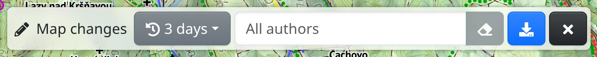

The Map changes tool shows the recent edits of [OpenStreetMap](https://www.openstreetmap.org) in the area you are looking at. It is for mappers who want to keep an eye on their area: who edited what, and whether the edit is right. Each edit is a _changeset_ – a set of changes a mapper uploaded at once, with a description.

## Opening the tool

Choose :FaPencilAlt: **Map changes** in the main menu, or press <kbd>g</kbd>, then <kbd>x</kbd>. Its toolbar appears at the top of the screen and the changesets of the visible area are downloaded.

## Filters

- :FaHistory: **Time window** – changesets from the last **3 days**, **7 days**, **14 days** or **30 days**.
- **All authors** – type a mapper's OpenStreetMap username to see only that mapper's changesets; :FaEraser: clears it.
- :FaDownload: **Download changesets for current map view** – after you move the map, downloads the changesets of the new area.

Over a large area there can be too many changesets. Then zoom in, choose fewer days or enter an author.

## Changesets on the map

Each changeset is a marker with the mapper's name and the changeset's description. Pointing at a marker outlines the area the changeset covers. The changesets are also listed under **Map changes** in the :FaLayerGroup: **Map layers** panel.

:FaEllipsisV: → :FaPencilAlt: **Convert to drawing** turns the changesets into points of a drawing, see [Drawing](#show=manual/drawing).

:FaTimes: closes the toolbar and takes the changesets off the map.

## Inspecting a changeset

Click a marker, or a changeset in the **Map layers** panel. The map zooms to the changeset and a box shows its **Author:**, **Description:**, **Time:** and other tags, such as the editor used. Clicking the author's name shows only that mapper's changesets.

The changed elements are drawn on the map: green for **created**, orange for **modified** and red, dashed, for **deleted**; where something moved, its previous shape is dashed grey. The box gives the counts of each and lists the changed relations, which are not drawn. The **Map layers** panel lists the changed elements; picking one zooms to it. If the changes are hard to see, lower :MdBrightness6: **Map brightness** in the :FaCog: menu.

Click an element on the map, or in the list, to see what happened to it: a table of its tags **Before** and **After**, with the changes highlighted, whether its geometry changed, and a link **History on osm.org**. The path at the top of the box leads back to the changeset.

**Open on osm.org** shows the changeset on the OpenStreetMap website.

:FaArrowLeft: **Back** in the toolbar or the × of the box ends the inspection. <kbd>Esc</kbd> takes you back one level at a time: from the element to the changeset, then out of the inspection.

The inspected changeset is part of the page address, so you can share it as a link.

## History of a single element

The details of an OpenStreetMap element on the map – a search result or a place picked on the map – have a :FaHistory: **History** button that lists its versions, each with the date, author and changeset description. Clicking a description inspects that changeset as described above, without opening the tool.

To fix a mistake you found, edit the map in OpenStreetMap, see [About Freemap and OpenStreetMap](#show=manual/about).
