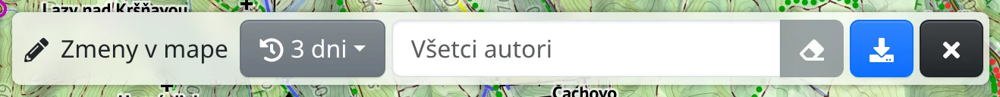

Nástroj Zmeny v mape zobrazuje nedávne úpravy [OpenStreetMap](https://www.openstreetmap.org) v oblasti, na ktorú sa práve pozeráte. Nástroj slúži mapérom, ktorí chcú sledovať svoje okolie: kto čo upravil a či je úprava správna. Každá úprava je _sada zmien_ – zmeny, ktoré mapér nahral naraz, s popisom.

## Otvorenie nástroja

V hlavnom menu zvoľte :FaPencilAlt: **Zmeny v mape** alebo stlačte <kbd>g</kbd> a potom <kbd>x</kbd>. Hore na obrazovke sa zobrazí lišta nástroja a stiahnu sa sady zmien zobrazenej oblasti.

## Filtre

- :FaHistory: **Časové okno** – sady zmien za posledné **3 dni**, **7 dní**, **14 dní** alebo **30 dní**.
- **Všetci autori** – zadajte používateľské meno mapéra v OpenStreetMap a zobrazia sa len sady zmien tohto mapéra; :FaEraser: pole vymaže.
- :FaDownload: **Stiahnuť sady zmien pre aktuálny výrez mapy** – po posunutí mapy stiahne sady zmien novej oblasti.

Vo veľkej oblasti môže byť sád zmien priveľa. Vtedy mapu priblížte, zvoľte menej dní alebo zadajte autora.

## Sady zmien na mape

Každá sada zmien je na mape značka s menom mapéra a popisom sady. Ukázaním na značku sa vyznačí oblasť, ktorej sa sada týka. Sady zmien sú vypísané aj pod položkou **Zmeny v mape** v paneli :FaLayerGroup: **Vrstvy mapy**.

:FaEllipsisV: → :FaPencilAlt: **Skonvertovať na kreslenie** zo sád zmien urobí body kreslenia, pozri [Kreslenie](#show=manual/drawing).

:FaTimes: zatvorí lištu nástroja a odstráni sady zmien z mapy.

## Preskúmanie sady zmien

Kliknite na značku alebo na sadu zmien v paneli **Vrstvy mapy**. Mapa sa priblíži na sadu zmien a v okne sa zobrazí **Autor:**, **Popis:**, **Čas:** a ďalšie tagy sady, napríklad použitý editor. Kliknutím na meno autora sa zobrazia len sady zmien tohto autora.

Zmenené prvky sa vykreslia na mape: zelenou **vytvorené**, oranžovou **upravené** a červenou prerušovanou čiarou **zmazané**; pri presunutom prvku je pôvodný tvar prvku sivý a prerušovaný. Okno uvádza počty prvkov v každej skupine a vypisuje zmenené relácie, ktoré sa na mape nekreslia. Panel **Vrstvy mapy** vypisuje zmenené prvky; výberom prvku sa mapa na tento prvok priblíži. Ak sú zmeny zle vidieť, znížte :MdBrightness6: **Jas mapy** v menu :FaCog:.

Kliknutím na prvok na mape alebo v zozname uvidíte, čo sa s prvkom stalo: tabuľku tagov **Predtým** a **Potom** so zvýraznenými zmenami, či sa zmenila geometria, a odkaz **História na osm.org**. Cesta navrchu okna vedie späť na sadu zmien.

**Otvoriť na osm.org** zobrazí sadu zmien na webe OpenStreetMap.

:FaArrowLeft: **Späť** na lište alebo × v okne preskúmanie ukončí. Klávesom <kbd>Esc</kbd> sa vrátite vždy o úroveň späť: z prvku na sadu zmien a potom von z preskúmania.

Preskúmaná sada zmien je súčasťou adresy stránky, takže ju môžete zdieľať ako odkaz.

## História jedného prvku

V detailoch prvku OpenStreetMap na mape – výsledku vyhľadávania alebo miesta vybraného na mape – je tlačidlo :FaHistory: **História** so zoznamom verzií prvku, pri každej s dátumom, autorom a popisom sady zmien. Kliknutím na popis preskúmate túto sadu zmien tak, ako je opísané vyššie, bez otvorenia nástroja.

Ak ste našli chybu, opravte ju v OpenStreetMap, pozri [O Freemape a OpenStreetMap](#show=manual/about).
