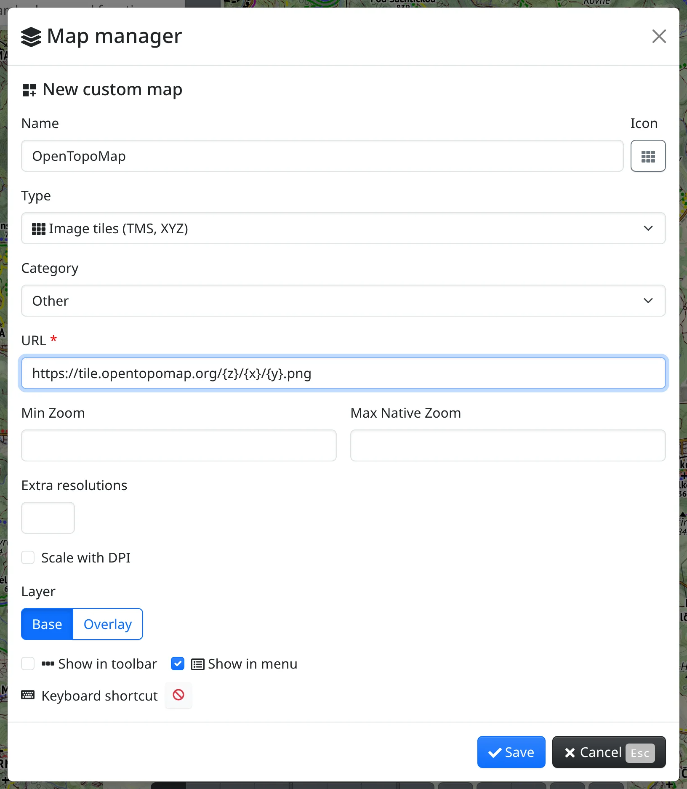

A custom map is a map from a server of your choice – image tiles, a WMS service or a vector style – that you add to Freemap yourself. You then use it like any other map: in the map toolbar, in the menu of maps, with a keyboard shortcut or from the search box. How to add maps from the library and arrange them is described in [Maps](#show=manual/maps).

Custom maps are saved with your account when you are logged in, otherwise in this browser.

## Creating a custom map

In the map toolbar, press :FaCog: and choose :FaLayerGroup: **Map manager**. At the bottom of the **Installed maps** or **Available maps** tab, press :FaPlus: **New custom map**.

- **Name** – how the map is labelled in the toolbar, the menu and the lists.
- **Icon** – the button next to the name picks the map's icon. Without one, the icon of its type is used.
- **Type** – what kind of server the map comes from:
  - :FaTh: **Image tiles (TMS, XYZ)** – the **URL** is a tile address template with the placeholders `{z}`, `{x}` and `{y}`, e.g. `https://tile.opentopomap.org/{z}/{x}/{y}.png`.
  - :TbVector: **Vector (MapLibre)** – the **URL** is the address of a MapLibre style.
  - :FaServer: **WMS** – the **URL** is the address of the WMS service; see below.
- **Category** – where the map belongs when you filter the lists in the map manager (**Maps**, **Orthophotos**, **Historic maps**, …).
- **Min Zoom** – below this zoom the map is not drawn.
- **Max Native Zoom** – the highest zoom the server has images for; zoomed in further, the map is drawn enlarged.
- **Layer** – **Base** replaces the base map, **Overlay** is drawn over it.
- **Show in toolbar** and **Show in menu** – where the map's button appears. **Keyboard shortcut** assigns a key combination that switches the map on (only on devices with a keyboard).

Press :FaCheck: **Save**. The map manager lists the new map under **Installed maps**, and while the map is not on, the message about saving has an **Activate** button that switches it on.

## A WMS service

For a WMS map, enter the service address in **URL** and press **Load layers**. The service's layers appear as a tree; tick the ones the map should draw. **Select all** and **Deselect all** act on all the layers shown, and a service with more than ten layers gets a search box. An empty **Name** is filled with the service's title, and an empty **Min Zoom** with the zoom from which the ticked layers are drawn.

A WMS map is requested as one image of the whole view. Tick **Load in tiles** for a server that limits the image size or works with tiles.

The layers ticked in the form are the map's defaults. Which layers are drawn can also be changed on the map, in the **Map layers** panel – see below.

## Where a custom map shows

- In the map toolbar, in the menu of maps (:FaEllipsisV: in the toolbar), under its keyboard shortcut and in the search box – just like the built-in maps.
- In the :FaLayerGroup: **Map layers** panel, while the map is on. Clicking its name opens its settings: opacity, the **Base** / **Overlay** switch, the layers of a WMS map, :FaPencilAlt: **Modify**, which opens its form, and **Reset to default**.
- In :FaLayerGroup: **Map manager** under **Installed maps**, where the **Kind** filter :FaUser: **Custom** lists only your custom maps.

## Modifying and deleting

In **Installed maps**, open the :FaEllipsisV: menu in the map's row:

- :FaPencilAlt: **Modify** opens the map's form. Saving puts its layer and WMS layers back to what the form says.
- :FaTrash: **Delete** removes the map after a confirmation. Maps saved from a WMS map with **Save as map** in the Map layers panel are deleted with it; the confirmation names them.

## Custom maps in a link

When a custom map is on the map, the link in the address bar carries the whole map definition. Whoever opens the link sees the map too, and it is added to their custom maps.
