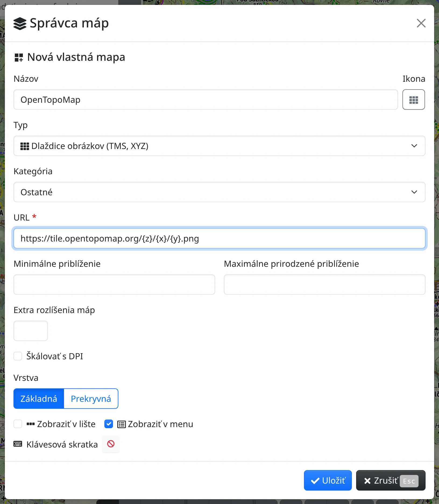

Vlastná mapa je mapa zo servera podľa vášho výberu – dlaždice obrázkov, služba WMS alebo vektorový štýl –, ktorú si do Freemapu pridáte sami. Potom ju používate ako ktorúkoľvek inú mapu: na lište máp, v ponuke máp, klávesovou skratkou alebo cez vyhľadávacie pole. Ako pridávať mapy z knižnice a usporiadať ich, popisuje kapitola [Mapy](#show=manual/maps).

Vlastné mapy sa po prihlásení ukladajú do vášho účtu, inak do tohto prehliadača.

## Vytvorenie vlastnej mapy

Na lište máp stlačte :FaCog: a zvoľte :FaLayerGroup: **Správca máp**. Na spodku záložky **Nainštalované mapy** alebo **Dostupné mapy** stlačte :FaPlus: **Nová vlastná mapa**.

- **Názov** – pod týmto názvom sa mapa zobrazuje na lište, v ponuke a v zoznamoch.
- **Ikona** – tlačidlom vedľa názvu vyberiete ikonu mapy. Bez vybranej ikony sa použije ikona typu mapy.
- **Typ** – z akého servera mapa pochádza:
  - :FaTh: **Dlaždice obrázkov (TMS, XYZ)** – do poľa **URL** zadajte šablónu adresy dlaždíc so zástupnými znakmi `{z}`, `{x}` a `{y}`, napr. `https://tile.opentopomap.org/{z}/{x}/{y}.png`.
  - :TbVector: **Vektor (MapLibre)** – do poľa **URL** zadajte adresu štýlu MapLibre.
  - :FaServer: **WMS** – do poľa **URL** zadajte adresu služby WMS, pozrite nižšie.
- **Kategória** – podľa kategórie sa mapa filtruje v zoznamoch správcu máp (**Mapy**, **Ortofotá**, **Historické mapy**, …).
- **Minimálne priblíženie** – pri menšom priblížení sa mapa nekreslí.
- **Maximálne prirodzené priblíženie** – najväčšie priblíženie, pre ktoré má server obrázky; pri väčšom priblížení sa mapa kreslí zväčšená.
- **Vrstva** – **Základná** nahradí podkladovú mapu, **Prekryvná** sa kreslí cez podkladovú mapu.
- **Zobraziť v lište** a **Zobraziť v menu** – kde sa zobrazí tlačidlo mapy. V poli **Klávesová skratka** nastavíte kombináciu klávesov, ktorou mapu zapnete (len na zariadeniach s klávesnicou).

Stlačte :FaCheck: **Uložiť**. Nová mapa sa zobrazí v správcovi máp na záložke **Nainštalované mapy** a kým mapa nie je zapnutá, správa o uložení obsahuje tlačidlo **Aktivovať**, ktorým mapu zapnete.

## Služba WMS

Pri mape typu WMS zadajte do poľa **URL** adresu služby a stlačte **Načítať vrstvy**. Vrstvy služby sa zobrazia ako strom; zaškrtnite tie, ktoré má mapa kresliť. **Vybrať všetky** a **Zrušiť výber všetkých** platia pre všetky zobrazené vrstvy a pri službe s viac ako desiatimi vrstvami pribudne pole na hľadanie vrstiev. Prázdne pole **Názov** sa vyplní názvom služby a prázdne pole **Minimálne priblíženie** priblížením, od ktorého sa zaškrtnuté vrstvy kreslia.

Mapa WMS sa zo servera načítava ako jeden obrázok celého výrezu. Pre server, ktorý obmedzuje veľkosť obrázka alebo pracuje s dlaždicami, zaškrtnite **Načítať po dlaždiciach**.

Vrstvy zaškrtnuté vo formulári sú predvolené vrstvy mapy. Ktoré vrstvy sa kreslia, môžete zmeniť aj priamo na mape, v paneli **Vrstvy mapy** – pozrite nižšie.

## Kde sa vlastná mapa zobrazuje

- Na lište máp, v ponuke máp (:FaEllipsisV: na lište), pod nastavenou klávesovou skratkou a vo vyhľadávacom poli – rovnako ako vstavané mapy.
- V paneli :FaLayerGroup: **Vrstvy mapy**, kým je mapa zapnutá. Kliknutím na názov mapy otvoríte nastavenia mapy: viditeľnosť, prepínač **Základná** / **Prekryvná**, vrstvy mapy WMS, :FaPencilAlt: **Upraviť**, ktoré otvorí formulár mapy, a **Obnoviť predvolené**.
- V :FaLayerGroup: správcovi máp na záložke **Nainštalované mapy**, kde filter **Druh** :FaUser: **Vlastné** ukáže len vaše vlastné mapy.

## Úprava a zmazanie

Na záložke **Nainštalované mapy** otvorte ponuku :FaEllipsisV: v riadku mapy:

- :FaPencilAlt: **Upraviť** otvorí formulár mapy. Uložením sa vrstva a vrstvy WMS mapy vrátia na hodnoty z formulára.
- :FaTrash: **Zmazať** po potvrdení mapu odstráni. Spolu s mapou WMS sa zmažú aj mapy, ktoré boli z tejto mapy uložené tlačidlom **Uložiť ako mapu** v paneli Vrstvy mapy; potvrdenie tieto mapy vymenuje.

## Vlastné mapy v odkaze

Keď je vlastná mapa zapnutá, odkaz v adresnom riadku prehliadača obsahuje celú definíciu mapy. Kto odkaz otvorí, uvidí túto mapu tiež a mapa sa pridá k vlastným mapám tohto používateľa.
