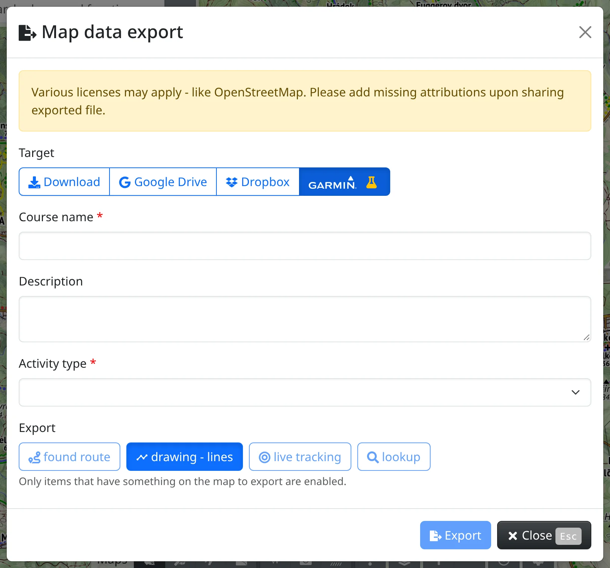
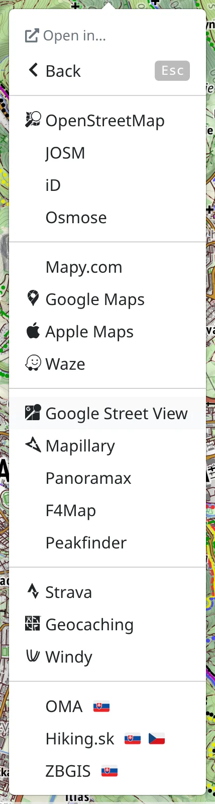

Freemap doesn't end in the browser. You can send a route to your Garmin, use Freemap maps in a navigation app on your phone, open the place you are looking at in another map, or put the map on your own web page.

## Sending a route to a Garmin device

If you have a [Garmin Connect](https://connect.garmin.com) account, you can [log in to Freemap](#show=login) with it, or connect it to your existing account in :FaUser: [Account](#show=account), section **Login providers**.

A planned route, a drawn line, a live-tracking track or a route picked from the map can then be sent to Garmin Connect as a course, and from there to your device. For example, to send a hiking route:

1. Zoom in to the hiking route.
2. Right-click the map, or press and hold it on a phone, and choose :FaInfo: **Query nearby features**.
3. Pick the route from the list of features found.
4. Open :FaBars: the main menu and choose :FaFileExport: [Map data export](#show=map-features-export).
5. Switch **Target** to :SiGarmin: (marked :FaFlask: as an experimental function).
6. Fill in the **Course name**, **Description** and **Activity type**.
7. Under **Export**, choose :FaSearch: **lookup** – the route must be a single continuous line, without branches.
8. Press :FaFileExport: **Export**.

If you are not logged in yet, or your account isn't connected with Garmin, you are asked to do so first. If everything goes well, the course appears on your device within a few seconds.

The same way you can send a :FaRoute: **found route**, a drawn line (:MdTimeline: **drawing - lines**) or a :FaBullseye: **live tracking** track – one line at a time.

## Files for other apps

With :FaFileExport: [Map data export](#show=map-features-export) you can also save what you have on the map – a route, drawn points, lines and polygons, objects, photos – as a GPX, GeoJSON or KML file. With **Target** set to :FaDownload: **Download** you get the file, with :FaShareAlt: **Share** you hand it straight to another app on your phone (where the browser allows it), and it can also go to Google Drive or Dropbox. Point icons are translated to their closest counterparts in Garmin, OsmAnd and Locus, so the file looks right there too.

## Freemap maps in Locus, OruxMaps and other apps

:FaMobileAlt: [Maps for GPS devices](#show=document/exports) in the main menu lists the Freemap maps ready to install into **Locus Map**, **OruxMaps**, **BackCountry Navigator**, **BikeComputer**, **XCTrack** and other apps reading the Mapsforge format, the online map addresses for apps that take your own tile map, and the **Garmin map** for Garmin devices and BaseCamp – with installation steps for each.

An area of a Freemap map can also be taken along as one MBTiles or SQLiteDB file with :FaDatabase: [Offline maps export](#show=offline-map-export) – see [Offline use](#show=manual/offline).

## Opening the place in another map

:FaExternalLinkAlt: **Share / Open in external app** in the main menu works with the place in the middle of the map:

- :FaClipboard: **Copy page URL** copies the link to what you see,
- :FaLink: **Share location** sends it through your device's share menu,
- the rest open the same place elsewhere – in :SiOpenstreetmap: **OpenStreetMap** and its editors, :SiGooglemaps: **Google Maps**, :SiApple: **Apple Maps**, **Mapy.com**, :SiWaze: Waze, :SiGooglestreetview: Google Street View, :SiMapillary: Mapillary, Peakfinder, :SiStrava: Strava, :SiGeocaching: Geocaching, :TbBrandWindy: Windy and more. Maps of a single country, such as **ZBGIS** or **Hiking.sk**, are offered only within that country.

On Android, with :FaMapMarkedAlt: **Map app** you pick any installed map app (Google Maps, Locus, OsmAnd, …) and :FaAndroid: **Freemap (Android)** opens the place in the Freemap Android app.

To open a particular spot rather than the middle of the map, use :FaExternalLinkAlt: **Open in…** in the map context menu, or in the menu of a found place, an object or a photo; where the other map supports it, the spot is marked there.

The most used targets also have keyboard shortcuts: press <kbd>j</kbd> and then <kbd>c</kbd> (copy the link), <kbd>o</kbd> (OpenStreetMap), <kbd>g</kbd> (Google Maps), <kbd>a</kbd> (Apple Maps), <kbd>m</kbd> (Mapy.com), <kbd>s</kbd> (Street View) and others – the menu shows them all, and so do the [keyboard shortcuts](#show=manual/shortcuts).

## The map on your web page

With :FaCode: [Embed map](#show=embed) in the main menu (<kbd>e</kbd> <kbd>e</kbd>) you get HTML code that puts the map, as you see it now, on your own web page. Set its **Width** and **Height**, choose which of **search**, **map layer switch** and **find me** visitors get, check the preview and press :FaClipboard: **Copy code**.

## Freemap on geocaching.com

If you use [geocaching.com](https://www.geocaching.com/), try the **Freemap.sk for Geocaching** extension for [Chrome](https://chromewebstore.google.com/detail/freemapsk-for-geocaching/iapkfaedafblcbjnjdhklenbcnedoodl) or [Firefox](https://addons.mozilla.org/en-US/firefox/addon/freemap-sk-for-geocaching/). It:

- adds the Slovak map layers **Freemap Outdoor** and **Ortofotomozaika SR** to the main map at [geocaching.com/play/map](https://www.geocaching.com/play/map), to cache details and to the small preview maps in lists and summaries,
- adds a **View on freemap.sk** button to cache details, which opens freemap.sk with the cache's location marked.
