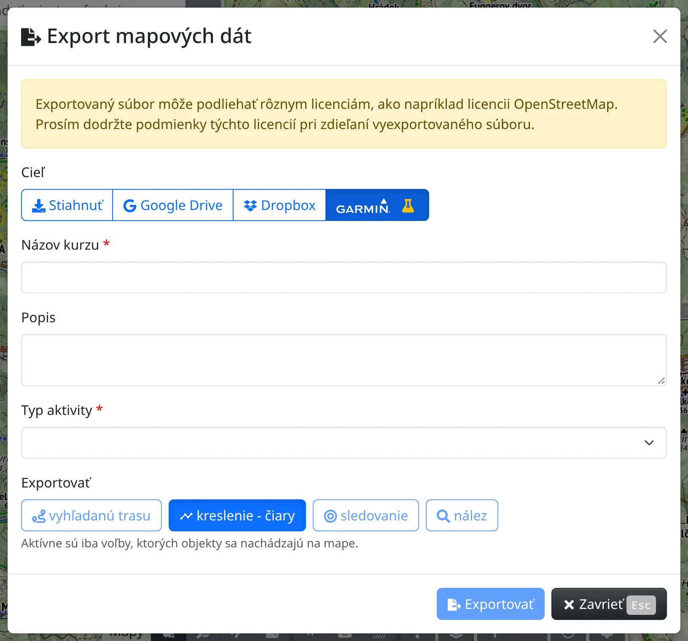
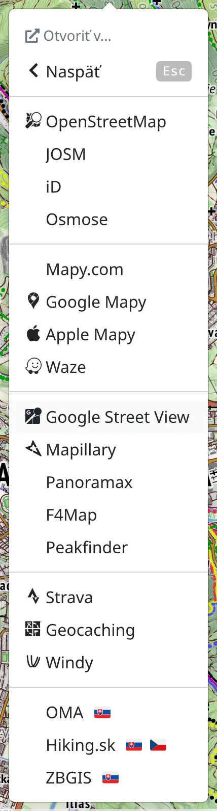

Freemap nekončí v prehliadači. Trasu si môžete poslať do Garminu, mapy Freemapu používať v navigačnej aplikácii v telefóne, miesto, na ktoré sa práve pozeráte, otvoriť v inej mape alebo mapu vložiť na vlastnú webstránku.

## Poslanie trasy do zariadenia Garmin

Ak máte účet [Garmin Connect](https://connect.garmin.com), môžete sa týmto účtom [prihlásiť na Freemap](#show=login) alebo ho pripojiť k svojmu existujúcemu účtu v časti **Poskytovatelia prihlásenia** v okne :FaUser: [Účet](#show=account).

Naplánovanú trasu, nakreslenú čiaru, záznam zo sledovania alebo trasu vybranú z mapy potom pošlete do Garmin Connect ako kurz a odtiaľ do zariadenia. Napríklad turistickú trasu takto:

1. Priblížte sa k turistickej trase.
2. Kliknite na mapu pravým tlačidlom myši, alebo na telefóne podržte prst na mape, a zvoľte :FaInfo: **Zistiť detaily v okolí**.
3. Zo zoznamu nájdených prvkov vyberte danú trasu.
4. Otvorte :FaBars: hlavné menu a zvoľte :FaFileExport: [Export mapových dát](#show=map-features-export).
5. Prepnite **Cieľ** na :SiGarmin: (s označením experimentálnej funkcie :FaFlask:).
6. Vyplňte **Názov kurzu**, **Popis** a **Typ aktivity**.
7. V časti **Exportovať** zvoľte :FaSearch: **nález** – trasa musí byť jedna súvislá čiara, bez odbočiek.
8. Stlačte :FaFileExport: **Exportovať**.

Bez prihlásenia alebo bez prepojenia účtu s Garminom budete najprv vyzvaní, aby ste to urobili. Ak všetko prebehne správne, kurz sa do niekoľkých sekúnd zobrazí vo vašom zariadení.

Rovnako pošlete aj :FaRoute: **vyhľadanú trasu**, nakreslenú čiaru (:MdTimeline: **kreslenie - čiary**) alebo záznam :FaBullseye: **sledovanie** – vždy jednu čiaru naraz.

## Súbory pre iné aplikácie

Cez :FaFileExport: [Export mapových dát](#show=map-features-export) môžete uložiť aj to, čo máte na mape – trasu, nakreslené body, čiary a polygóny, objekty či fotografie – do súboru GPX, GeoJSON alebo KML. Keď je **Cieľ** :FaDownload: **Stiahnuť**, dostanete súbor, cez :FaShareAlt: **Zdieľať** ho odovzdáte priamo inej aplikácii v telefóne (ak to prehliadač umožňuje) a uložiť ho môžete aj do Google Drive alebo Dropboxu. Ikony bodov sa prekladajú na najbližšie zodpovedajúce ikony v Garmine, OsmAnde a Locuse, takže súbor dobre vyzerá aj tam.

## Mapy Freemapu v Locuse, OruxMaps a ďalších aplikáciách

V :FaMobileAlt: [Mapy pre GPS zariadenia](#show=document/exports) v hlavnom menu nájdete mapy Freemapu pripravené na inštaláciu do aplikácií **Locus Map**, **OruxMaps**, **BackCountry Navigator**, **BikeComputer**, **XCTrack** a ďalších, ktoré čítajú formát Mapsforge, adresy online máp pre aplikácie, do ktorých si môžete pridať vlastnú dlaždicovú mapu, a **Garmin mapu** pre zariadenia Garmin a BaseCamp – každú s postupom inštalácie.

Územie z mapy Freemapu si môžete vziať so sebou aj ako jeden súbor MBTiles alebo SQLiteDB cez :FaDatabase: [Export offline máp](#show=offline-map-export) – pozri [Používanie offline](#show=manual/offline).

## Otvorenie miesta v inej mape

:FaExternalLinkAlt: **Zdieľať / otvoriť v ext. aplikácii** v hlavnom menu pracuje s miestom v strede mapy:

- :FaClipboard: **Kopírovať URL stránky** skopíruje odkaz na to, čo vidíte,
- :FaLink: **Zdieľať polohu** ho pošle cez ponuku zdieľania vo vašom zariadení,
- ostatné položky otvoria to isté miesto inde – v :SiOpenstreetmap: **OpenStreetMap** a v editoroch OpenStreetMap, :SiGooglemaps: **Google Mapy**, :SiApple: **Apple Mapy**, **Mapy.com**, :SiWaze: Waze, :SiGooglestreetview: Google Street View, :SiMapillary: Mapillary, Peakfinder, :SiStrava: Strava, :SiGeocaching: Geocaching, :TbBrandWindy: Windy a ďalších. Mapy jednej krajiny, napríklad **ZBGIS** alebo **Hiking.sk**, sa ponúkajú len v rámci danej krajiny.

V Androide si cez :FaMapMarkedAlt: **Mapová aplikácia** vyberiete ktorúkoľvek nainštalovanú mapovú aplikáciu (Google Mapy, Locus, OsmAnd, …) a :FaAndroid: **Freemap (Android)** otvorí miesto v aplikácii Freemap pre Android.

Ak chcete otvoriť konkrétne miesto, a nie stred mapy, použite :FaExternalLinkAlt: **Otvoriť v…** v kontextovom menu mapy alebo v menu nájdeného miesta, objektu či fotografie; kde to druhá mapa dovoľuje, miesto sa tam aj vyznačí.

Najpoužívanejšie ciele majú aj klávesové skratky: stlačte <kbd>j</kbd> a potom <kbd>c</kbd> (skopírovať odkaz), <kbd>o</kbd> (OpenStreetMap), <kbd>g</kbd> (Google Mapy), <kbd>a</kbd> (Apple Mapy), <kbd>m</kbd> (Mapy.com), <kbd>s</kbd> (Street View) a ďalšie – všetky ukazuje menu aj prehľad [klávesových skratiek](#show=manual/shortcuts).

## Mapa na vašej webstránke

Cez :FaCode: [Vložiť do webstránky](#show=embed) v hlavnom menu (<kbd>e</kbd> <kbd>e</kbd>) získate HTML kód, ktorý vloží mapu tak, ako ju práve vidíte, na vašu webstránku. Nastavte rozmery mapy (**Šírka**, **Výška**), zvoľte, ktoré z funkcií **vyhľadávanie**, **prepínanie vrstiev mapy** a **nájdenie vlastnej pozície** budú návštevníci mať, pozrite si ukážku a stlačte :FaClipboard: **Skopírovať kód**.

## Freemap na geocaching.com

Ak používate [geocaching.com](https://www.geocaching.com/), vyskúšajte rozšírenie **Freemap.sk for Geocaching** pre [Chrome](https://chromewebstore.google.com/detail/freemapsk-for-geocaching/iapkfaedafblcbjnjdhklenbcnedoodl) alebo [Firefox](https://addons.mozilla.org/sk/firefox/addon/freemap-sk-for-geocaching/). Rozšírenie:

- pridáva slovenské mapové vrstvy **Freemap Outdoor** a **Ortofotomozaika SR** do hlavnej mapy na [geocaching.com/play/map](https://www.geocaching.com/play/map), do detailu kešiek a do malých mapiek vo výpisoch a zoznamoch,
- dopĺňa do detailu kešky tlačidlo **Zobraziť na freemap.sk**, ktoré otvorí freemap.sk s vyznačenou polohou kešky.
