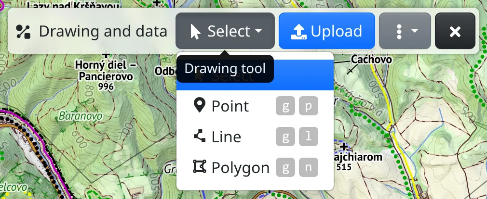
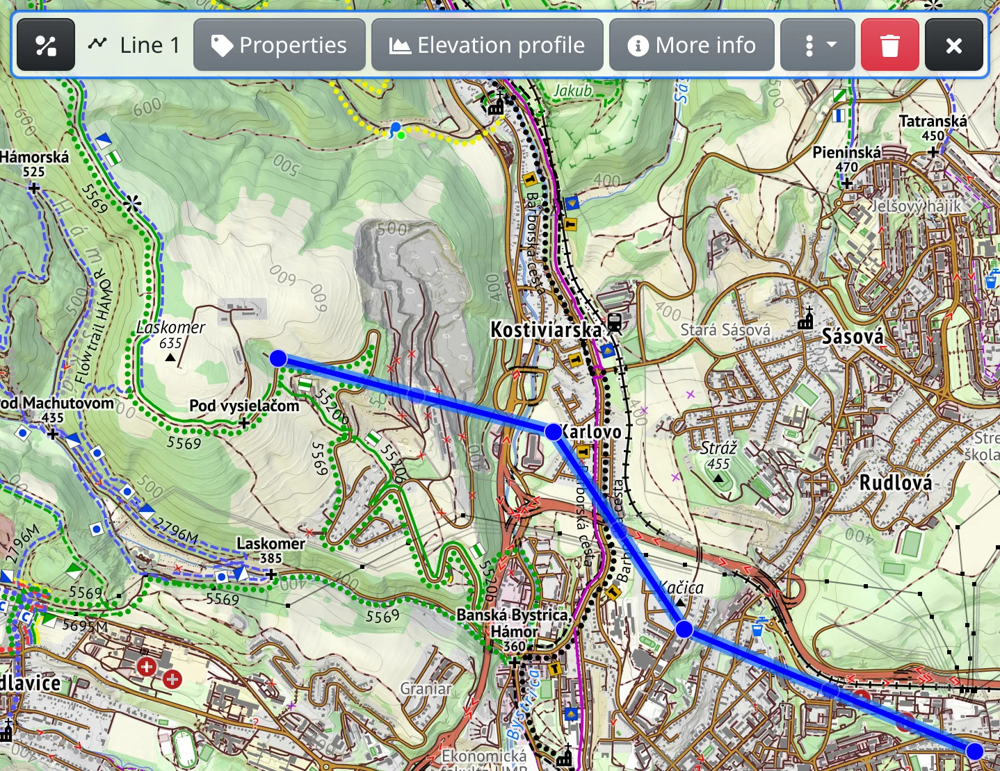

Draw points, lines and areas on the map – to mark a place, sketch a trip or measure a distance or an area. Everything you draw stays in the link, so you can send it to someone.

## Starting to draw

Drawing happens in the :MdShapeLine: **Drawing and data** tool (main menu, or <kbd>g</kbd> <kbd>g</kbd>). In its **Drawing tool** drop-down you choose what a click on the map does:

- :FaMousePointer: **Select** – clicks select what is drawn,
- :FaMapMarkerAlt: **Point** (<kbd>g</kbd> <kbd>p</kbd>) – each click adds a point,
- :MdPolyline: **Line** (<kbd>g</kbd> <kbd>l</kbd>) – each click adds a vertex of a line,
- :FaDrawPolygon: **Polygon** (<kbd>g</kbd> <kbd>n</kbd>) – each click adds a corner of an area.

You can also start from the map context menu: :FaMapMarkerAlt: **Add here a point** or :MdTimeline: **Start here drawing a line or measurement**.

A line or polygon is finished with :FaRegStopCircle: **Stop drawing** or the <kbd>Esc</kbd> key. The next click then starts a new one. While a drawing mode is on, clicks on the map draw rather than select.

## Measuring

- **Distance** – while you draw a line, the length of the next segment, its azimuth and the total so far follow the pointer. A finished line shows its **Length**; the unit button next to it switches between kilometres, metres, miles and more, and :FaCopy: copies the value.
- **Area** – a polygon shows its **Area** and **Perimeter**.
- **Coordinates and elevation** – a drawn point shows its elevation and coordinates. For any place without drawing anything, use :FaRuler: **Find coordinates and elevation** in the map context menu. :TbDecimal: switches the coordinate format and :FaCopy: copies them.

## Editing

Click a drawn point, line or polygon to select it (with the drawing tool on **Select**, or with no drawing tool open). It gets a toolbar of its own, and a line or polygon shows a handle on every vertex:

- drag a handle to move the vertex,
- drag the small handle between two vertices to insert a new one,
- click a handle to select the vertex – then :FaTrash: **Delete** (<kbd>Del</kbd>) removes it, and at the end of a line you draw on from there with :FaRegPlayCircle: **Continue**.

A selected point can be dragged to a new place. Pointing at a vertex shows the distance and azimuth from the previous one.

## Labels and style

:FaTag: **Properties** on the selection toolbar opens a dialog where you set the **Label** shown on the map, the **Color**, and for a line or polygon also the **Width**, **Dash style** and **Fill color**; a point has a **Shape** and an icon or short **Text** inside its marker. A label can also show measured values: write `{length}` into a line's label, or `{area}` into a polygon's.

The style of new drawings is set by :FaPaintBrush: **Set default style** in the tool's :FaEllipsisV: menu (<kbd>e</kbd> <kbd>d</kbd>). There, with **Show label** you also choose whether labels are shown always or only on hover or when selected.

## Deleting

- :FaTrash: **Delete** on the selection toolbar (<kbd>Del</kbd>) removes the selected feature.
- :FaEraser: **Clear map elements** in the main menu (<kbd>g</kbd> <kbd>c</kbd>) removes everything at once.

The browser's **Back** button undoes your last change.

## Keeping your drawing

Your drawing is written into the link in the address bar – copy it and others will see the same. A very large drawing doesn't fit into the link; the toolbar then shows **Unsaved**, and the drawing stays only in this browser. To keep it, choose :FaSave: **Save to my maps** in the :FaEllipsisV: menu (you need to be logged in); your saved maps are in :FaRegMap: [My maps](#show=my-maps).

Importing GPX and other files, the elevation profile, colouring a track and export are described in [Tracks and files](#show=manual/tracks).
