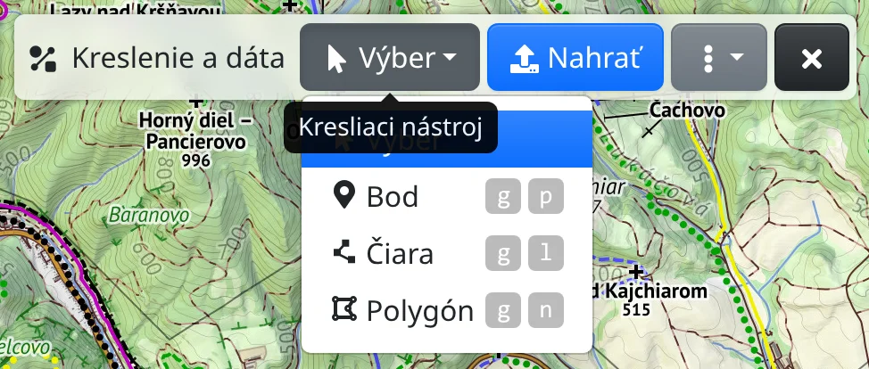
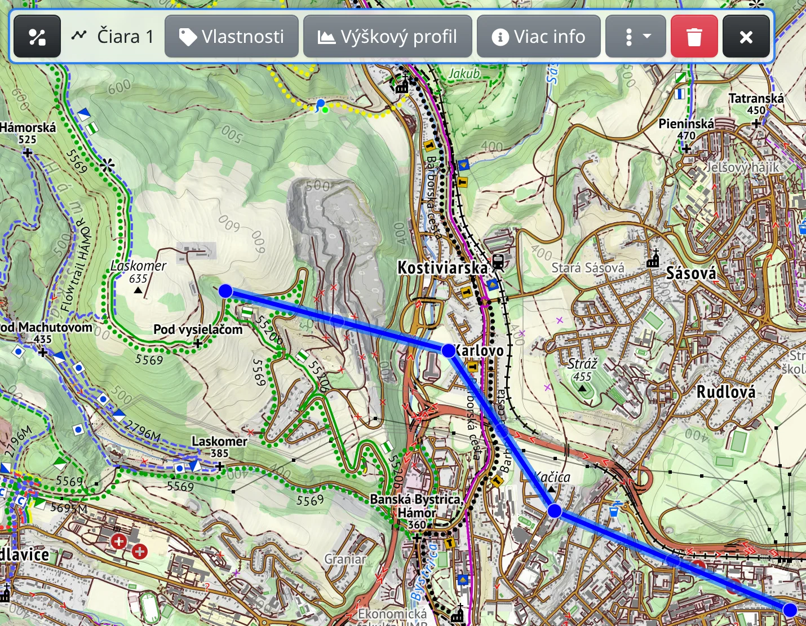

Na mapu môžete kresliť body, čiary a plochy – označiť si miesto, načrtnúť výlet alebo odmerať vzdialenosť či plochu. Všetko nakreslené je súčasťou odkazu, takže ho môžete niekomu poslať.

## Ako začať kresliť

Kreslí sa v nástroji :MdShapeLine: **Kreslenie a dáta** (v hlavnom menu alebo <kbd>g</kbd> <kbd>g</kbd>). V ponuke **Kresliaci nástroj** na lište nástroja vyberiete, čo urobí kliknutie do mapy:

- :FaMousePointer: **Výber** – kliknutím vyberiete, čo je nakreslené,
- :FaMapMarkerAlt: **Bod** (<kbd>g</kbd> <kbd>p</kbd>) – každé kliknutie pridá bod,
- :MdPolyline: **Čiara** (<kbd>g</kbd> <kbd>l</kbd>) – každé kliknutie pridá vrchol čiary,
- :FaDrawPolygon: **Polygón** (<kbd>g</kbd> <kbd>n</kbd>) – každé kliknutie pridá roh plochy.

Začať môžete aj z kontextového menu mapy: :FaMapMarkerAlt: **Pridať sem bod** alebo :MdTimeline: **Začať tu kresliť čiaru, merať dĺžku**.

Čiaru či polygón dokončíte tlačidlom :FaRegStopCircle: **Ukončiť kreslenie** alebo klávesom <kbd>Esc</kbd>. Ďalšie kliknutie potom začne novú. Kým je zapnuté kreslenie, kliknutie do mapy kreslí, a nie vyberá.

## Meranie

- **Vzdialenosť** – počas kreslenia čiary sa pri kurzore zobrazuje dĺžka a azimut ďalšieho úseku a doterajší súčet. Pri hotovej čiare sa zobrazí **Dĺžka**; tlačidlo s jednotkou vedľa údaja prepína kilometre, metre, míle a ďalšie jednotky a :FaCopy: hodnotu skopíruje.
- **Plocha** – pri polygóne sa zobrazí **Plocha** a **Obvod**.
- **Súradnice a výška** – pri nakreslenom bode sa zobrazí nadmorská výška a súradnice bodu. Pre ľubovoľné miesto, bez kreslenia, použite :FaRuler: **Zistiť súradnice a výšku bodu** v kontextovom menu mapy. :TbDecimal: prepína formát súradníc a :FaCopy: ich skopíruje.

## Úpravy

Kliknutím na nakreslený bod, čiaru alebo polygón ho vyberiete (keď je kresliaci nástroj nastavený na **Výber** alebo keď nie je otvorený žiadny kresliaci nástroj). Dostane vlastnú lištu a čiara či polygón zobrazí úchyt na každom vrchole:

- ťahaním úchytu vrchol posuniete,
- ťahaním malého úchytu medzi dvoma vrcholmi vložíte nový,
- kliknutím na úchyt vrchol vyberiete – potom ho :FaTrash: **Zmazať** (<kbd>Del</kbd>) odstráni a na konci čiary od neho tlačidlom :FaRegPlayCircle: **Pokračovať** kreslíte ďalej.

Vybraný bod môžete presunúť ťahaním. Ukázaním na vrchol sa zobrazí vzdialenosť a azimut od predchádzajúceho vrcholu.

## Popisy a štýl

:FaTag: **Vlastnosti** na lište výberu otvorí dialóg, kde nastavíte **Popis** zobrazený na mape, **Farbu** a pri čiare či polygóne aj **Šírku**, **Štýl prerušovania** a **Farbu výplne**; bod má **Tvar** a v značke ikonu alebo krátky **Text**. Popis môže ukazovať aj namerané hodnoty: do popisu čiary napíšte `{length}`, do popisu polygónu `{area}`.

Štýl nových kresieb nastavíte cez :FaPaintBrush: **Nastaviť predvolený štýl** v menu :FaEllipsisV: nástroja (<kbd>e</kbd> <kbd>d</kbd>). Voľbou **Zobraziť popis** tam tiež určíte, či sa popisy zobrazujú vždy, alebo len pri prejdení myšou či keď je prvok vybraný.

## Mazanie

- :FaTrash: **Zmazať** na lište výberu (<kbd>Del</kbd>) odstráni vybraný prvok.
- :FaEraser: **Vyčistiť mapu** v hlavnom menu (<kbd>g</kbd> <kbd>c</kbd>) odstráni všetko naraz.

Tlačidlom **Späť** v prehliadači vrátite poslednú zmenu.

## Uloženie kresby

Kresba sa zapisuje do odkazu v paneli s adresou – skopírujte ho a ostatní uvidia to isté. Veľmi veľká kresba sa do odkazu nezmestí; lišta potom ukáže **Neuložené** a kresba zostane len v tomto prehliadači. Ak si ju chcete ponechať, zvoľte :FaSave: **Uložiť do mojich máp** v menu :FaEllipsisV: (treba byť prihlásený); uložené mapy nájdete v :FaRegMap: [Mojich mapách](#show=my-maps).

Import súborov GPX a iných, výškový profil, farbenie trasy a export opisuje kapitola [Trasy](#show=manual/tracks).
