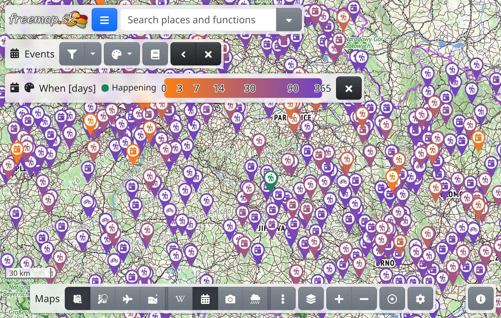
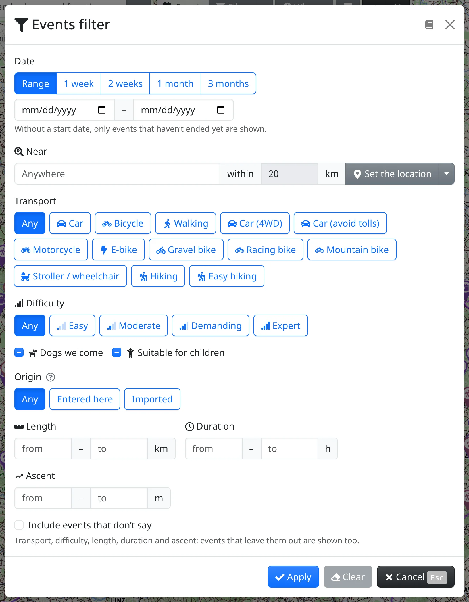
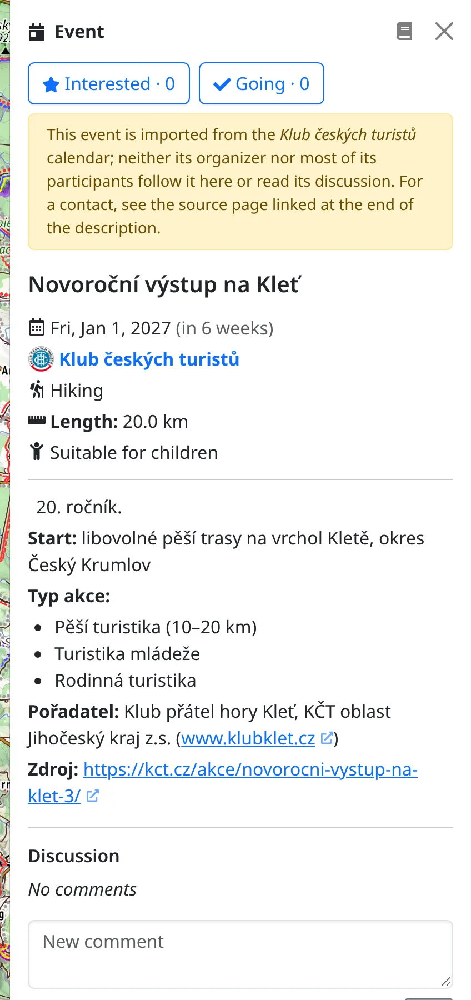

Events are shared trips – a hike, a bike ride, a ski tour – with a time, a start point and often a map of the route. Anyone can browse them; with an account you can say you are interested or going, join the discussion and enter events of your own. Every event is public.

Besides events entered here, Freemap takes over events from the calendars of organizations such as hiking clubs. Such an imported event says so in its panel: its organizer doesn't follow it here, so for a contact see the source page linked at the end of its description.

## Showing events

Turn on the :FaCalendarAlt: **Events** overlay with its button in the map toolbar or <kbd>Shift</kbd>+<kbd>E</kbd> (see [Maps](#show=manual/maps)). The events show from zoom 8 on, each as a marker at its start point: with the icon of its transport where it names just one, else a calendar. The search box finds events by their title too.

The overlay's toolbar has:

- :FaFilter: **Filter** – see below.
- :FaPalette: **Colorize by** – colours the markers by **When** (ended grey, happening green, upcoming from orange for soon to purple for weeks away), **Mine and others**, **Transport**, **Length**, **Duration**, **Ascent**, **Difficulty**, **Dogs** or **Children**; **Legend** in the same menu explains the colours.
- :FaPlus: **New event**, when you are logged in.

In the :FaLayerGroup: **Map layers** panel, the row of the Events overlay opens a list of the events shown, which you can search by title, sort (by date, title, length, ascent, duration, interest, or by distance from the map center, the nearest of your places or the filter's place) and keep to the current view. The eye menu in its header chooses what the rows show.

## Filtering

:FaFilter: **Filter** opens the **Events filter**:

- **Date** – a **Range** of dates, or a period from today: **1 week**, **2 weeks**, **1 month**, **3 months**. Without a start date only events that haven't ended yet are shown.
- **Near** – a place and a radius in km. Type coordinates or press **Set the location** and click the map; its menu offers **My location** and your places.
- **Transport**, **Difficulty**, **Dogs welcome**, **Suitable for children**, and ranges of **Length**, **Duration** and **Ascent**.
- **Origin** – **Entered here** or **Imported**.
- **Include events that don't say** also shows events that leave out the transport, difficulty or a stat you filter on.

The filter is remembered, and it is part of the link to the map. While it hides some events, the overlay's button shows :FaFilter.text-warning:. **Clear filter** in the menu of :FaFilter: removes it.

When you are logged in you can keep up to 20 filters under a name: choose **New saved filter** in **Saved filter** at the top of the dialog, name it and press **Save and apply**. With **Email me events matching this filter** ticked, events others add that match it come to your email, a few at a time; each email has a link to stop them. The saved filters are offered in the menu of :FaFilter:, those that email with :FaBell:. Fixed dates are not saved – choose a period instead.

## An event's panel

Click a marker, a row of the list or a search result to open the event's panel – on the right, on a phone over the lower half of the screen (dragging its header shrinks it or stretches it to the whole screen). The address in the browser is then the event's link, to share.

- :FaStar: **Interested** and :FaCheck: **Going** let others know – one or the other; pressing it again withdraws it. You need to be logged in.
- The details: the cover image, dates, organizer, length, duration, ascent and descent, difficulty, whether dogs are welcome and whether it suits children, and the description.
- For an event in the next 16 days, the [weather forecast](#show=manual/weather-forecast) for its place on its days, and where the event's linked map has a route, the weather along it.
- Who is going and who is interested; a name opens that person's profile.
- **Discussion** – comments, oldest first. :FaBell: follows the event by email: you hear of new comments, and of a change of time or place or a cancellation. The organizer and those going or interested follow it on their own.

With a linked map, :FaExternalLinkAlt: **Open in new tab** shows it in a new tab and leaves your map as it is; :FaCloudDownloadAlt: **Load here** loads it into the current map, asking whether to add it or replace what is there. :FaArrowLeft: **Back to events** then clears the map and returns to the markers.

## Entering an event

Press :FaPlus: **New event** in the overlay's toolbar, or choose **New event** in a map's menu in [My maps](#show=manual/my-maps), which links that map at once.

- **Title**, **Description** (with **Write** and **Preview**; bold, italics, links and lists are allowed), and a **Cover image** of up to 20 MB.
- **Start** and **End** – without an end, the event lasts until the end of its day. **Dates only, no time** suits trips of whole days.
- **Start point** – typed in coordinates, or picked with **Set the location**.
- **Linked map** – one of your maps, so participants see the route, or **New map from the current content**, which saves what is on the map now as the event's own map. Choosing a map fills in what you have left empty – the title, the start point, the transport and the length, duration and ascent of its route; what you have typed stays.
- **Transport**, **Difficulty**, **Dogs**, **Children**, **Length**, **Duration**, **Ascent** and **Descent** – each may be left unsaid.

Say in the description how to reach you. :FaEdit: **Modify** and :FaTrash: **Delete** in the event's panel change or remove it; deleting an event keeps the map it links.
