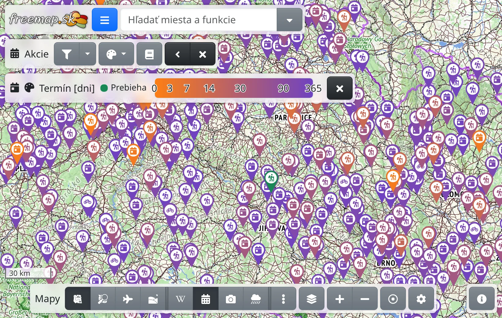
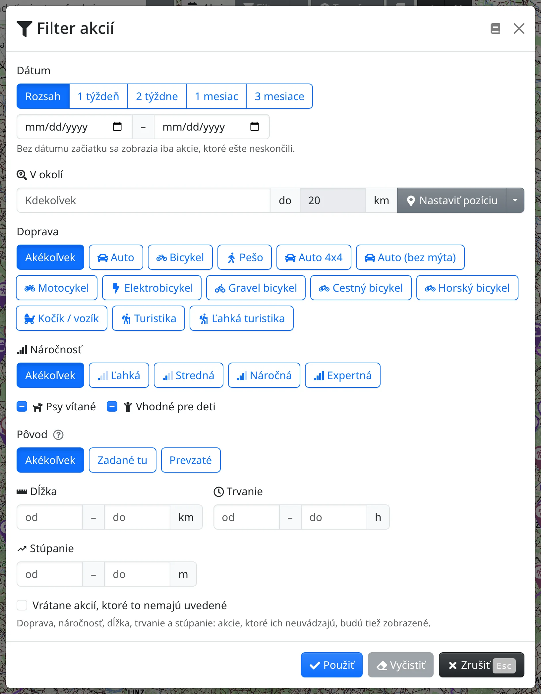
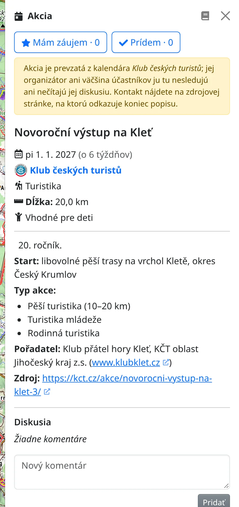

Akcie sú spoločné výlety – túra, cyklovýlet, skialpinistická túra – s termínom, miestom začiatku a často aj mapou trasy. Prezerať ich môže ktokoľvek; s účtom môžete dať vedieť, že máte záujem alebo prídete, zapojiť sa do diskusie a zadávať vlastné akcie. Každá akcia je verejná.

Okrem akcií zadaných tu Freemap preberá akcie z kalendárov organizácií, napríklad turistických klubov. Prevzatá akcia to uvádza vo svojom paneli: jej organizátor ju tu nesleduje, preto kontakt hľadajte na zdrojovej stránke, na ktorú odkazuje koniec jej popisu.

## Zobrazenie akcií

Zapnite prekrytie :FaCalendarAlt: **Akcie** jeho tlačidlom na lište máp alebo klávesmi <kbd>Shift</kbd>+<kbd>E</kbd> (pozri [Mapy](#show=manual/maps)). Akcie sa zobrazujú od priblíženia 8, každá ako značka na mieste začiatku: s ikonou dopravy, ak uvádza práve jednu, inak s kalendárom. Vyhľadávacie pole nájde akcie aj podľa názvu.

Lišta prekrytia obsahuje:

- :FaFilter: **Filter** – pozri nižšie.
- :FaPalette: **Vyfarbiť podľa** – vyfarbí značky podľa **Termín** (skončené sivou, prebiehajúce zelenou, nadchádzajúce od oranžovej pre blízke po fialovú pre o týždne), **Moje a ostatné**, **Doprava**, **Dĺžka**, **Trvanie**, **Stúpanie**, **Náročnosť**, **Psy** alebo **Deti**; **Legenda** v tej istej ponuke farby vysvetlí.
- :FaPlus: **Nová akcia**, ak ste prihlásení.

V paneli :FaLayerGroup: **Vrstvy mapy** riadok prekrytia Akcie otvorí zoznam zobrazených akcií, v ktorom môžete hľadať podľa názvu, triediť (podľa dátumu, názvu, dĺžky, stúpania, trvania, záujmu alebo podľa vzdialenosti od stredu mapy, domova či miesta z filtra) a obmedziť ho na aktuálne zobrazenie. Ponuka s okom v jeho hlavičke určuje, čo riadky ukazujú.

## Filtrovanie

:FaFilter: **Filter** otvorí **Filter akcií**:

- **Dátum** – **Rozsah** dátumov alebo obdobie od dnes: **1 týždeň**, **2 týždne**, **1 mesiac**, **3 mesiace**. Bez dátumu začiatku sa zobrazia iba akcie, ktoré ešte neskončili.
- **V okolí** – miesto a polomer v km. Zadajte súradnice alebo stlačte **Nastaviť pozíciu** a kliknite do mapy; jeho ponuka ponúka **Moja poloha** a **Domovská poloha**.
- **Doprava**, **Náročnosť**, **Psy vítané**, **Vhodné pre deti** a rozsahy **Dĺžka**, **Trvanie** a **Stúpanie**.
- **Pôvod** – **Zadané tu** alebo **Prevzaté**.
- **Vrátane akcií, ktoré to nemajú uvedené** zobrazí aj akcie, ktoré neuvádzajú dopravu, náročnosť alebo údaj, podľa ktorého filtrujete.

Filter sa pamätá a je súčasťou odkazu na mapu. Kým niektoré akcie skrýva, tlačidlo prekrytia ukazuje :FaFilter.text-warning:. **Zrušiť filter** v ponuke :FaFilter: ho odstráni.

Prihlásení si môžete uložiť až 20 filtrov pod názvom: v **Uložený filter** hore v dialógu zvoľte **Nový uložený filter**, pomenujte ho a stlačte **Uložiť a použiť**. Ak zaškrtnete **Posielať e-mailom akcie zodpovedajúce tomuto filtru**, akcie, ktoré pridajú iní a filtru zodpovedajú, vám prídu e-mailom, vždy po niekoľkých; každý e-mail má odkaz, ktorým ich zastavíte. Uložené filtre ponúka ponuka :FaFilter:, tie posielajúce e-maily so :FaBell:. Pevné dátumy sa neukladajú – zvoľte radšej obdobie.

## Panel akcie

Kliknutím na značku, riadok zoznamu alebo výsledok vyhľadávania otvoríte panel akcie – vpravo, na telefóne cez dolnú polovicu obrazovky (ťahaním za hlavičku ho zmenšíte alebo roztiahnete na celú obrazovku). Adresa v prehliadači je vtedy odkazom na akciu, ktorý môžete zdieľať.

- :FaStar: **Mám záujem** a :FaCheck: **Prídem** dajú vedieť ostatným – jedno alebo druhé; ďalším stlačením to vezmete späť. Treba byť prihlásený.
- Podrobnosti: titulný obrázok, dátumy, organizátor, dĺžka, trvanie, stúpanie a klesanie, náročnosť, či sú vítané psy a či je vhodná pre deti, a popis.
- Kto príde a kto má záujem; meno otvorí profil daného človeka.
- **Diskusia** – komentáre od najstaršieho. :FaBell: sleduje akciu e-mailom: dozviete sa o nových komentároch, o zmene termínu či miesta a o zrušení. Organizátor a tí, čo prídu alebo majú záujem, ju sledujú sami od seba.

S prepojenou mapou ju :FaExternalLinkAlt: **Otvoriť na novej karte** ukáže na novej karte a vašu mapu nechá tak; :FaCloudDownloadAlt: **Načítať sem** ju načíta do aktuálnej mapy a opýta sa, či ju pridať, alebo nahradiť, čo v nej je. :FaArrowLeft: **Späť na akcie** potom mapu vyčistí a vráti sa k značkám.

## Zadanie akcie

Stlačte :FaPlus: **Nová akcia** na lište prekrytia alebo v ponuke mapy v [Mojich mapách](#show=manual/my-maps) zvoľte **Nová akcia**, ktorá túto mapu hneď prepojí.

- **Názov**, **Popis** (so záložkami **Písať** a **Náhľad**; môžete použiť tučné písmo, kurzívu, odkazy a zoznamy) a **Titulný obrázok** do 20 MB.
- **Začiatok** a **Koniec** – bez konca trvá akcia do konca dňa. **Iba dátumy, bez času** sa hodí na celodenné výlety.
- **Miesto začiatku** – zadané súradnicami alebo vybrané tlačidlom **Nastaviť pozíciu**.
- **Prepojená mapa** – jedna z vašich máp, aby účastníci videli trasu, alebo **Nová mapa z aktuálneho obsahu**, ktorá uloží to, čo je práve na mape, ako vlastnú mapu akcie. Výber mapy doplní, čo ste nechali prázdne – názov, miesto začiatku, dopravu a dĺžku, trvanie a stúpanie jej trasy; čo ste napísali, zostane.
- **Doprava**, **Náročnosť**, **Psy**, **Deti**, **Dĺžka**, **Trvanie**, **Stúpanie** a **Klesanie** – každé môže zostať neuvedené.

V popise uveďte, ako vás zastihnúť. :FaEdit: **Upraviť** a :FaTrash: **Zmazať** v paneli akcie ju zmenia alebo odstránia; zmazanie akcie ponechá mapu, ktorú prepája.
