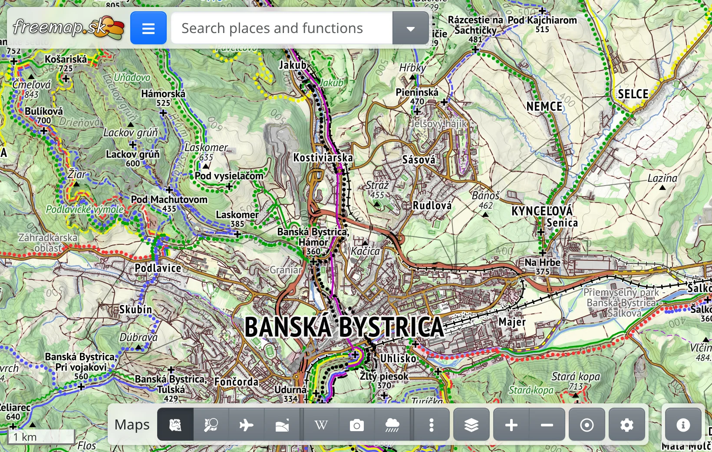
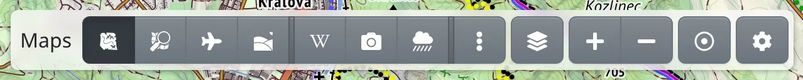
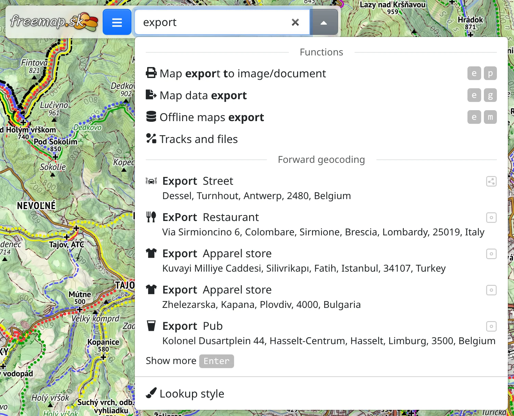
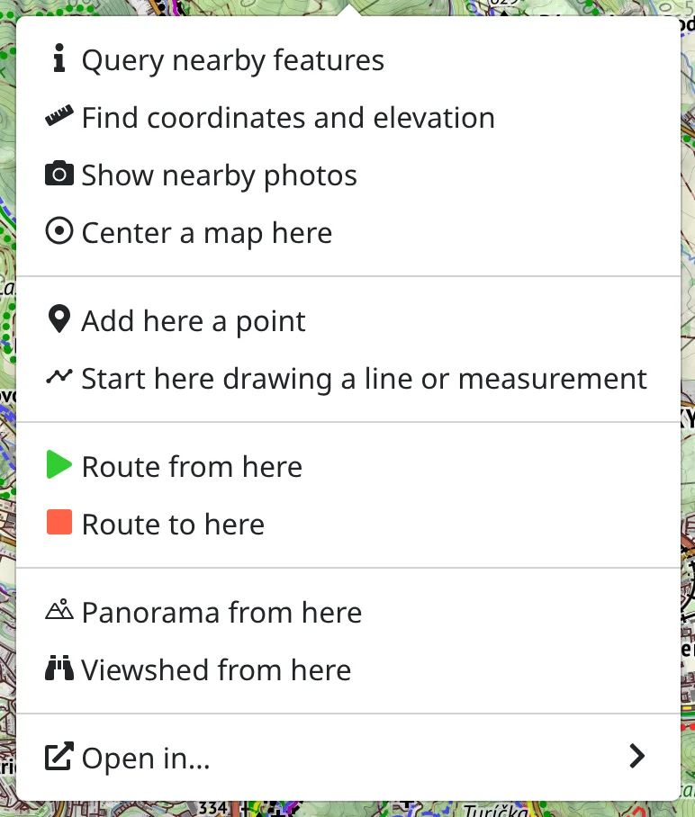

Freemap is a map for hiking, cycling, skiing and other outdoor activities, built on [OpenStreetMap](https://www.openstreetmap.org) data. This chapter shows where everything is.

## The screen at a glance

- :FaBars: **Main menu** – at the top left. It holds the tools (:FaRoute: route finder, :MdShapeLine: drawing and data, :PiMountains: panorama, …), :FaRegMap: your maps, exports, :FaUser: your account, :IoLanguage: the language and :FaBook: **Info & help**, where this manual lives.
- **Search box** – next to the main menu. In it you search for places, coordinates and also the app's own functions and maps.
- **Map toolbar** – at the bottom in the middle. With it you switch maps, and it holds the zoom buttons and :FaRegDotCircle: **Locate me**.
- :FaInfoCircle: – at the bottom right. It opens the map legend and the credits of the map being shown.

When a tool is open, its toolbar appears at the top of the screen. You close it with its :FaTimes: button. The drawing tools, the route finder and map details also close with <kbd>Esc</kbd>.

## Moving around the map

- Drag the map to move it, scroll the mouse wheel or pinch with two fingers to zoom.
- On a phone you can zoom with one finger: tap twice, keep the finger down after the second tap and drag down to zoom in or up to zoom out.
- On a keyboard, the arrow keys move the map and <kbd>+</kbd> / <kbd>-</kbd> zoom.

## Choosing a map

The map toolbar at the bottom lists the maps you use most. Press one to switch to it. Some of them are overlays – such as hiking trails, photos or weather radar – which are drawn over the base map and can be combined.

- :FaEllipsisV: lists more maps.
- :FaLayerGroup: opens the **Map layers** panel with the maps that are on, where you can change their opacity or switch them off.
- :FaPlus: and :FaMinus: zoom in and out.
- :FaRegDotCircle: **Locate me** – see below.
- :FaCog: opens a menu with the :FaLayerGroup: [map manager](#show=installed-maps), where you add maps from the library, remove the ones you don't use and choose which appear in the toolbar, as well as offline maps and preferences.

If a map can't be shown in the current view, its button gets a yellow icon: :FaSearchPlus.text-warning: when you need to zoom in, :FaGlobeEurope.text-warning: when you are outside the map's area, :FaSearchLocation.text-warning: when both. Pressing it moves the map to where the map has content.

What the symbols on the map mean is explained in the :FaList: [map legend](#show=legend).

## Finding a place

Type into the search box at the top: a name of a place, a summit, a street, or coordinates. Suggestions appear as you type; pressing <kbd>Enter</kbd> or :FaSearch: brings up a longer list. Pointing at a result shows it on the map, and picking it moves the map there.

In the same box you can also find:

- **functions** – type e.g. “export”, “route” or “weather” to open a tool or a dialog without looking for it in the menu,
- **maps** – type a map's name to switch it on,
- **types of places** – type e.g. “spring” or “shelter” to show all of them on the map.

## Where am I?

:FaRegDotCircle: **Locate me** in the map toolbar shows your position as a dot with an accuracy circle, and the map stays centred on you as you move. Once you move the map by hand, it no longer stays centred; pressing the button again brings the map back to you. Pressing it while the map is centred on you switches locating off.

The browser asks for permission to use your location the first time.

## The map context menu

Right-click the map, or press and hold it on a phone, to get a menu of actions for that place – for example :FaRuler: find its coordinates and elevation, :FaInfo: show what is there, :FaCamera: show nearby photos, plan a route from or to there, or :MdTimeline: start drawing.

## Everything is in the link

The address in your browser's address bar always describes what you see: the map, the place, the drawn lines, the planned route. Copy it and send it to someone, and they will see the same. The browser's **Back** button also steps back through your changes.

## More

- :FaRegKeyboard: [Keyboard shortcuts](#show=manual/shortcuts) make many actions faster.
- Most functions work without an account. Once :FaSignInAlt: [logged in](#show=login), you can save your maps and upload photos.
