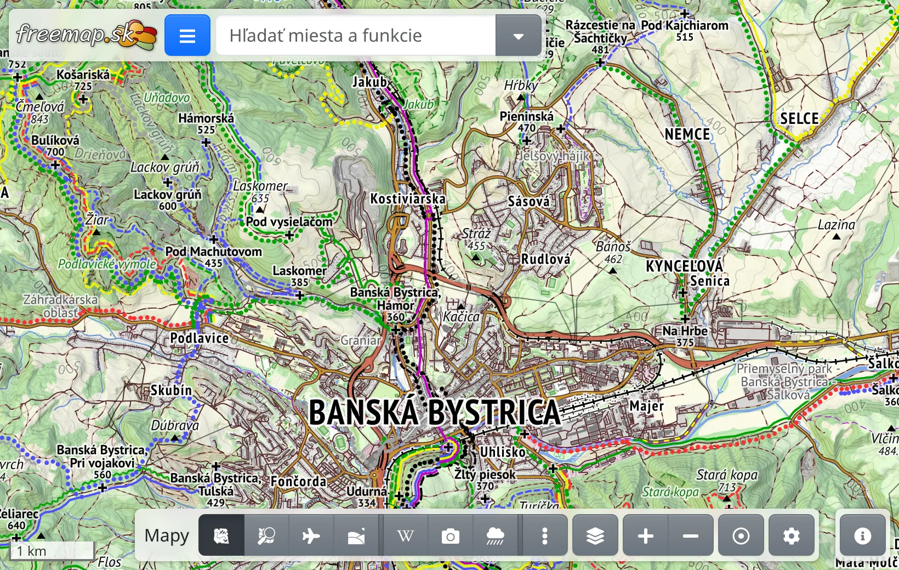
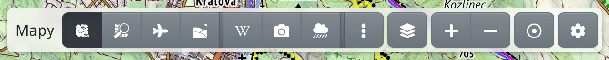
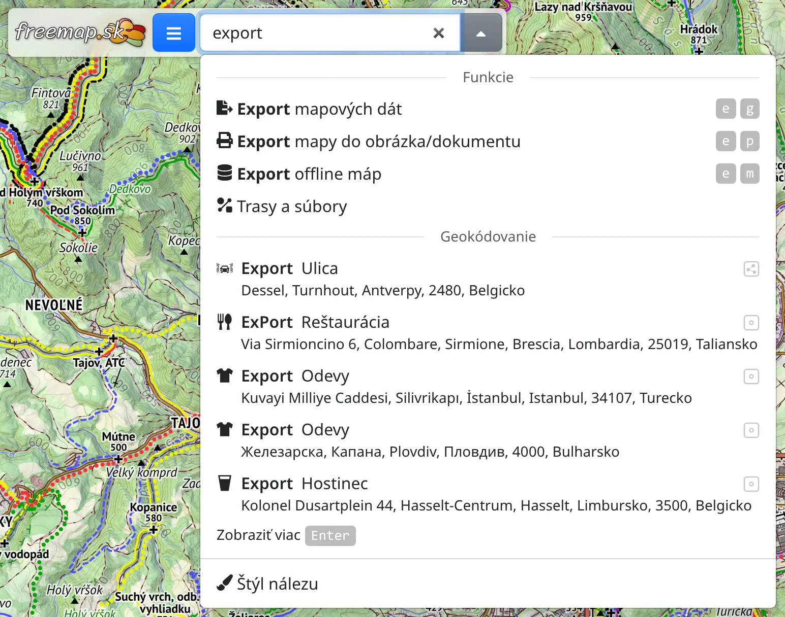
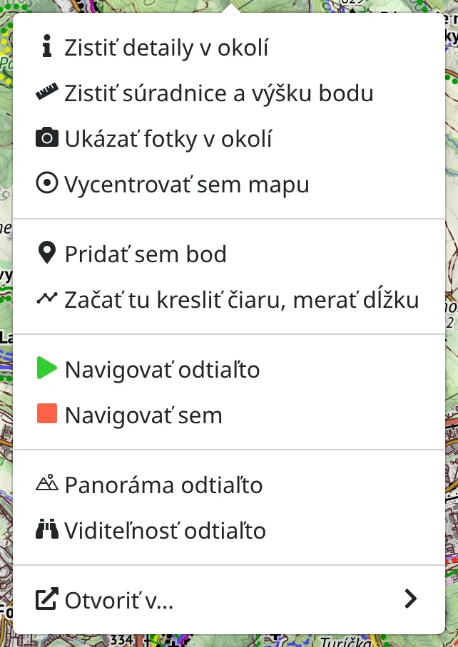

Freemap je mapa pre turistiku, cyklistiku, lyžovanie a ďalšie aktivity v prírode, postavená na dátach [OpenStreetMap](https://www.openstreetmap.org). Táto kapitola ukazuje, kde čo nájdete.

## Obrazovka v skratke

- :FaBars: **Hlavné menu** – vľavo hore. V menu nájdete nástroje (:FaRoute: vyhľadávač trás, :MdShapeLine: kreslenie a dáta, :PiMountains: panoráma, …), :FaRegMap: svoje mapy, exporty, :FaUser: svoj účet, :IoLanguage: jazyk a :FaRegQuestionCircle: **Info a pomoc**, kde je aj táto :FaBook: príručka.
- **Vyhľadávacie pole** – vedľa hlavného menu. Slúži na hľadanie miest, súradníc, ale aj funkcií a máp aplikácie.
- **Lišta máp** – dole v strede. Slúži na prepínanie máp a nájdete tu aj tlačidlá priblíženia a :FaRegDotCircle: **Kde som?**
- :FaInfoCircle: – vpravo dole. Otvára legendu mapy a zdroje zobrazenej mapy.

Lišta otvoreného nástroja sa zobrazí hore na obrazovke. Nástroj zatvoríte tlačidlom :FaTimes: na lište. Kreslenie, vyhľadávač trás a detaily v mape sa zatvárajú aj klávesom <kbd>Esc</kbd>.

## Pohyb po mape

- Mapu posuniete ťahaním, priblížite kolieskom myši alebo roztiahnutím dvoch prstov.
- Na telefóne sa dá približovať aj jedným prstom: ťuknite dvakrát, po druhom ťuknutí nechajte prst na displeji a ťahajte nadol na priblíženie alebo nahor na oddialenie.
- Na klávesnici mapu posúvajú šípky a <kbd>+</kbd> / <kbd>-</kbd> ju približujú a odďaľujú.

## Výber mapy

Na lište máp dole sú mapy, ktoré používate najčastejšie. Stlačením tlačidla sa na mapu prepnete. Niektoré z nich sú prekrytia – napríklad turistické trasy, fotografie alebo meteoradar – ktoré sa kreslia cez podkladovú mapu a dajú sa kombinovať.

- :FaEllipsisV: zobrazí ďalšie mapy.
- :FaLayerGroup: otvára panel **Vrstvy mapy** so zapnutými mapami, kde im môžete zmeniť viditeľnosť alebo ich vypnúť.
- :FaPlus: a :FaMinus: mapu približujú a odďaľujú.
- :FaRegDotCircle: **Kde som?** – pozrite nižšie.
- :FaCog: otvára menu. V tomto menu je :FaLayerGroup: [správca máp](#show=installed-maps), kde pridáte mapy z knižnice, odoberiete nepoužívané a vyberiete, ktoré sa zobrazia na lište; ďalej offline mapy a predvoľby.

Ak mapu nemožno zobraziť v aktuálnom výreze, na tlačidle mapy sa objaví žltá ikona: :FaSearchPlus.text-warning:, keď treba mapu priblížiť, :FaGlobeEurope.text-warning:, keď ste mimo územia mapy, a :FaSearchLocation.text-warning:, keď platí oboje. Stlačením ikony sa mapa presunie tam, kde má obsah.

Čo znamenajú značky na mape, vysvetľuje :FaList: [legenda mapy](#show=legend).

## Hľadanie miesta

Do vyhľadávacieho poľa hore napíšte názov obce, vrchu, ulice alebo súradnice. Návrhy sa zobrazujú už počas písania, klávesom <kbd>Enter</kbd> alebo :FaSearch: si vyžiadate dlhší zoznam. Ukázaním na výsledok ho uvidíte na mape, výberom výsledku sa mapa presunie na toto miesto.

V tom istom poli nájdete aj:

- **funkcie** – napíšte napr. „export“, „trasa“ alebo „počasie“ a otvoríte nástroj či dialóg bez hľadania v menu,
- **mapy** – napíšte názov mapy a zapnete ju,
- **druhy miest** – napíšte napr. „prameň“ alebo „útulňa“ a na mape sa zobrazia všetky.

## Kde som?

:FaRegDotCircle: **Kde som?** na lište máp zobrazí vašu polohu ako bod s kruhom presnosti a mapa sa počas pohybu posúva s vami. Keď mapu posuniete rukou, prestane sa s vami posúvať; ďalším stlačením tlačidla sa mapa vráti k vám. Stlačením, kým sa mapa posúva s vami, sa zisťovanie polohy vypne.

Pri prvom použití si prehliadač vyžiada povolenie na prístup k polohe.

## Kontextové menu mapy

Kliknite na mapu pravým tlačidlom myši, alebo na telefóne podržte prst na mape, a zobrazí sa ponuka akcií pre toto miesto – napríklad :FaRuler: zistiť súradnice a nadmorskú výšku, :FaInfo: zistiť detaily v okolí, :FaCamera: ukázať fotky v okolí, naplánovať trasu odtiaľ alebo tam, či :MdTimeline: začať kresliť.

## Všetko je v odkaze

Adresa v paneli prehliadača vždy popisuje to, čo vidíte: mapu, miesto, nakreslené čiary aj naplánovanú trasu. Skopírujte ju a pošlite niekomu – uvidí to isté. Tlačidlom **Späť** v prehliadači sa vrátite k predchádzajúcemu stavu.

## Ďalej

- :FaRegKeyboard: [Klávesové skratky](#show=manual/shortcuts) mnohé úkony zrýchlia.
- Väčšina funkcií funguje bez účtu. Po :FaSignInAlt: [prihlásení](#show=login) si môžete ukladať mapy a nahrávať fotografie.
