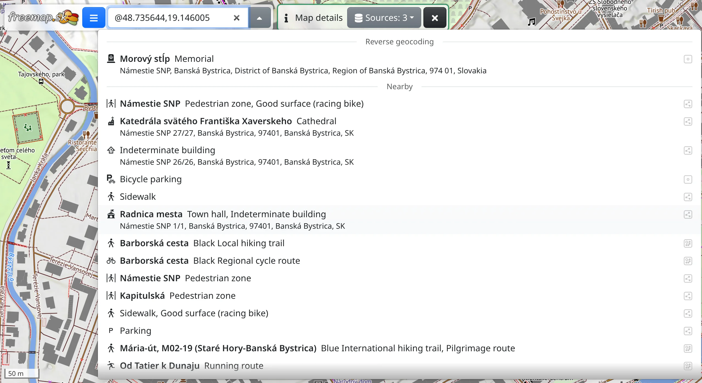
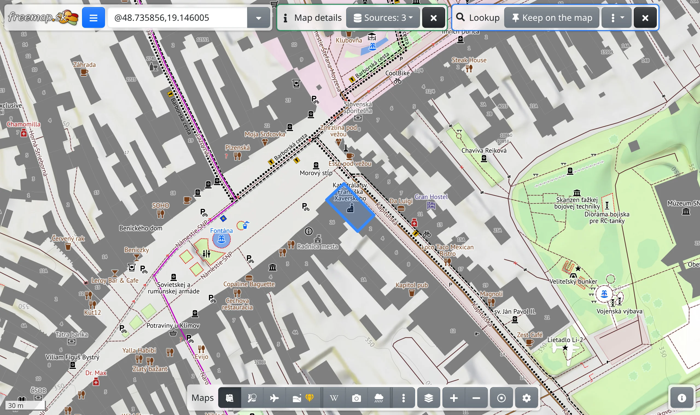

Map details is for finding out what is at a place on the map: its address, the OpenStreetMap features nearby, the areas the place lies in, and what a WMS map says about it. It needs an internet connection.

## Opening the tool

Choose :FaInfo: **Map details** in the main menu, or press <kbd>g</kbd>, then <kbd>i</kbd>. Its toolbar appears at the top of the screen.

To ask about a single place without opening the tool, right-click it, or press and hold it on a phone, and choose :FaInfo: **Query nearby features**.

## Querying a place

With the tool open, click the map. The search box shows the coordinates of the place, and the features found there are listed below it, under the source they come from:

- **Reverse geocoding** – the address or locality of the place.
- **Nearby** – features close to the place; the circle around the pointer shows how far that reaches.
- **Containing features** – the areas the place lies in, such as the cadastral community, district, region, mountain range and country.
- one section for each WMS map shown on the map, with what that map reports at the place.

**Nearby** and **Containing features** cover Europe only.

With :FaDatabase: **Sources** in the toolbar you choose which sources are asked; the button shows how many are on.

## Feature details

Pointing at a row in the list shows the feature on the map. Click the row to select it: the map moves to the feature and its details open – the name and kind, the elevation, the OpenStreetMap tags and the source. What the details show is described in [Objects](#show=manual/objects).

The × closes the details; clicking the feature on the map brings them back.

## History of an element

For an OpenStreetMap element, :FaHistory: **History** in the details lists its versions, newest first, each with its date, author and changeset comment. Clicking a comment shows that changeset on the map and what it changed on the element. The links at the top lead back to the history and the details, and <kbd>Esc</kbd> goes back one step. Browsing changesets is described in [Map changes](#show=manual/changesets).

## What to do with a found feature

The selected feature has its own toolbar:

- :FaThumbtack: **Keep on the map** – the feature stays on the map when you select another one. A kept feature is removed with :FaTrash: **Delete**.
- :FaEllipsisV: holds :FaPencilAlt: **Convert to drawing**, which turns the feature into a drawing you can edit (see [Drawing](#show=manual/drawing)), the actions for the place, as in the map's context menu, and :FaExternalLinkAlt: **Open in…** – for an OpenStreetMap element **OpenStreetMap.org**, **OpenStreetMap.org (history)** and the editors **JOSM** and **iD**, followed by other maps and apps.

:FaFileExport: **Map data export** in the main menu saves the found features as GPX or another format. How they are drawn on the map is set in :FaPaintBrush: **Lookup style**, the last row of the search box's list.
