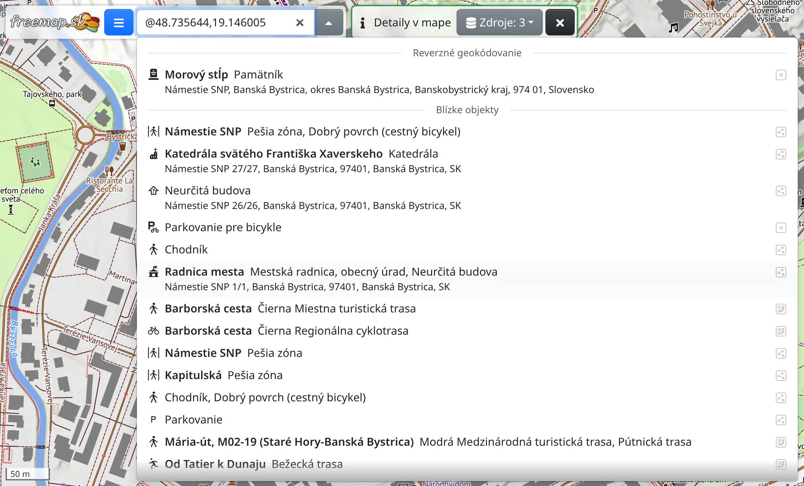
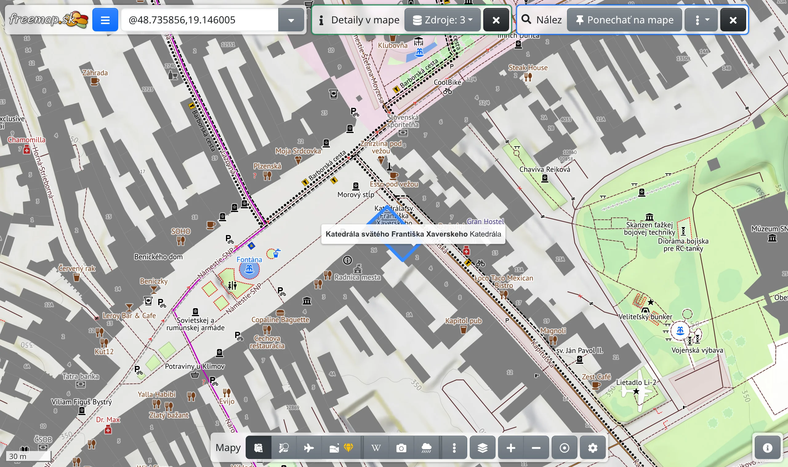

Detaily v mape slúžia na zistenie, čo sa nachádza na mieste v mape: adresa miesta, prvky OpenStreetMap v okolí, územia, do ktorých miesto patrí, a údaje WMS mapy o tomto mieste. Nástroj vyžaduje pripojenie na internet.

## Otvorenie nástroja

V hlavnom menu zvoľte :FaInfo: **Detaily v mape** alebo stlačte <kbd>g</kbd> a potom <kbd>i</kbd>. Hore na obrazovke sa zobrazí lišta nástroja.

Na jedno miesto sa môžete opýtať aj bez otvorenia nástroja: kliknite na miesto pravým tlačidlom myši, alebo na telefóne podržte prst na mieste, a zvoľte :FaInfo: **Zistiť detaily v okolí**.

## Zistenie detailov miesta

Pri otvorenom nástroji kliknite do mapy. Vo vyhľadávacom poli sa zobrazia súradnice miesta a pod poľom zoznam nájdených prvkov, rozdelený podľa zdroja:

- **Reverzné geokódovanie** – adresa alebo obec, kde miesto leží.
- **Blízke objekty** – prvky blízko miesta; krúžok okolo kurzora ukazuje, kam až siaha okolie.
- **Obsahujúce objekty** – územia, do ktorých miesto patrí, napríklad katastrálne územie, okres, kraj, pohorie a štát.
- samostatná časť pre každú zobrazenú WMS mapu s údajmi tejto mapy o mieste.

**Blízke objekty** a **Obsahujúce objekty** pokrývajú iba Európu.

Tlačidlom :FaDatabase: **Zdroje** na lište zvolíte, ktoré zdroje sa použijú; na tlačidle je počet zapnutých zdrojov.

## Podrobnosti o prvku

Ukázaním na riadok v zozname sa prvok zobrazí na mape. Kliknutím na riadok prvok vyberiete: mapa sa presunie na prvok a otvoria sa podrobnosti o prvku – názov a druh, nadmorská výška, značky OpenStreetMap a zdroj. Čo podrobnosti obsahujú, popisuje kapitola [Objekty](#show=manual/objects).

Krížikom podrobnosti zatvoríte; kliknutím na prvok v mape sa znova otvoria.

## História prvku

Pri prvku OpenStreetMap zobrazí tlačidlo :FaHistory: **História** v podrobnostiach verzie prvku od najnovšej, každú s dátumom, autorom a komentárom zmeny. Kliknutím na komentár sa na mape zobrazí táto zmena aj úpravy prvku v rámci tejto zmeny. Odkazmi navrchu sa vrátite k histórii a k podrobnostiam, <kbd>Esc</kbd> vráti o krok späť. Prezeranie zmien popisuje kapitola [Zmeny v mape](#show=manual/changesets).

## Čo s nájdeným prvkom

Vybraný prvok má vlastnú lištu:

- :FaThumbtack: **Ponechať na mape** – prvok zostane na mape aj po výbere iného prvku. Ponechaný prvok odstránite tlačidlom :FaTrash: **Zmazať**.
- V ponuke :FaEllipsisV: nájdete :FaPencilAlt: **Skonvertovať na kreslenie**, ktoré z prvku urobí kreslenie na úpravu (pozri [Kreslenie](#show=manual/drawing)), akcie pre dané miesto ako v kontextovej ponuke mapy a :FaExternalLinkAlt: **Otvoriť v…** – pri prvku OpenStreetMap **OpenStreetMap.org**, **OpenStreetMap.org (história)** a editory **JOSM** a **iD**, za nimi ďalšie mapy a aplikácie.

:FaFileExport: **Export mapových dát** v hlavnom menu uloží nájdené prvky do súboru GPX alebo iného formátu. Vzhľad prvkov na mape nastavíte v :FaPaintBrush: **Štýl nálezu**, poslednom riadku zoznamu vo vyhľadávacom poli.
