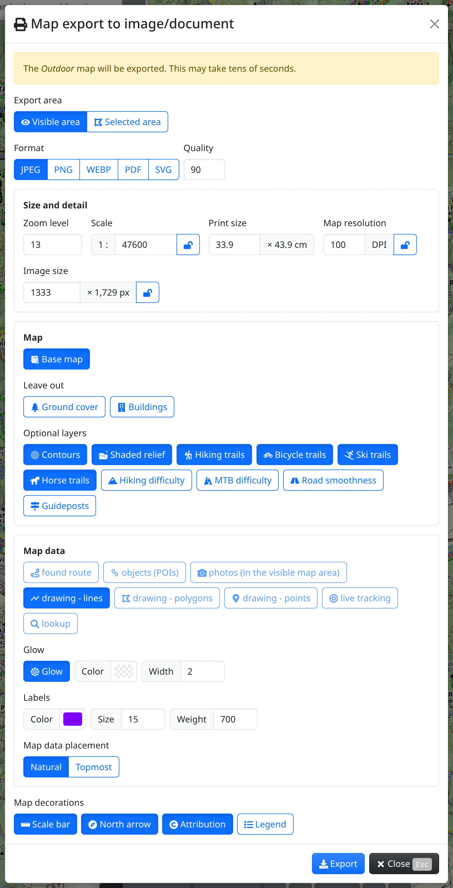
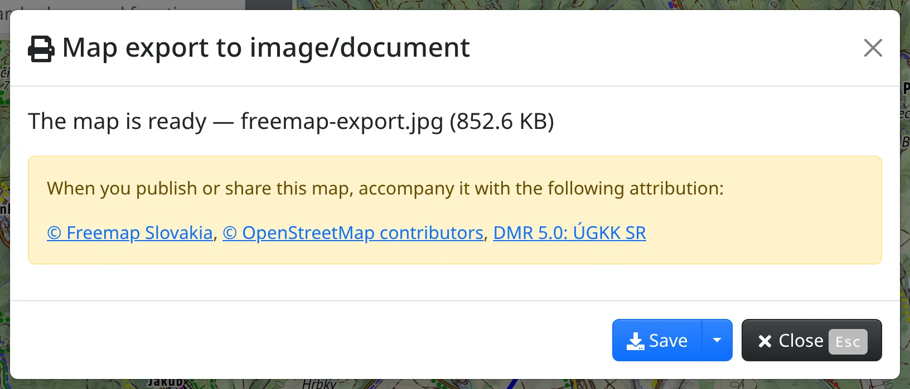

You can save a piece of the Outdoor map as a picture or a PDF – to print, to put in a report or on a web page – together with your route, drawing or photos. Open :FaBars: **Main menu** → :FaPrint: **Map export to image/document** (<kbd>e</kbd> <kbd>p</kbd>). The map is drawn on the server, so you need to be online, and it can take tens of seconds.

The export always draws the Outdoor map, whichever map you are looking at. For a file to open in another app, use [Map data export](#show=map-features-export) instead, see [Tracks and files](#show=manual/tracks).

## Area and format

- **Export area** – :FaEye: **Visible area** is what you see on the screen; with :FaDrawPolygon: **Selected area** the dialog steps aside, you adjust a rectangle on the map and confirm it.
- **Format** – JPEG, PNG, WebP, PDF or SVG. JPEG takes a **Quality**; WebP is **Lossless** or **Lossy**, the lossy one with a **Quality** too. For a map, lossless WebP is exact and usually also the smallest.

## Size and detail

- **Zoom level** sets how detailed the map is – which roads, paths and names it shows. It starts at the zoom of the map.
- **Scale** and **Print size** (the width in cm, the height follows the area) are one value in two units.
- **Map resolution** (DPI) and **Image size** (the width in pixels) say how sharp the picture is.

Two of scale, DPI and image size set the third. A value you type gets locked :FaLock:, and the others adjust around it; pressing :FaLock: unlocks it again, and :FaLockOpen: locks the value shown. An unlocked scale follows the zoom. With a locked scale, a different zoom only makes text and symbols print larger or smaller – a note below the fields gives their size in percent.

The file carries its DPI, so it prints at the stated size. A too large area at a high zoom can't be exported; the message says which zoom still fits.

## What goes in

Under **Map**:

- :GiTreasureMap: **Base map** – on, the whole map is drawn; off, only the chosen optional layers, over a transparent background.
- **Leave out** – :FaTree: **Ground cover** and :FaBuilding: **Buildings** become transparent, for laying the map over an aerial image.
- **Optional layers** – :RxTarget: **Contours**, :GiHills: **Shaded relief**, trails for hiking, cycling, skiing and riding, :FaMountain: **Hiking difficulty**, :GiMountainRoad: **MTB difficulty**, :FaRoad: **Road smoothness** and :FaMapSigns: **Guideposts**.

Anything short of the whole map needs PNG, WebP or SVG; JPEG and PDF can't be chosen then.

Under **Map data** you pick what of your own to draw over the map – a :FaRoute: **found route**, :TbMapPins: **objects (POIs)**, :FaCamera: **photos**, the lines, polygons and points of your [drawing](#show=manual/drawing), :FaBullseye: **live tracking**, :FaSearch: **lookup**. Only what is on the map can be chosen. With :FaRegSun: **Glow** they get an outline of the chosen **Color** and **Width**; under **Labels** you set the colour, size and weight of their names. **Map data placement** – **Natural** fits the data into the map's own layers, **Topmost** draws it over everything.

## Map decorations

:FaRulerHorizontal: **Scale bar**, :FaCompass: **North arrow**, :FaCopyright: **Attribution** – the sources of the map, written in its corner – and :FaList: **Legend**, a panel beside the map explaining the symbols in the area. The legend makes the document wider than the chosen paper.

## When the map is ready

Press :FaDownload: **Export**. While it runs, only :FaTimes: **Cancel** works. Then the dialog shows **The map is ready** with the file name and size, and the sources to credit when you publish or share the map.

:FaDownload: **Save** saves the file and closes the dialog; the sources stay in a message on the screen. Behind the arrow beside it are :FaExternalLinkAlt: **Open in a new tab** (not for SVG) and :FaCopy: **Copy attribution**. Closing the dialog without saving asks first, as the map would be lost.

What the licences of the maps require is in [About Freemap and OpenStreetMap](#show=manual/about). To put an interactive map on a web page, see [Maps in other apps and devices](#show=manual/devices).
