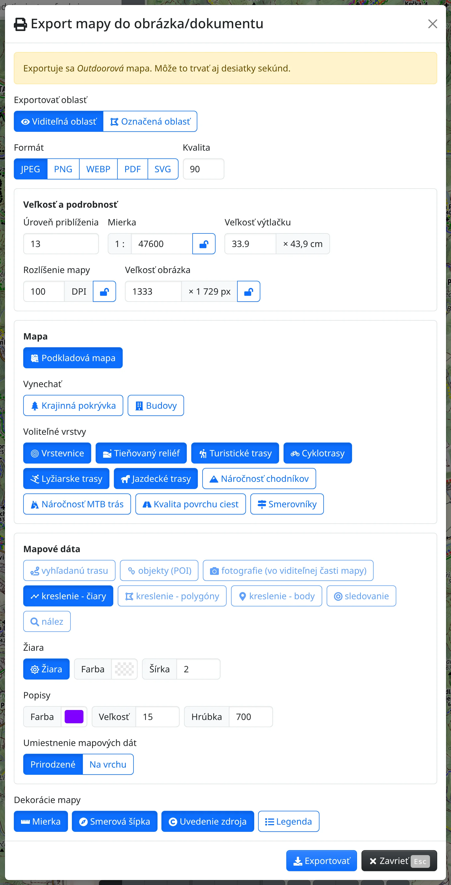
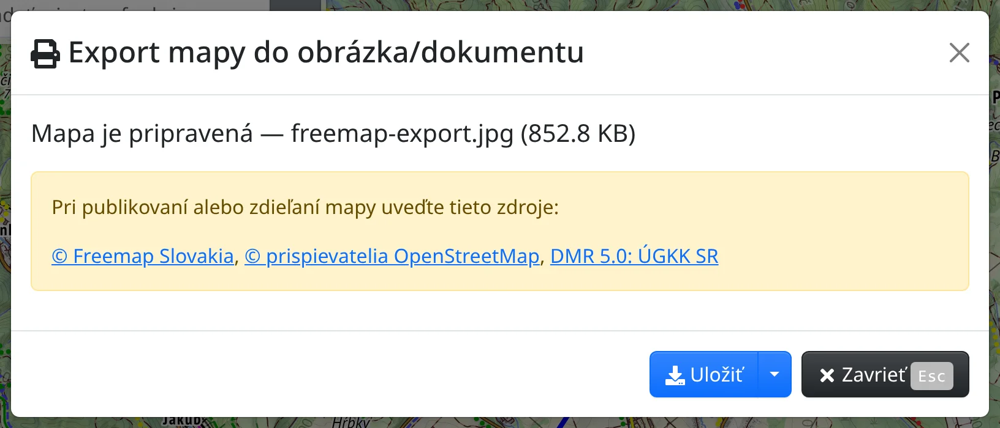

Výrez Outdoorovej mapy si môžete uložiť ako obrázok alebo PDF – na tlač, do správy či na webstránku – spolu so svojou trasou, kresbou alebo fotografiami. Otvorte :FaBars: **Hlavné menu** → :FaPrint: **Export mapy do obrázka/dokumentu** (<kbd>e</kbd> <kbd>p</kbd>). Mapa sa vykresľuje na serveri, preto treba byť online a export môže trvať aj desiatky sekúnd.

Exportuje sa vždy Outdoorová mapa, bez ohľadu na to, ktorú mapu si práve prezeráte. Na súbor, ktorý otvoríte v inej aplikácii, slúži [Export mapových dát](#show=map-features-export), pozri [Trasy a súbory](#show=manual/tracks).

## Oblasť a formát

- **Exportovať oblasť** – :FaEye: **Viditeľná oblasť** je to, čo vidíte na obrazovke; pri :FaDrawPolygon: **Označená oblasť** sa dialóg odsunie, na mape upravíte obdĺžnik a potvrdíte ho.
- **Formát** – JPEG, PNG, WebP, PDF alebo SVG. Pri JPEG nastavíte **Kvalitu**; WebP je **Bezstratová** alebo **Stratová**, stratová tiež s **Kvalitou**. Pri mape je bezstratový WebP presný a väčšinou aj najmenší.

## Veľkosť a podrobnosť

- **Úroveň priblíženia** určuje podrobnosť mapy – ktoré cesty, chodníky a názvy ukáže. Na začiatku zodpovedá priblíženiu mapy.
- **Mierka** a **Veľkosť výtlačku** (šírka v cm, výška vyplýva z oblasti) sú jedna hodnota v dvoch jednotkách.
- **Rozlíšenie mapy** (DPI) a **Veľkosť obrázka** (šírka v pixeloch) určujú ostrosť obrázka.

Z mierky, DPI a veľkosti obrázka stačia dve, tretia sa dopočíta. Hodnota, ktorú zadáte, sa zamkne :FaLock: a ostatné sa prispôsobia; tlačidlom zámku :FaLockOpen: ju opäť odomknete, prípadne zamknete zobrazenú hodnotu. Nezamknutá mierka sa riadi priblížením. Pri zamknutej mierke iné priblíženie len zväčší alebo zmenší texty a značky vo výtlačku – poznámka pod poľami uvádza ich veľkosť v percentách.

Súbor nesie údaj o DPI, takže sa vytlačí v uvedenej veľkosti. Príliš veľkú oblasť pri veľkom priblížení nemožno exportovať; hlásenie uvedie, ktoré priblíženie sa ešte zmestí.

## Čo bude na mape

V časti **Mapa**:

- :GiTreasureMap: **Podkladová mapa** – zapnutá vykreslí celú mapu; vypnutá len zvolené voliteľné vrstvy na priehľadnom pozadí.
- **Vynechať** – :FaTree: **Krajinná pokrývka** a :FaBuilding: **Budovy** budú priehľadné, na prekrytie leteckej snímky.
- **Voliteľné vrstvy** – :RxTarget: **Vrstevnice**, :GiHills: **Tieňovaný reliéf**, turistické, cyklistické, lyžiarske a jazdecké trasy, :FaMountain: **Náročnosť chodníkov**, :GiMountainRoad: **Náročnosť MTB trás**, :FaRoad: **Kvalita povrchu ciest** a :FaMapSigns: **Smerovníky**.

Čokoľvek iné než celá mapa vyžaduje PNG, WebP alebo SVG; JPEG a PDF sa vtedy zvoliť nedajú.

V časti **Mapové dáta** vyberiete, čo vlastné sa nakreslí na mapu – :FaRoute: **vyhľadanú trasu**, :TbMapPins: **objekty (POI)**, :FaCamera: **fotografie**, čiary, polygóny a body z [kreslenia](#show=manual/drawing), :FaBullseye: **sledovanie**. Vybrať sa dá len to, čo je na mape. S voľbou :FaRegSun: **Žiara** sa okolo týchto prvkov nakreslí obrys so zvolenou **Farbou** a **Šírkou**; v časti **Popisy** nastavíte farbu, veľkosť a hrúbku ich názvov.

## Dekorácie mapy

:FaRulerHorizontal: **Mierka**, :FaCompass: **Smerová šípka**, :FaCopyright: **Uvedenie zdroja** – zdroje mapy vpísané do rohu mapy – a :FaList: **Legenda**, panel vedľa mapy s vysvetlením značiek v oblasti. S legendou bude dokument širší ako zvolený papier.

## Keď je mapa pripravená

Stlačte :FaDownload: **Exportovať**. Počas exportu funguje len **Zrušiť**. Potom dialóg ukáže **Mapa je pripravená** s názvom a veľkosťou súboru a zdroje, ktoré treba uviesť pri publikovaní alebo zdieľaní mapy.

:FaDownload: **Uložiť** uloží súbor a zatvorí dialóg; zdroje zostanú v hlásení na obrazovke. Pod šípkou vedľa tlačidla sú :FaExternalLinkAlt: **Otvoriť na novej karte** (nie pre SVG) a :FaCopy: **Kopírovať zdroje**. Pri zatvorení dialógu bez uloženia sa zobrazí otázka, lebo mapa by sa stratila.

Čo vyžadujú licencie máp, sa dočítate v kapitole [O Freemape a OpenStreetMap](#show=manual/about). Interaktívnu mapu na webstránku vložíte podľa kapitoly [Mapy v iných aplikáciách a zariadeniach](#show=manual/devices).
