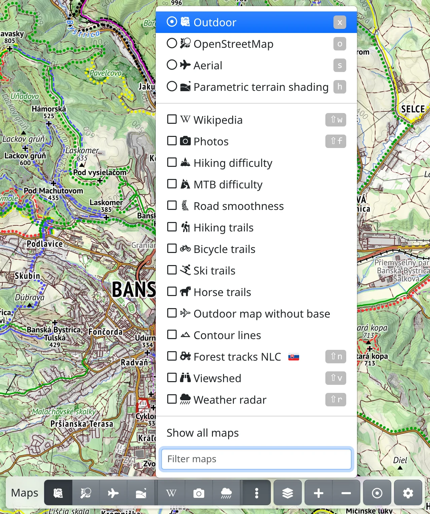
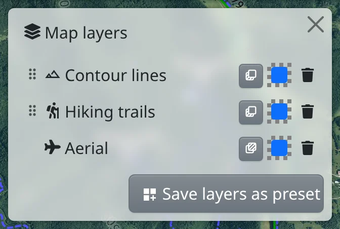
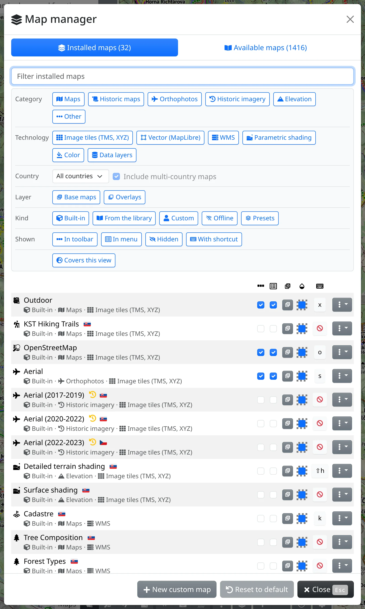

Freemap offers many maps – its own outdoor map, aerial imagery, terrain shading, national maps and hundreds more from the library. This chapter shows how to switch between them, combine them and choose which ones you keep at hand.

## Base maps and overlays

A **base map** fills the whole screen; only one is on at a time, and choosing another replaces it. An **overlay** – hiking trails, contour lines, photos, Wikipedia, the weather radar – is drawn over the base map, and any number of overlays can be on at once.

In menus a base map has a round radio button and an overlay a checkbox. Most maps can be used either way – for example aerial imagery as a half-transparent overlay over the outdoor map – see **Base / Overlay** below.

## Switching maps

The map toolbar at the bottom of the screen has a button for each map you have chosen for it, the base maps first, then the overlays. Press a base map's button to switch to it, an overlay's to turn it on or off. Pointing at a button shows the map's name.

:FaEllipsisV: at the end of the row opens a menu with more maps:

- the base maps on top and the overlays below them,
- **Show all maps** lists every installed map, not only those chosen for the menu,
- **Filter maps** – type part of a name to find a map quickly.

On a phone, or wherever the map buttons don't fit, the toolbar has a single :FaRegMap: button instead of them. Its menu lists the maps chosen for the toolbar; **Show more maps** and then **Show all maps** add the rest.

Each map can also have a keyboard shortcut, shown next to its name in the menu: the key switches to a base map or turns an overlay on and off. Maps can be found in the search box at the top too – type a map's name.

If a map can't be shown in the current view, its button has a yellow icon: :FaSearchPlus.text-warning: zoom in, :FaGlobeEurope.text-warning: the view is outside the map's area, :FaSearchLocation.text-warning: both. Press it to move to where the map has content. :FaGem.text-warning: means the map needs [premium](#show=premium) at this zoom.

## The Map layers panel

:FaLayerGroup: **Map layers** next to the map buttons, or the <kbd>.</kbd> key, opens a panel with everything that is on the map, top first: the overlays in the order they are drawn, then the base map.

- :MdDragIndicator: – drag an overlay up or down to draw it above or below the others.
- :TbLayersSelected: / :TbLayersSelectedBottom: – whether the map is a base map or an overlay. For a map that can be both, it opens the **Base / Overlay** switch.
- The opacity swatch opens a slider. A faded base map shows the map background beneath.
- :FaTrash: **Remove** takes the map off. Without a base map, the map background shows beneath the overlays.

Some maps have more settings – a WMS map such as **Cadastre** its layers, **Parametric terrain shading** its look (see [Terrain shading](#show=manual/shading)), **Solid colour** its colour. Click the map's name in the panel to open them, and :FaArrowLeft: to go back. :FaSave: **Save as map** keeps such a map as set up under a name of its own, e.g. the cadastre with only the parcels; :FaUndo: **Reset to default** puts the map's settings back.

Above the maps the panel also lists what the tools have put on the map – drawings, the planned route, search results and more. Click one to see its items; clicking an item selects it on the map.

## Map presets

A map preset is a combination of maps saved under a name – e.g. aerial imagery with a half-transparent cadastre over it. It is switched on and off like a single map.

1. Put the maps you want on the map and set their order and opacity in the **Map layers** panel.
2. Press :MdDashboardCustomize: **Save layers as preset** at the bottom of the panel.
3. Fill in the **Name** and **Icon**, and choose whether the preset should be in the toolbar, in the menu, or have a keyboard shortcut.

A preset with a base map takes the base map's place; one made only of overlays is added over the base map like an overlay. To change a preset, click its name in the **Map layers** panel: there you set the opacity of each map, drag them, remove them or add another with :FaPlus: **Add map**; every change is kept at once. :FaCopy: **Duplicate** makes a copy to change without touching the original.

A preset holds only maps: photos, Wikipedia, the weather radar and offline maps can't be part of one.

## The map manager

:FaCog: in the map toolbar opens a menu, where :FaLayerGroup: **Map manager** (<kbd>m</kbd> <kbd>m</kbd>) shows all your maps. It has two tabs.

### Installed maps

The :FaLayerGroup: **Installed maps** tab lists the maps you have – built-in ones, those added from the library, your [custom maps](#show=manual/custom-maps), [offline maps](#show=manual/offline) and presets. Find a map with **Filter installed maps** or the filter chips above the list. Each row has columns for:

- **Show in toolbar** and :FaRegListAlt: **Show in menu** – where the map appears,
- :TbLayersSelected: whether it is a base map or an overlay, with the **Base / Overlay** switch where the map can be both,
- :MdOpacity: **Opacity** – the same as in the **Map layers** panel (not on a phone),
- :FaKeyboard: **Keyboard shortcut** – click it and press the key you want; <kbd>Backspace</kbd> removes the shortcut.

The row's :FaEllipsisV: menu has :FaEye: **Preview on the map**, :FaDownload: **Download for offline use** for maps that can be downloaded, :FaPencilAlt: **Modify** for custom maps and presets, and :FaTrash: **Uninstall** or **Delete**. An uninstalled map disappears from the toolbar, the menus and the search, and can be added again from **Available maps**.

Every change takes effect at once. :FaUndo: **Reset to default** in the footer puts the toolbar, menu and shortcut settings and the opacity and layers of every map back to their defaults; installed maps stay installed. When you are logged in, the settings are kept with your account, otherwise in this browser.

### Available maps

The :FaBookOpen: **Available maps** tab is the library: hundreds of maps you can add – orthophotos, historic maps and imagery, elevation maps and national maps from many countries. Search by name or country in the box at the top, or narrow the list with the chips **Category**, **Technology**, **Country**, **Layer** and **Covers this view**.

- :FaEye: shows the map on the map first. Move around to see it, then choose :FaPlus: **Install**, :FaCheck: **Keep on map** (use it now without installing), :FaArrowLeft: **Back to library** or :FaTimes: to put the earlier maps back.
- :FaPlus: installs the map, which then moves to **Installed maps**.

If you know of a map that is missing, write to [freemap@freemap.sk](mailto:freemap@freemap.sk). Your own WMS or tile server is added with :FaPlus: **New custom map**, see [Custom maps](#show=manual/custom-maps).

## Map legend

:FaInfoCircle: at the bottom right → :FaList: **Map legend** (<kbd>m</kbd> <kbd>l</kbd>) explains the symbols of the maps that are on. With several maps, each has its own section. The outdoor map's legend has a **Search the legend** box; for some maps the legend is a link to the OpenStreetMap Wiki. The item is there only when a map with a legend is on.

## Brightness and data layer opacity

The :FaCog: menu ends with two sliders:

- :MdBrightness6: **Map brightness** darkens or lightens the maps, while routes, drawings and tracks stay as they are, so they stand out better.
- :MdOpacity: **Data layer opacity** fades the routes, drawings, tracks and other features on the map, to see the map beneath them; at the far left they are hidden. <kbd>Shift</kbd>+<kbd>d</kbd> hides and shows them quickly. While they are almost or fully hidden, they can't be clicked, :FaCog: carries a :FaEyeSlash: mark, and a reload shows them again.

## Map preferences

:FaCog: → :FaSlidersH: **Map preferences** (<kbd>m</kbd> <kbd>p</kbd>) holds settings for how the map is drawn:

- **Max zoom** and **Zoom step** – how far and in what steps the map zooms,
- **Resolution scale** and **Pixel-exact tiles** – the sharpness of the map on your display,
- **Feature size** – larger labels and lines on the map,
- **Map background** – the colour where no map is drawn, optionally as a **Checkerboard**,
- **Direction indicator** and **Distance and bearing** – how your position is shown after :FaRegDotCircle: **Locate me**.

Changes apply after **Save**.

## More

- [Offline maps](#show=manual/offline) – maps for when you have no signal.
- [Custom maps](#show=manual/custom-maps) – your own WMS or tile maps.
- [Terrain shading](#show=manual/shading) and [Weather radar](#show=manual/weather-radar) have chapters of their own.
