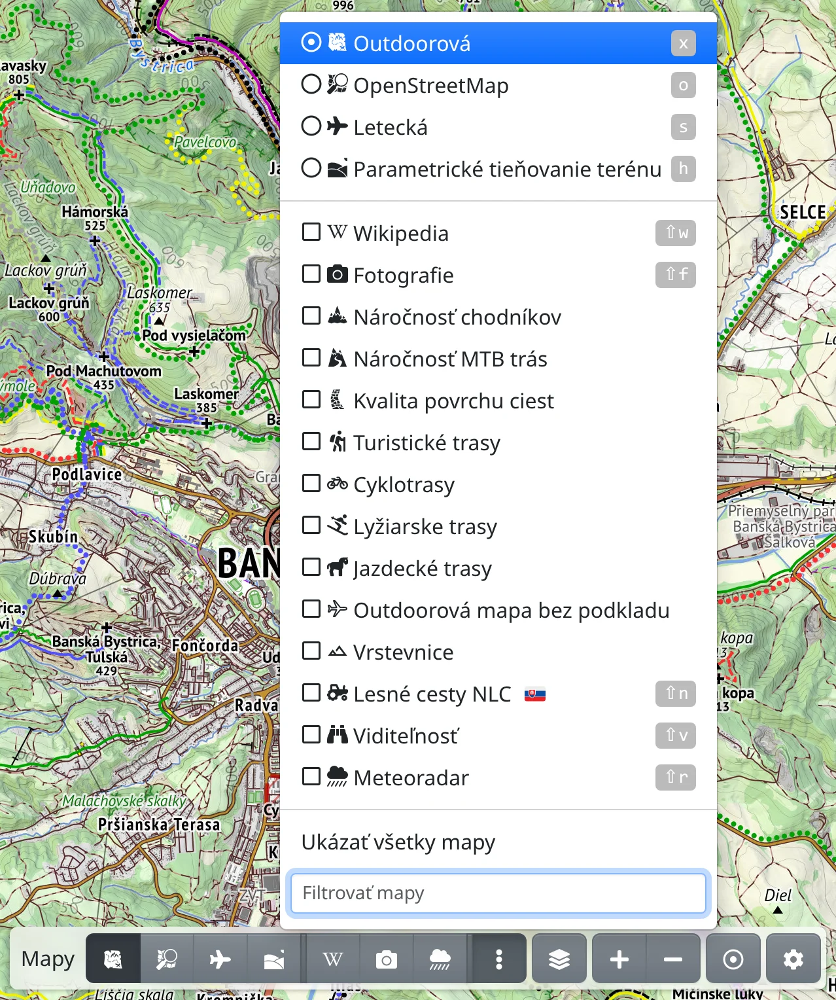
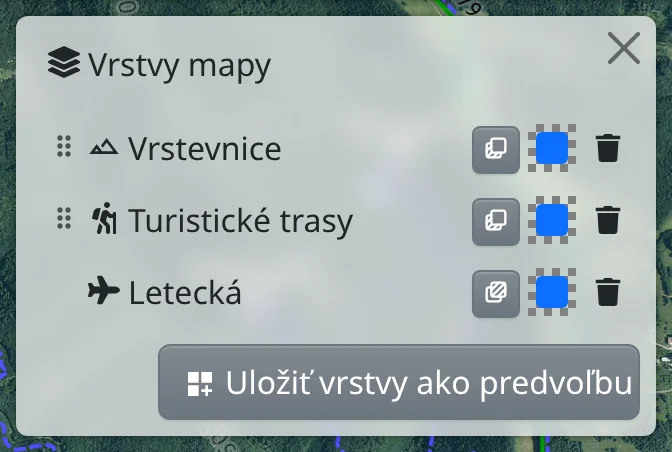
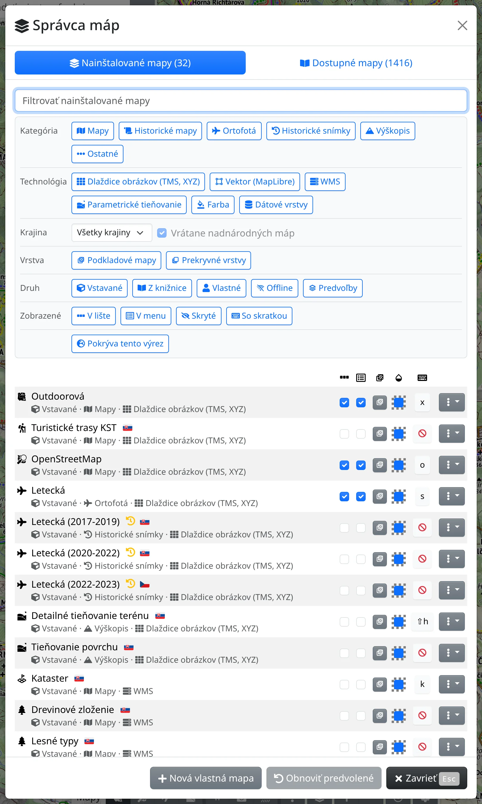

Vo Freemape nájdete množstvo máp – vlastnú turistickú mapu, letecké snímky, tieňovanie terénu, národné mapy a stovky ďalších z knižnice. Táto kapitola ukazuje, ako medzi mapami prepínať, ako ich kombinovať a ako si vybrať tie, ktoré chcete mať poruke.

## Podkladové mapy a prekrytia

**Podkladová mapa** vypĺňa celú obrazovku; naraz môže byť zapnutá len jedna a výberom inej sa nahradí. **Prekrytie** – turistické trasy, vrstevnice, fotografie, Wikipedia, meteoradar – sa kreslí cez podkladovú mapu a zapnutých môže byť ľubovoľne veľa naraz.

V ponukách má podkladová mapa okrúhly prepínač a prekrytie zaškrtávacie políčko. Väčšinu máp možno použiť oboma spôsobmi – napríklad leteckú mapu ako polopriehľadné prekrytie nad turistickou mapou – pozrite prepínač **Základná / Prekryvná** nižšie.

## Prepínanie máp

Na lište máp dole na obrazovke je tlačidlo pre každú mapu, ktorú ste si na lištu vybrali – najprv podkladové mapy, potom prekrytia. Stlačením tlačidla podkladovej mapy sa na mapu prepnete, tlačidlom prekrytia prekrytie zapnete alebo vypnete. Ukázaním na tlačidlo sa zobrazí názov mapy.

:FaEllipsisV: na konci lišty otvára ponuku ďalších máp:

- najprv podkladové mapy, potom prekrytia,
- **Ukázať všetky mapy** zobrazí všetky nainštalované mapy, nielen tie vybrané do menu,
- **Filtrovať mapy** – napíšte časť názvu a mapu rýchlo nájdete.

Na telefóne, alebo všade, kde sa tlačidlá máp nezmestia, je na lište namiesto tlačidiel máp jediné tlačidlo :FaRegMap:. V ponuke tohto tlačidla sú mapy vybrané na lištu; **Ukázať viac máp** a potom **Ukázať všetky mapy** pridajú ostatné.

Každá mapa môže mať aj klávesovú skratku, uvedenú pri názve mapy v ponuke: kláves prepne na podkladovú mapu alebo zapne či vypne prekrytie. Mapy nájdete aj vo vyhľadávacom poli hore – stačí napísať názov mapy.

Ak mapu v aktuálnom výreze nemožno zobraziť, na tlačidle mapy je žltá ikona: :FaSearchPlus.text-warning: treba priblížiť, :FaGlobeEurope.text-warning: výrez je mimo územia mapy, :FaSearchLocation.text-warning: platí oboje. Stlačením ikony sa mapa presunie tam, kde má obsah. :FaGem.text-warning: znamená, že mapa pri tomto priblížení vyžaduje [prémiový prístup](#show=premium).

## Panel Vrstvy mapy

:FaLayerGroup: **Vrstvy mapy** vedľa tlačidiel máp alebo kláves <kbd>.</kbd> otvára panel so všetkým, čo je na mape, odhora nadol: prekrytia v poradí, v akom sa kreslia, a na spodku podkladová mapa.

- :MdDragIndicator: – ťahaním presuniete prekrytie vyššie alebo nižšie, a tým určíte, ktoré prekrytie sa kreslí navrchu.
- :TbLayersSelected: / :TbLayersSelectedBottom: – či je mapa podkladová alebo prekrytie. Pri mape, ktorá môže byť oboje, sa tu otvára prepínač **Základná / Prekryvná**.
- Vzorka viditeľnosti otvára posuvník. Cez vyblednutú podkladovú mapu presvitá pozadie mapy.
- :FaTrash: **Odstrániť** mapu vypne. Bez podkladovej mapy je pod prekrytiami pozadie mapy.

Niektoré mapy majú ďalšie nastavenia – mapa WMS, napríklad **Kataster**, svoje vrstvy, **Parametrické tieňovanie terénu** svoj vzhľad (pozrite [Tieňovanie terénu](#show=manual/shading)), **Jednofarebná plocha** svoju farbu. Otvoríte ich kliknutím na názov mapy v paneli, späť sa vrátite cez :FaArrowLeft:. :FaSave: **Uložiť ako mapu** uloží takto nastavenú mapu pod vlastným názvom, napríklad kataster len s parcelami; :FaUndo: **Obnoviť predvolené** vráti nastavenia mapy na predvolené.

Nad mapami panel zobrazuje aj to, čo na mapu pridali nástroje – kreslenie, naplánovanú trasu, výsledky vyhľadávania a ďalšie. Kliknutím na položku uvidíte zoznam prvkov; kliknutím na prvok ho vyberiete na mape.

## Predvoľby máp

Predvoľba mapy je kombinácia máp uložená pod názvom – napríklad letecká mapa s polopriehľadným katastrom navrchu. Zapína a vypína sa ako jedna mapa.

1. Zapnite požadované mapy a v paneli **Vrstvy mapy** nastavte ich poradie a viditeľnosť.
2. Stlačte :MdDashboardCustomize: **Uložiť vrstvy ako predvoľbu** dole v paneli.
3. Vyplňte polia **Názov** a **Ikona** a zvoľte, či má byť predvoľba na lište, v menu alebo mať klávesovú skratku.

Predvoľba s podkladovou mapou nahradí podkladovú mapu; predvoľba len z prekrytí sa pridá nad podkladovú mapu ako prekrytie. Predvoľbu upravíte kliknutím na názov predvoľby v paneli **Vrstvy mapy**: tam nastavíte viditeľnosť jednotlivých máp, presuniete ich, odstránite alebo pridáte ďalšiu cez :FaPlus: **Pridať mapu**; každá zmena sa uloží hneď. :FaCopy: **Duplikovať** vytvorí kópiu, ktorú môžete meniť bez zásahu do pôvodnej predvoľby.

Predvoľba obsahuje iba mapy: fotografie, Wikipedia, meteoradar, viditeľnosť ani offline mapy do predvoľby zahrnúť nemožno.

## Správca máp

:FaCog: na lište máp otvára menu, v ktorom :FaLayerGroup: **Správca máp** (<kbd>m</kbd> <kbd>m</kbd>) zobrazí všetky vaše mapy. Správca má dve záložky.

### Nainštalované mapy

Záložka :FaLayerGroup: **Nainštalované mapy** obsahuje mapy, ktoré máte – vstavané, pridané z knižnice, [vlastné mapy](#show=manual/custom-maps), [offline mapy](#show=manual/offline) a predvoľby. Mapu nájdete cez **Filtrovať nainštalované mapy** alebo filtre nad zoznamom. Každý riadok má stĺpce:

- **Zobraziť v lište** a :FaRegListAlt: **Zobraziť v menu** – kde sa mapa ponúka,
- :TbLayersSelected: či je mapa podkladová alebo prekrytie, s prepínačom **Základná / Prekryvná** pri mape, ktorá môže byť oboje,
- :MdOpacity: **Viditeľnosť** – tá istá ako v paneli **Vrstvy mapy** (nie na telefóne),
- :FaKeyboard: **Klávesová skratka** – kliknite a stlačte požadovaný kláves; <kbd>Backspace</kbd> skratku zruší.

Ponuka :FaEllipsisV: v riadku obsahuje :FaEye: **Ukážka na mape** (**Zobraziť na mape** pri predvoľbe), :FaDownload: **Stiahnuť na použitie offline** pri mapách, ktoré sa dajú stiahnuť, :FaPencilAlt: **Upraviť** pri vlastných mapách, predvoľbách a offline mapách a :FaTrash: **Odinštalovať** alebo **Zmazať**. Odinštalovaná mapa zmizne z lišty, z ponúk aj z vyhľadávania a znova ju pridáte v záložke **Dostupné mapy**.

Každá zmena platí hneď. :FaUndo: **Obnoviť predvolené** v pätičke vráti nastavenie lišty, menu a skratiek aj viditeľnosť a vrstvy všetkých máp na predvolené; nainštalované mapy zostanú nainštalované. Po prihlásení sa nastavenia ukladajú k vášmu účtu, inak v tomto prehliadači.

### Dostupné mapy

Záložka :FaBookOpen: **Dostupné mapy** je knižnica: stovky máp, ktoré si môžete pridať – ortofotá, historické mapy a snímky, výškopisné mapy a národné mapy mnohých krajín. Hľadajte podľa názvu alebo krajiny v poli hore, prípadne zúžte zoznam filtrami **Kategória**, **Technológia**, **Krajina**, **Vrstva** a **Pokrýva tento výrez**.

- :FaEye: zobrazí mapu najprv na mape. Pohybom po mape si ju prezrite a potom zvoľte :FaPlus: **Nainštalovať**, :FaCheck: **Ponechať na mape** (použiť hneď, bez inštalácie), :FaArrowLeft: **Späť do knižnice** alebo :FaTimes:, ktoré vrátia predchádzajúce mapy.
- :FaPlus: mapu nainštaluje a mapa sa presunie do záložky **Nainštalované mapy**.

Ak poznáte mapu, ktorá chýba, napíšte na [freemap@freemap.sk](mailto:freemap@freemap.sk). Vlastný server WMS alebo dlaždíc pridáte cez :FaPlus: **Nová vlastná mapa**, pozrite [Vlastné mapy](#show=manual/custom-maps).

## Legenda mapy

:FaInfoCircle: vpravo dole → :FaList: **Legenda mapy** (<kbd>m</kbd> <kbd>l</kbd>) vysvetľuje značky zapnutých máp. Pri viacerých mapách má každá mapa vlastnú časť. V legende turistickej mapy je pole **Hľadať v legende**; pri niektorých mapách je legenda odkazom na OpenStreetMap Wiki. Položka je v ponuke, len keď je zapnutá mapa, ktorá legendu má.

## Jas mapy a viditeľnosť dátovej vrstvy

Na konci menu :FaCog: sú dva posuvníky:

- :MdBrightness6: **Jas mapy** stmaví alebo zosvetlí mapy, kým trasy, kresby a záznamy trás zostanú bez zmeny, takže lepšie vyniknú.
- :MdOpacity: **Viditeľnosť dátovej vrstvy** zoslabí trasy, kresby, záznamy trás a ďalšie prvky na mape, aby bolo vidieť mapu pod týmito prvkami; úplne vľavo sú skryté. <kbd>Shift</kbd>+<kbd>d</kbd> ich rýchlo skryje a znova zobrazí. Kým sú prvky takmer alebo úplne skryté, nedajú sa vybrať kliknutím, na :FaCog: je značka :FaEyeSlash: a po opätovnom načítaní stránky sa znova zobrazia.

## Nastavenia mapy

:FaCog: → :FaSlidersH: **Nastavenia mapy** (<kbd>m</kbd> <kbd>p</kbd>) obsahujú nastavenia vykresľovania mapy:

- **Maximálne priblíženie** a **Krok priblíženia** – ako ďaleko a po akých krokoch sa mapa približuje,
- **Škála rozlíšenia** a **Dlaždice presne na pixely** – ostrosť mapy na vašom displeji,
- **Veľkosť prvkov** – väčšie popisy a čiary na mape,
- **Pozadie mapy** – farba tam, kde sa nekreslí žiadna mapa, prípadne ako **Šachovnica**,
- **Ukazovateľ smeru** a **Vzdialenosť a azimut** – ako sa zobrazuje vaša poloha po stlačení :FaRegDotCircle: **Kde som?**

Zmeny sa prejavia po stlačení **Uložiť**.

## Ďalej

- [Offline mapy](#show=manual/offline) – mapy na miesta bez signálu.
- [Vlastné mapy](#show=manual/custom-maps) – vlastné mapy WMS alebo dlaždicové mapy.
- [Tieňovanie terénu](#show=manual/shading) a [Meteoradar](#show=manual/weather-radar) majú vlastné kapitoly.
