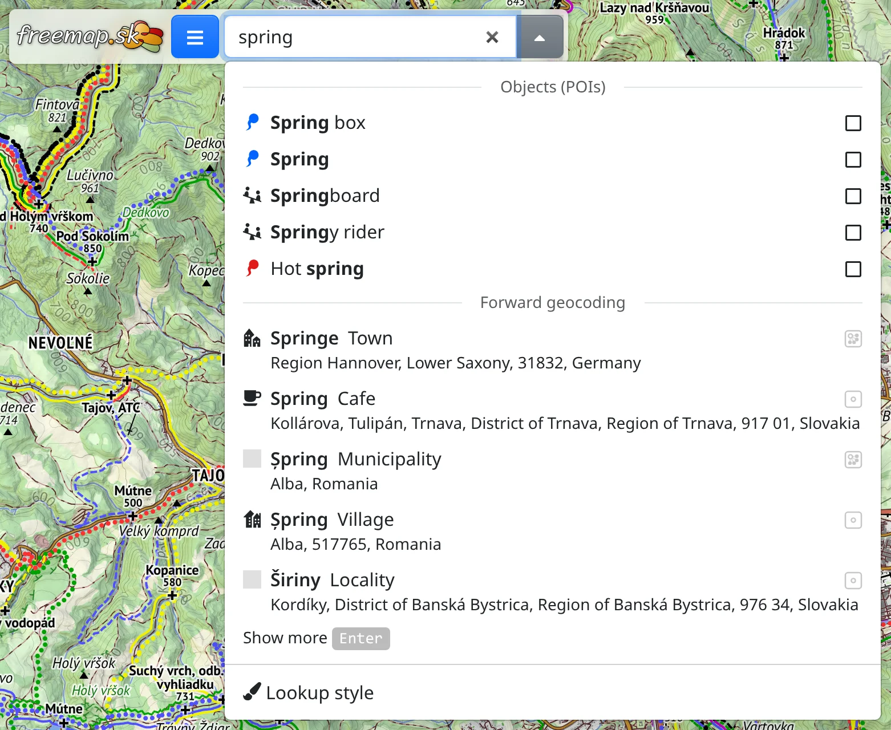
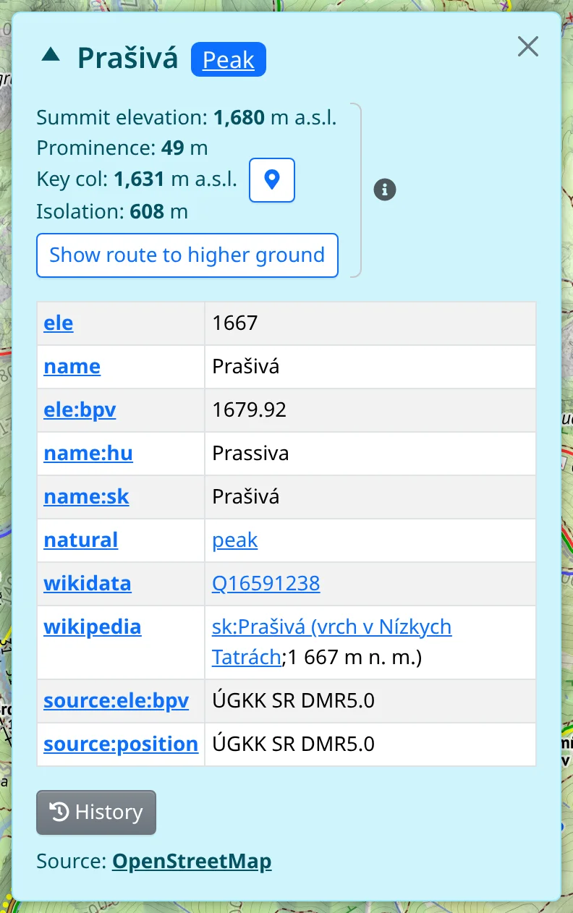

Objects are places of a given type – peaks, springs, shelters, viewpoints, pubs, shops and hundreds more – shown on the map as markers with icons. They come from [OpenStreetMap](#show=manual/about) and cover Europe.

## Finding types of places

Type the kind of place you are looking for into the search box at the top, for example *spring* or *peak*. From the second character on, the list shows the matching types under the **Objects (POIs)** caption, above the places found by name. A type can also be found by its OpenStreetMap tag, such as `amenity=pub`.

Each type has a checkbox. Ticking it shows objects of that type on the map; the list stays open, so you can tick several types in a row. Unticking the same row hides that type again.

Objects are shown from zoom level 8 on; at a lower zoom a message offers **Zoom-in**. Without a connection no types are offered, since the objects are downloaded.

## The Objects (POIs) toolbar

While a type is on, the :TbMapPins: **Objects (POIs)** toolbar is at the top of the screen. :FaTimes: (or <kbd>Del</kbd>) switches all types off, and the toolbar goes with them.

Its :FaEllipsisV: menu holds:

- :FaPencilAlt: **Convert all to drawing** – turns the objects on the map into points you can edit, see [Drawing](#show=manual/drawing). The types are switched off.
- :FaSearch: **Show all as Lookup** – keeps the objects on the map as lookups, the marks the search box leaves, up to 500 at once. The types are switched off.
- :FaPaintBrush: **Marker style** – the **Marker shape** (**Pin**, **Ring** or **Square**) and **Color** of all objects, and **Show label** – when their names appear: **Always**, **On hover**, **When selected** or **On hover or selected**.

## Object details

Click an object to select it. Its details then open:

- the name and the kinds of the place. Each kind is a button that shows or hides objects of that type; :FaChevronRight: adds the **More general types**.
- the **Elevation** read from the terrain model,
- the object's OpenStreetMap tags,
- :FaHistory: **History** – the versions of the object, newest first, each with its date, author and comment. Clicking a comment shows what that change did to the object.
- **Source** – a link to the object on OpenStreetMap.org.

The × closes the details while the object stays selected; clicking the object on the map opens them again.

## Peaks and saddles

For a peak, the details show the **Summit elevation**, read at the highest ground near the marker. Where that point lies a few metres or more from the marker, a line below says how far, and :FaMapMarkerAlt: marks the point on the map. Below follow:

- **Prominence** – how high the peak rises above the highest saddle linking it to higher ground,
- **Key col** – that saddle; :FaMapMarkerAlt: marks it on the map, moving the map if it is out of view,
- **Isolation** – the distance to the nearest higher ground,
- **Show route to higher ground** – draws the way from the summit over the key col to the first higher ground. :FaEllipsisV: beside it copies the route to drawing.

For a saddle or mountain pass they show the **Saddle elevation**, the **Saddle depth**, and the peak it is the **Key col of**, which :FaMapMarkerAlt: selects.

## Selected object

A selected object has its own :FaMapMarkerAlt: **Object (POI)** toolbar. Its :FaEllipsisV: menu holds:

- :FaEyeSlash: **Hide type “…”** – switches off the type the object is shown under,
- :FaPencilAlt: **Copy to drawing** – a copy of the object in the drawing, while the object stays on the map. For a building, area or route you can choose its **Own geometry** instead of a single point.
- :FaSearch: **Show as Lookup** – keeps the object on the map even after its type is switched off,
- the same actions for the place as the map's context menu, such as a route from or to it,
- :FaExternalLinkAlt: **Open in…** – **OpenStreetMap.org**, **OpenStreetMap.org (history)**, the **JOSM** and **iD** editors, and other maps and apps.

To find out what is at any place on the map, not only objects of the chosen types, see [Map details](#show=manual/map-details).
