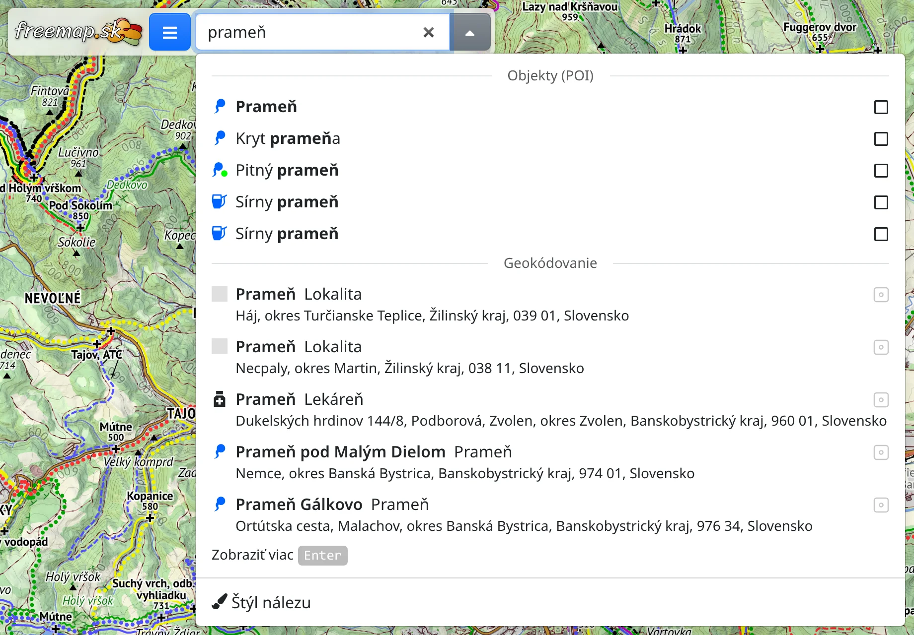
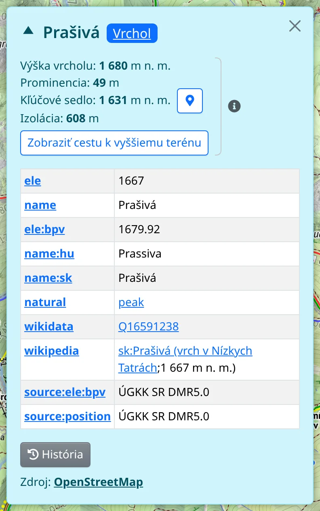

Objekty sú miesta určitého typu – vrcholy, pramene, útulne, vyhliadky, krčmy, obchody a stovky ďalších – zobrazené na mape ako značky s ikonami. Pochádzajú z [OpenStreetMap](#show=manual/about) a pokrývajú Európu.

## Vyhľadanie typov miest

Do vyhľadávacieho poľa hore napíšte, aký druh miesta hľadáte, napríklad *prameň* alebo *vrchol*. Od druhého znaku zoznam ukáže zodpovedajúce typy pod nadpisom **Objekty (POI)**, nad miestami nájdenými podľa názvu. Typ nájdete aj podľa značky OpenStreetMap, napríklad `amenity=pub`.

Každý typ má zaškrtávacie políčko. Zaškrtnutím sa objekty daného typu zobrazia na mape; zoznam zostane otvorený, takže môžete zaškrtnúť viac typov za sebou. Zrušením zaškrtnutia v tom istom riadku typ znova skryjete.

Objekty sa zobrazujú od priblíženia úrovne 8; pri menšom priblížení sa zobrazí správa s tlačidlom **Priblíž**. Bez pripojenia sa typy neponúkajú, pretože objekty sa sťahujú zo servera.

## Lišta Objekty (POI)

Kým je zapnutý niektorý typ, hore na obrazovke je lišta :TbMapPins: **Objekty (POI)**. Tlačidlo :FaTimes: (alebo kláves <kbd>Del</kbd>) vypne všetky typy a lišta zmizne.

V ponuke :FaEllipsisV: na lište nájdete:

- :FaPencilAlt: **Skonvertovať všetko na kreslenie** – z objektov na mape urobí body, ktoré môžete upravovať, pozrite [Kreslenie](#show=manual/drawing). Typy sa vypnú.
- :FaSearch: **Zobraziť všetko ako Nález** – ponechá objekty na mape ako nálezy, rovnaké značky, aké zostávajú po vyhľadávaní, najviac 500 naraz. Typy sa vypnú.
- :FaPaintBrush: **Štýl značky** – **Tvar značky** (**Špendlík**, **Okrúhla** alebo **Štvorcová**) a **Farba** všetkých objektov a **Zobraziť popis** – kedy sa zobrazujú názvy objektov: **Vždy**, **Pri prejdení myšou**, **Keď je vybraný** alebo **Pri prejdení myšou alebo keď je vybraný**.

## Podrobnosti o objekte

Kliknutím na objekt ho vyberiete a otvoria sa podrobnosti o objekte:

- názov a druhy miesta. Každý druh je tlačidlo, ktoré zobrazí alebo skryje objekty daného typu; :FaChevronRight: pridá **Všeobecnejšie typy**.
- **Nadmorská výška** podľa modelu terénu,
- značky (tagy) objektu v OpenStreetMap,
- :FaHistory: **História** – verzie objektu od najnovšej, každá s dátumom, autorom a komentárom. Kliknutím na komentár uvidíte, čo sa pri danej zmene na objekte upravilo.
- **Zdroj** – odkaz na objekt na OpenStreetMap.org.

Tlačidlo × podrobnosti zavrie a objekt zostane vybraný; kliknutím na objekt na mape sa podrobnosti znova otvoria.

## Vrcholy a sedlá

Pri vrchole je v podrobnostiach **Výška vrcholu** nameraná v najvyššom bode terénu blízko značky. Ak je tento bod od značky vzdialený niekoľko metrov alebo viac, riadok pod výškou uvádza vzdialenosť a :FaMapMarkerAlt: bod označí na mape. Ďalej nasleduje:

- **Prominencia** – o koľko sa vrchol dvíha nad najvyššie sedlo, ktoré vrchol spája s vyšším terénom,
- **Kľúčové sedlo** – toto sedlo; :FaMapMarkerAlt: sedlo označí na mape, a ak sedlo nie je vidieť, presunie mapu k sedlu,
- **Izolácia** – vzdialenosť k najbližšiemu vyššiemu terénu,
- **Zobraziť cestu k vyššiemu terénu** – nakreslí cestu z vrcholu cez kľúčové sedlo k prvému vyššiemu terénu. :FaEllipsisV: vedľa tlačidla skopíruje cestu do kreslenia.

Pri sedle alebo horskom priechode sú v podrobnostiach **Výška sedla**, **Hĺbka sedla** a **Kľúčové sedlo vrcholu** – vrchol, ktorého je toto sedlo kľúčovým sedlom; :FaMapMarkerAlt: tento vrchol vyberie.

## Vybraný objekt

Vybraný objekt má vlastnú lištu :FaMapMarkerAlt: **Objekt (POI)**. V ponuke :FaEllipsisV: na lište nájdete:

- :FaEyeSlash: **Skryť typ „…“** – vypne typ, pod ktorým sa objekt zobrazuje,
- :FaPencilAlt: **Kopírovať do kreslenia** – pridá kópiu objektu do kreslenia a objekt zostane na mape. Pri budove, ploche alebo trase si namiesto jediného bodu môžete zvoliť možnosť **Vlastná geometria**.
- :FaSearch: **Zobraziť ako Nález** – ponechá objekt na mape, aj keď typ objektu vypnete,
- rovnaké akcie pre toto miesto ako v kontextovej ponuke mapy, napríklad navigovanie odtiaľto alebo sem,
- :FaExternalLinkAlt: **Otvoriť v…** – **OpenStreetMap.org**, **OpenStreetMap.org (história)**, editory **JOSM** a **iD** a ďalšie mapy a aplikácie.

Ako zistiť, čo sa nachádza na ľubovoľnom mieste mapy, nielen objekty zvolených typov, opisuje kapitola [Detaily v mape](#show=manual/map-details).
