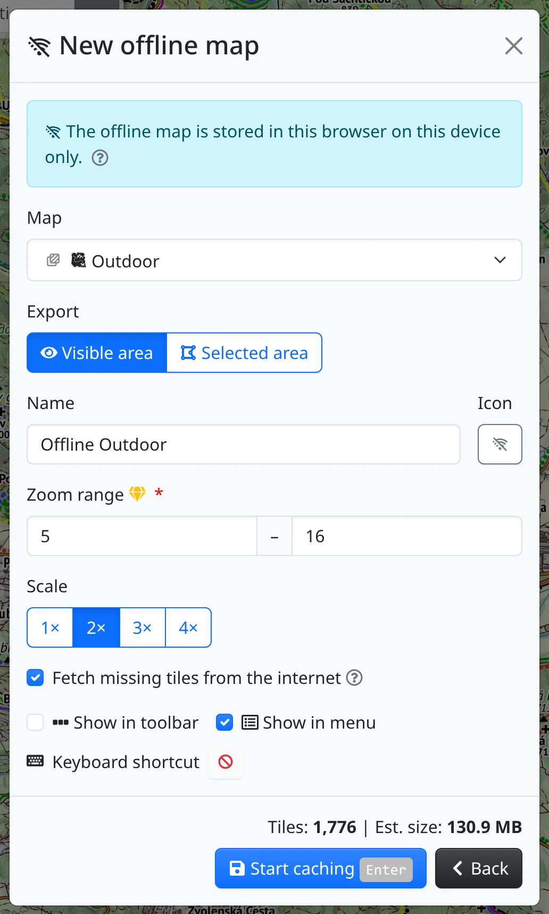

Freemap can be used where there is no signal. Download the maps you will need beforehand, while you are still connected.

## Without a connection

When the device is offline, a crossed-out Wi-Fi symbol :BiWifiOff: appears beside the logo at the top. The same symbol marks every function that needs the server – such as the route finder, logging in, photo upload or exports – and those functions are disabled until the connection comes back. In the map menus it also marks every map that has nothing downloaded.

What keeps working:

- drawing and measuring, and tracks and files you open,
- offline maps and tiles kept while browsing,
- maps from :FaRegMap: **My maps** marked **Available offline in this browser**,
- the search box for coordinates; searching by name needs a connection.

The app itself is kept in the browser as soon as you have something stored for offline use, so it opens even without a connection.

## Downloading an offline map

Press :FaCog: in the map toolbar and choose :BiWifiOff: **Offline maps** (shortcut <kbd>m</kbd> <kbd>o</kbd>). The dialog lists the offline maps you have; press :FaPlus: **Add offline map** to make a new one:

- **Map** – the map to download. Only Freemap's own maps are offered.
- **Export** – :FaEye: **Visible area** covers what you see on the screen; with :FaDrawPolygon: **Selected area** you drag a rectangle on the map and confirm it.
- **Name** and **Icon** – how the map is shown in the lists.
- **Zoom range** – the higher the last zoom level, the more detail, but the download grows quickly. The most detailed levels of some maps need premium access.
- **Fetch missing tiles from the internet** – while you are online, places outside the downloaded area or zoom levels are filled in from the internet. Untick it to see only what was downloaded.
- **Show in toolbar**, **Show in menu** and a **Keyboard shortcut** – where the offline map will appear among the other maps.

The form shows the number of tiles and the estimated size, and a warning for a very large download or one that won't fit in the browser. :FaSave: **Start caching** starts the download.

The offline map is stored in this browser on this device only. To have it on another device or in another browser, create it there too.

## Using and managing offline maps

Each offline map in the list shows its zoom range, number of tiles, size and state – **Ready**, or incomplete with a percentage while it downloads. Its actions are:

- :FaEye: **Activate** – switches the map on and moves to its area.
- :FaCrosshairs: **Zoom to area** – while the map is not complete yet.
- :FaStop: **Stop** halts the download and keeps what has been downloaded; :FaPlay: **Resume** later downloads only the missing tiles.
- :FaPencilAlt: **Modify** – change the name, icon, area or zoom range. Enlarging downloads only the missing tiles, shrinking deletes the tiles that are no longer needed.
- :FaLayerGroup: **Show in Installed maps** – where you set its opacity and whether it appears in the toolbar and menu.
- :FaTrash: **Delete** – removes the map with all its tiles.

Below the list you see how much space all offline maps take together. The same total is shown next to **Offline maps** in the :FaCog: menu.

## Caching while browsing

Besides offline maps you plan in advance, you can also keep the tiles you have already seen. Open :FaCog: → :FaDatabase: **Caching while browsing** (<kbd>m</kbd> <kbd>b</kbd>). It is off until you set it up:

- **Serve tiles from** – **Internet only**, **Internet, then cache**, **Cache, then internet** or **Cache only**.
- **Save tiles fetched from the internet** – tick it to fill the cache as you browse.
- **Keep tiles for** and **Cache size limit** – old tiles and, over the limit, the least recently shown ones are dropped.

The settings take effect after :FaCheck: **Save**. :FaTrash: **Clear cache** removes the kept tiles and leaves the settings as they are.

## Offline maps export

:FaDatabase: [Offline maps export](#show=offline-map-export) in the main menu is something else: it is for getting an MBTiles or SQLiteDB file for other apps, such as Locus Map, OsmAnd or Guru Maps. It is paid for with credits and the download link arrives by email.
