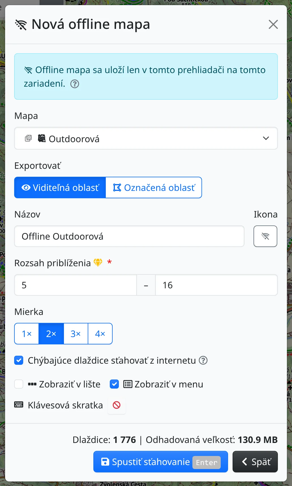

Freemap môžete používať aj tam, kde nie je signál. Mapy, ktoré budete potrebovať, si stiahnite vopred, kým ste ešte pripojení.

## Bez pripojenia

Keď je zariadenie offline, vedľa loga hore sa zobrazí prečiarknutý symbol Wi-Fi :BiWifiOff:. Rovnakým symbolom sú označené všetky funkcie, ktoré potrebujú server – napríklad vyhľadávač trás, prihlásenie, nahrávanie fotografií či exporty – a kým sa pripojenie neobnoví, sú vypnuté. V ponukách máp označuje aj každú mapu, z ktorej nemáte nič stiahnuté.

Naďalej funguje:

- kreslenie a meranie, ako aj trasy a súbory, ktoré otvoríte,
- offline mapy a dlaždice uložené pri prehliadaní,
- mapy z :FaRegMap: **Moje mapy** označené ako **Dostupné offline v tomto prehliadači**,
- vyhľadávacie pole pre súradnice; hľadanie podľa názvu potrebuje pripojenie.

Samotná aplikácia sa v prehliadači uchová, len čo máte niečo uložené na použitie offline, takže sa otvorí aj bez pripojenia.

## Stiahnutie offline mapy

Na lište máp stlačte :FaCog: a vyberte :BiWifiOff: **Offline mapy** (skratka <kbd>m</kbd> <kbd>o</kbd>). Dialóg zobrazí vaše offline mapy; novú vytvoríte tlačidlom :FaPlus: **Pridať offline mapu**:

- **Mapa** – mapa, ktorá sa stiahne. Ponúkajú sa len vlastné mapy Freemapu.
- **Exportovať** – :FaEye: **Viditeľná oblasť** zahŕňa to, čo vidíte na obrazovke, pri :FaDrawPolygon: **Označená oblasť** natiahnete na mape obdĺžnik a potvrdíte ho.
- **Názov** a **Ikona** – ako sa mapa zobrazí v zoznamoch.
- **Rozsah priblíženia** – čím vyššie posledné priblíženie, tým viac podrobností, no sťahovanie rýchlo narastá. Najpodrobnejšie priblíženia niektorých máp vyžadujú prémiový prístup.
- **Chýbajúce dlaždice sťahovať z internetu** – kým ste online, miesta mimo stiahnutej oblasti či priblížení sa doplnia z internetu. Ak voľbu vypnete, uvidíte len to, čo sa stiahlo.
- **Zobraziť v lište**, **Zobraziť v menu** a **Klávesová skratka** – kde sa offline mapa objaví medzi ostatnými mapami.

Formulár ukáže počet dlaždíc a odhadovanú veľkosť a pri veľmi veľkom sťahovaní alebo pri takom, ktoré sa do prehliadača nezmestí, aj upozornenie. Tlačidlom :FaSave: **Spustiť sťahovanie** sa sťahovanie začne.

Offline mapa sa uloží len v tomto prehliadači na tomto zariadení. Ak ju chcete mať aj na inom zariadení alebo v inom prehliadači, vytvorte ju aj tam.

## Používanie a správa offline máp

Pri každej offline mape v zozname vidíte rozsah priblíženia, počet dlaždíc, veľkosť a stav – **Pripravená**, alebo počas sťahovania nekompletná s percentom. K dispozícii sú tieto akcie:

- :FaEye: **Aktivovať** – zapne mapu a presunie sa na oblasť mapy.
- :FaCrosshairs: **Priblížiť na oblasť** – kým mapa ešte nie je kompletná.
- :FaStop: **Zastaviť** preruší sťahovanie a ponechá, čo sa už stiahlo; :FaPlay: **Pokračovať** neskôr stiahne len chýbajúce dlaždice.
- :FaPencilAlt: **Upraviť** – zmena názvu, ikony, oblasti alebo rozsahu priblíženia. Pri zväčšení sa stiahnu len chýbajúce dlaždice, pri zmenšení sa nepotrebné zmažú.
- :FaLayerGroup: **Zobraziť v nainštalovaných mapách** – tam nastavíte priehľadnosť mapy a to, či sa zobrazuje na lište a v menu.
- :FaTrash: **Zmazať** – odstráni mapu so všetkými stiahnutými dlaždicami.

Pod zoznamom vidíte, koľko miesta zaberajú všetky offline mapy spolu. Rovnaký súčet je uvedený aj pri položke **Offline mapy** v menu :FaCog:.

## Ukladanie pri prehliadaní

Okrem vopred pripravených offline máp si môžete uchovať aj dlaždice, ktoré ste si už prezreli. Otvorte :FaCog: → :FaDatabase: **Ukladanie pri prehliadaní** (<kbd>m</kbd> <kbd>b</kbd>). Kým ho nenastavíte, je vypnuté:

- **Zdroj dlaždíc** – **Iba internet**, **Internet, potom vyrovnávacia pamäť**, **Vyrovnávacia pamäť, potom internet** alebo **Iba vyrovnávacia pamäť**.
- **Ukladať dlaždice stiahnuté z internetu** – zapnite, aby sa pamäť pri prehliadaní plnila.
- **Uchovávať dlaždice** a **Limit veľkosti** – staré dlaždice a po prekročení limitu tie najdlhšie nezobrazené sa zahodia.

Nastavenia začnú platiť po stlačení :FaCheck: **Uložiť**. Tlačidlo :FaTrash: **Vymazať pamäť** odstráni uložené dlaždice a nastavenia ponechá.

## Export offline máp

:FaDatabase: [Export offline máp](#show=offline-map-export) v hlavnom menu je niečo iné: slúži na získanie súboru MBTiles alebo SQLiteDB pre iné aplikácie, napríklad Locus Map, OsmAnd či Guru Maps. Export sa platí kreditmi a odkaz na stiahnutie príde e-mailom.
