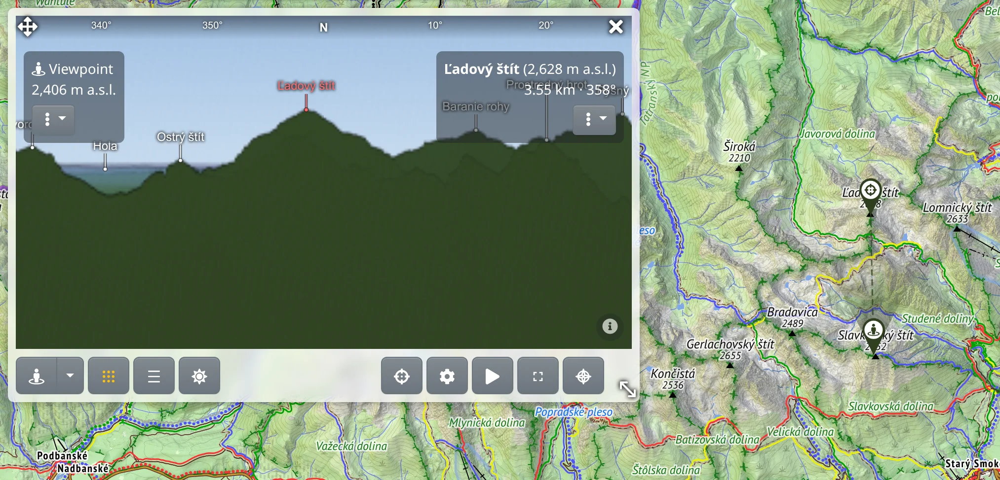

The panorama is a 360° view of the terrain from a point on the map, with the names of the peaks in view and the distance to every ridge. It is rendered on a server from the same terrain models as the elevation profiles and the map's shading, so it needs an internet connection.

## Opening the panorama

Choose :PiMountains: **Panorama** in the main menu. A floating panel opens; along its bottom is a row of controls. Then choose where to look from:

- :FaStreetView: **Pick on the map** – click the place on the map.
- :FaRegDotCircle: **View from my position**, in the menu next to that button – the panorama from your GPS position.

Quicker still from the map itself: right-click a place, or press and hold it on a phone, and choose :PiMountains: **Panorama from here**.

The viewpoint is marked on the map with :FaStreetView:. The eye is placed on the highest point within a few metres of the click, so a view from a summit is not spoiled by the rock beside it.

## Rendering

A panorama takes seconds to render, and the server renders one at a time. While it works, a bar over the picture shows the stage it is at, or how many panoramas are waiting ahead of yours; **Cancel** stops it.

Nothing is rendered by moving the map. When you drag the viewpoint marker elsewhere or change a setting that needs a new picture, :FaSync: **Update** appears in the row – press it to render again.

:TbGridDots: **View and detail** holds two sliders:

- **Horizontal view** – **All around**, or just a slice of 180° down to 30°. A narrower slice renders faster, or in finer detail for the same wait. Which way the slice faces is set by turning the wedge on the map; then press **Update**.
- **Detail** – the sharpness of the picture in pixels per degree.

The button shows what will be rendered, and below the sliders is roughly how many seconds the render will take.

## Looking around

- Drag the picture to turn it; a full panorama can be turned round and round. The mouse wheel, or a pinch, zooms in.
- A compass strip along the top shows which way you are looking, and a wedge on the map shows the part of the horizon on screen. You can also grab the wedge and turn it.
- On a phone the picture moves by itself: with a compass in the phone it follows where you point the phone, otherwise it turns slowly. :FaStop: stops it, and :FaCompass: or :FaPlay: (**Turn with the device, or by itself**) starts it again.

## Peak names and distances

The names of the most prominent peaks in view are written above them. Zooming in reveals more names.

- Pointing at the picture shows how far away that place is and marks it on the map.
- Clicking the picture leaves the mark on the map, with a dashed line of sight from the viewpoint. Click a peak name to mark that peak; the name turns red.
- The picked place – its name, elevation, distance and azimuth – shows in a box at the top right of the picture; the viewpoint's elevation is at the top left. The :FaEllipsisV: menu under either box holds what you can do with that place, as in the map's context menu.

To look the other way round, from the map into the picture, use :FaCrosshairs: **Look at a place on the map** and click the map, or right-click a place and choose :FaCrosshairs: **Look at this in the panorama**. The picture turns to the place and marks it; a place hidden behind a ridge is marked on the ridge that hides it.

## What the picture shows

These menus in the row change the picture already rendered, at once and without waiting:

- :TbBaselineDensityMedium: **Peak names** – **Number of names**, **Minimum dominance** (how much a summit must stand above its surroundings), **Rank peaks by** size or nearness, **How far names carry**, **Favour real mountains**, and **Under the name** – a second line with **Elevation**, **Distance**, **Prominence** or **Isolation**. **Reset to default** brings them all back.
- :FaSun: **Sun and moon** – the day's **Sun path** and **Moon path** over the picture, with the hours along them and the times of going behind the terrain and coming out from it. Under **Day** you choose another date; **Today** returns.

:PiCompassRoseBold: **Create toposcope from this view** makes a toposcope from the named peaks, see [Toposcope](#show=manual/toposcope).

## Panorama settings

:FaCog: **Panorama settings** ([open](#show=panorama-settings)) holds what you set once: **Eye height** above the ground (for a tower or a drone), **Vertical view**, **Unfold distance** (lifts distant ranges apart, like a hand-drawn panorama), **Max. visible distance**, the **Look** of the picture – **Natural**, **Shaded relief**, **Drawn**, **Engraved** or **Custom** – and the colour of the **Ground**. After **Save**, press **Update** to render the panorama with them.

## The panel

- :FaArrowsAlt: at the top left moves the panel, :LuMoveDiagonal2: at the bottom right resizes it, and :FaTimes: closes the panorama.
- :MdFullscreen: **Fullscreen** fills the screen with the panorama; <kbd>Esc</kbd> leaves it.
- When the panel is narrow, the buttons of the row fold into the :FaEllipsisV: menu.
- The panel takes no clicks on the map, so it can stay open beside the route finder or drawing.

## Limits of the picture

The terrain model is bare earth: forests and buildings are not in it, so a view a forest would block is drawn as open. This is the largest source of error. :FaInfoCircle: in the bottom-right corner of the picture shows this and the sources of the terrain data and peak names. For which places can be seen from a point, see [Viewshed](#show=manual/viewshed).

## With premium

[Premium](#show=premium) adds to the panorama:

- finer **Detail** – without premium a render may cost only so much, so a full turn stays coarse while a narrow slice can be finer,
- **Max. visible distance** beyond 300 km.

Settings that need premium are marked :FaGem.text-warning:, and the :TbGridDots: button is yellow without premium.
