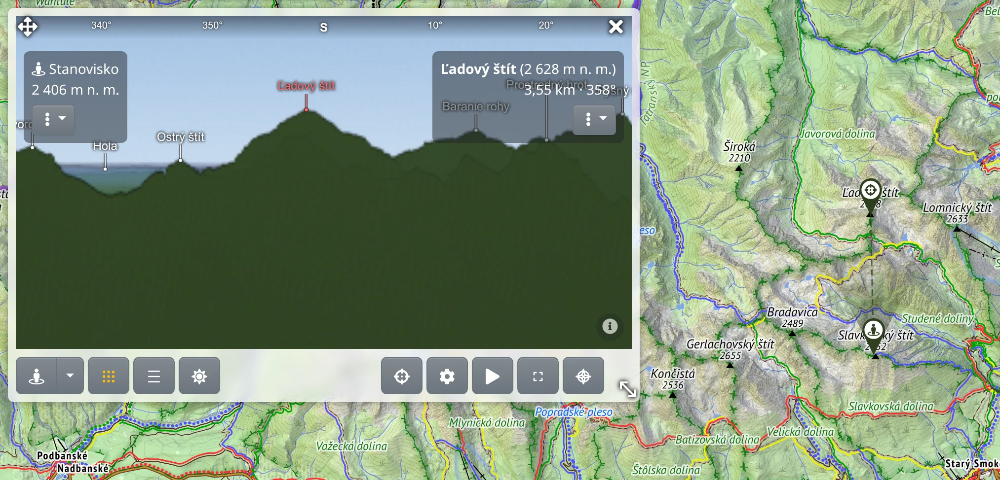

Panoráma je 360° pohľad na terén z bodu na mape s názvami viditeľných vrchov a so vzdialenosťou ku každému hrebeňu. Vykresľuje sa na serveri z rovnakých modelov terénu ako výškové profily a tieňovanie mapy, preto vyžaduje pripojenie na internet.

## Otvorenie panorámy

V hlavnom menu zvoľte :PiMountains: **Panoráma**. Otvorí sa plávajúci panel, v spodnej časti panela je rad ovládacích prvkov. Potom zvoľte, odkiaľ sa chcete pozerať:

- :FaStreetView: **Vybrať v mape** – kliknite na miesto v mape.
- :FaRegDotCircle: **Pohľad z mojej polohy** v ponuke vedľa tohto tlačidla – panoráma z vašej polohy GPS.

Ešte rýchlejšie to ide priamo z mapy: kliknite na miesto pravým tlačidlom myši, alebo na telefóne podržte prst na mieste, a zvoľte :PiMountains: **Panoráma odtiaľto**.

Stanovisko je v mape označené značkou :FaStreetView:. Oko sa umiestni na najvyšší bod v okruhu niekoľkých metrov od miesta kliknutia, aby výhľad z vrcholu nekazila skala vedľa.

## Vykreslenie

Vykreslenie panorámy trvá niekoľko sekúnd a server vykresľuje panorámy jednu po druhej. Počas vykresľovania ukazuje pruh cez obrázok, v akej fáze je práca, alebo koľko panorám čaká pred vašou; tlačidlom **Zrušiť** vykresľovanie zastavíte.

Posúvaním mapy sa nič nevykresľuje. Keď značku stanoviska presuniete inam alebo zmeníte nastavenie, ktoré si žiada nový obrázok, v rade sa zobrazí :FaSync: **Aktualizovať** – stlačením sa panoráma vykreslí znova.

V ponuke :TbGridDots: **Výrez a detail** sú dva posuvníky:

- **Vodorovný rozsah** – **Dookola**, alebo len výsek od 180° do 30°. Užší výsek sa vykreslí rýchlejšie, prípadne za rovnaký čas jemnejšie. Smer výseku nastavíte otočením klinu v mape a stlačením **Aktualizovať**.
- **Detail** – ostrosť obrázka v pixeloch na stupeň.

Tlačidlo ukazuje, čo sa vykreslí, a pod posuvníkmi je približný čas vykreslenia v sekundách.

## Rozhliadanie sa

- Ťahaním obrázok otáčate; celú panorámu môžete otáčať dookola. Kolieskom myši alebo roztiahnutím dvoch prstov obrázok priblížite.
- Pás s kompasom hore ukazuje, ktorým smerom sa pozeráte, a klin v mape ukazuje časť obzoru, ktorá je na obrazovke. Klin môžete aj chytiť a otočiť.
- Na telefóne sa obrázok hýbe sám: ak má telefón kompas, obrázok sleduje smer, ktorým telefón namierite, inak sa pomaly otáča. Tlačidlo :FaStop: pohyb zastaví a :FaCompass: alebo :FaPlay: (**Otáčať so zariadením alebo samo**) ho znova spustí.

## Názvy vrchov a vzdialenosti

Nad najvýraznejšími viditeľnými vrchmi sú napísané názvy týchto vrchov. Po priblížení pribudnú ďalšie názvy.

- Ukázaním na obrázok uvidíte, ako ďaleko je dané miesto, a miesto sa označí v mape.
- Kliknutím na obrázok značku v mape ponecháte, spolu s prerušovanou čiarou výhľadu zo stanoviska. Kliknutím na názov vrchu označíte tento vrch; názov sa zafarbí na červeno.
- Vybrané miesto – názov, nadmorská výška, vzdialenosť a azimut – sa zobrazí v rámčeku vpravo hore na obrázku; nadmorská výška stanoviska je vľavo hore. V ponuke :FaEllipsisV: pod každým rámčekom nájdete akcie pre dané miesto, rovnaké ako v kontextovej ponuke mapy.

Opačným smerom, z mapy do obrázka, slúži tlačidlo :FaCrosshairs: **Pozrieť sa na miesto v mape** a kliknutie do mapy, alebo položka :FaCrosshairs: **Pozrieť sa na to v panoráme** v kontextovej ponuke miesta. Obrázok sa otočí k miestu a označí ho; miesto skryté za hrebeňom sa označí na hrebeni, ktorý ho zakrýva.

## Čo obrázok ukazuje

Tieto ponuky v rade menia už vykreslený obrázok, a to hneď a bez čakania:

- :TbBaselineDensityMedium: **Názvy vrchov** – **Počet názvov**, **Minimálna dominancia** (o koľko musí vrch prevyšovať okolie), **Hodnotiť vrchy podľa** veľkosti či blízkosti, **Dokiaľ siahajú názvy**, **Uprednostniť skutočné hory** a **Pod názvom** – druhý riadok s údajom **Výška**, **Vzdialenosť**, **Prominencia** alebo **Izolácia**. **Obnoviť predvolené** vráti všetky na pôvodné hodnoty.
- :FaSun: **Slnko a mesiac** – **Dráha slnka** a **Dráha mesiaca** v daný deň nakreslené cez obrázok, s hodinami pozdĺž dráhy a s časmi, kedy slnko či mesiac zájde za terén a kedy sa spoza terénu objaví. V poli **Deň** zvolíte iný dátum, tlačidlo **Dnes** vráti dnešok.

:PiCompassRoseBold: **Vytvoriť orientačnú ružicu z tohto výhľadu** vytvorí orientačnú ružicu z pomenovaných vrchov, pozri [Orientačná ružica](#show=manual/toposcope).

## Nastavenia panorámy

V okne :FaCog: **Nastavenia panorámy** ([otvoriť](#show=panorama-settings)) sú veci, ktoré sa nastavujú raz: **Výška očí** nad zemou (pre rozhľadňu či dron), **Zvislý rozsah**, **Rozvinúť diaľku** (oddelí vzdialené pohoria od seba ako na ručne kreslenej panoráme), **Max. viditeľná vzdialenosť**, **Vzhľad** obrázka – **Prirodzený**, **Tieňovaný reliéf**, **Kreslený**, **Rytina** alebo **Vlastný** – a farba pre **Terén**. Po stlačení **Uložiť** stlačte **Aktualizovať**, aby sa panoráma vykreslila s novými nastaveniami.

## Panel

- Tlačidlom :FaArrowsAlt: vľavo hore panel presuniete, tlačidlom :LuMoveDiagonal2: vpravo dole zmeníte veľkosť panela a :FaTimes: panorámu zavrie.
- :MdFullscreen: **Na celú obrazovku** zobrazí panorámu na celej obrazovke; klávesom <kbd>Esc</kbd> sa vrátite späť.
- Keď je panel úzky, tlačidlá z radu sa presunú do ponuky :FaEllipsisV:.
- Panel nereaguje na kliknutia do mapy, takže môže zostať otvorený popri vyhľadávači trás či kreslení.

## Obmedzenia obrázka

Model terénu je holá zem bez lesov a budov, takže výhľad, ktorý by zakryl les, je nakreslený ako otvorený. To je najväčší zdroj nepresností. Tlačidlo :FaInfoCircle: v pravom dolnom rohu obrázka zobrazí toto upozornenie spolu so zdrojmi údajov o teréne a názvov vrchov. Ktoré miesta je z bodu vidno, ukazuje [Viditeľnosť](#show=manual/viewshed).

## S prémiovým prístupom

[Prémiový prístup](#show=premium) pridáva do panorámy:

- jemnejší **Detail** – bez prémiového prístupu môže vykreslenie stáť len obmedzene veľa, takže celá panoráma dookola zostane hrubšia, kým úzky výsek môže byť jemnejší,
- **Max. viditeľná vzdialenosť** nad 300 km.

Nastavenia, ktoré vyžadujú prémiový prístup, sú označené :FaGem:.
