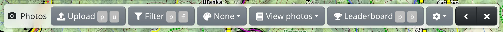
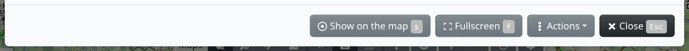

Freemap shows photos of the landscape taken by its users, together with geotagged photos from Wikimedia Commons. You can browse them on the map, rate and comment on them, and upload your own.

## Showing photos on the map

Press :FaCamera: **Photos** in the map toolbar, or <kbd>Shift</kbd> <kbd>F</kbd>. Photos appear as small marks from zoom level 10 on:

- a circle is a photo uploaded to Freemap,
- a wide rectangle is a panorama uploaded to Freemap,
- a square is a photo from Wikimedia Commons.

At the same time the photo toolbar appears at the top. :FaTimes: in it switches the photos off again.

## Opening a photo

Click the map near the marks – the circle around the mouse pointer shows how far around the click photos are looked for. The photos found there open in the viewer. If there is none, you get “There were no photos found on this place.” You can also use :FaCamera: **Show nearby photos** in the map context menu.

The viewer's title shows which photo you are looking at, e.g. “1 / 48”; the arrows at the sides of the photo or the left and right arrow keys move between them. Below the photo are its author, capture date, rating, tags and license. A 360° panorama can be looked around by dragging.

The buttons at the bottom:

- :FaRegDotCircle: **Show on the map** – shows where the photo was taken; :FaChevronLeft: **Back** returns to the photo.
- :RiFullscreenLine: **Fullscreen** – the photo over the whole screen.
- :FaEllipsisV: **Actions** – a menu of actions for the place where the photo was taken, e.g. :FaPencilAlt: **Copy to drawing** adds a point named after the photo to the map.
- :FaPencilAlt: **Modify** and :FaTrash: **Delete** – only for your own photos.

## Rating and comments

Once [logged in](#show=login), you can give a photo one to five stars next to **Your rating:** and write a comment under **Comments** and send it with **Add**. A photo from Wikimedia Commons can be rated and commented on too, but its author is not told about your comment.

## The photo toolbar

- :FaUpload: **Upload** – uploads your photos, see below.
- :FaFilter: **Filter** – shows only the photos that match: by tag, author, upload or capture date, rating, license, premium or panorama, and by **Source** (**Freemap** or **Wikimedia Commons**). :FaCheck: **Apply** applies the filter, :FaEraser: **Clear** removes it. The button stays highlighted while a filter is on.
- :FaPalette: **Colorize by** – colours the marks by author, rating, capture or upload date, season, premium or license; **Differ mine** sets your own photos apart. The button shows the current choice, **None** at first. For most choices, **Legend** in the same menu shows what the colours mean.
- :FaRegImages: **View photos** – browse all photos that pass the filter, from the last uploaded, from the newest, from the most rated or from the last comment.
- :FaTrophy: **Leaderboard** – who has uploaded the most photos, over all time, the last 3 months or the last 30 days, also per country.
- :FaCog: – :FaLocationArrow: **Show shooting direction** draws on the marks which way the photo was taken. After logging in, it also holds :FaEnvelope: **Notify photos comments via email** and settings for all your photos at once: :FaGem: premium content, :FaDove: access for everyone and :FaCreativeCommons: the license.

## Uploading photos

Uploading needs you to be [logged in](#show=login). Press :FaUpload: **Upload**, or drag photos from your computer onto the map. In the **Upload photos** dialog, drop the photos into the marked area or click it to choose them.

For each photo fill in:

- **Name** and **Description**,
- **Capture date and time**,
- **Location** – type coordinates, or press :FaRegDotCircle: **Set the location**, click the place on the map and confirm with :FaCheck: **OK**,
- **Azimuth** – the shooting direction,
- **Tags**,
- **License** – CC BY-SA 4.0 unless you choose another Creative Commons license.

When the photo carries its location, capture time or direction, they are filled in for you. **Make available only to users with premium access** hides the photo from everyone without premium access. Then press :FaUpload: **Upload**.

Read the rules in the dialog before uploading: only your own photos of landscapes or documentation pictures, at most 10 MB per file.

## Premium photos

Some authors make their photos available only to users with premium access. Such a photo shows a note instead of the picture, and :FaGem: **Get premium access**.
