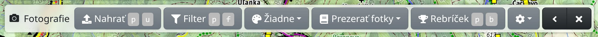
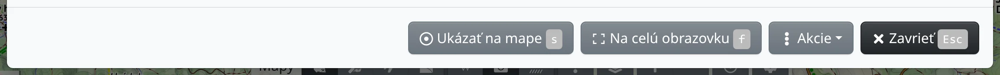

Freemap zobrazuje fotografie krajiny od svojich používateľov spolu s fotografiami s polohou z Wikimedia Commons. Môžete si ich prezerať na mape, hodnotiť a komentovať a nahrávať aj vlastné.

## Zobrazenie fotiek na mape

Stlačte :FaCamera: **Fotografie** na lište máp alebo <kbd>Shift</kbd> <kbd>F</kbd>. Fotky sa zobrazia ako malé značky od priblíženia 10:

- krúžok je fotka nahratá na Freemap,
- široký obdĺžnik je panoráma nahratá na Freemap,
- štvorec je fotka z Wikimedia Commons.

Zároveň sa hore zobrazí lišta fotografií. Tlačidlom :FaTimes: na tejto lište fotky opäť vypnete.

## Otvorenie fotky

Kliknite do mapy blízko značiek – kruh okolo kurzora myši ukazuje, v akom okolí kliknutia sa fotky hľadajú. Nájdené fotky sa otvoria v prehliadači fotiek. Ak tam žiadna nie je, zobrazí sa „Na tomto mieste neboli nájdené žiadne fotky.“ Fotky v okolí zobrazíte aj cez :FaCamera: **Ukázať fotky v okolí** v kontextovom menu mapy.

V nadpise prehliadača vidíte, na ktorú fotku sa práve pozeráte, napr. „1 / 48“; medzi fotkami sa presúvate šípkami po stranách fotky alebo klávesmi šípka vľavo a vpravo. Pod fotkou je autor, dátum odfotenia, hodnotenie, tagy a licencia. 360° panorámu si poobzeráte ťahaním.

Tlačidlá dole:

- :FaRegDotCircle: **Ukázať na mape** – ukáže, kde bola fotka odfotená; tlačidlom :FaChevronLeft: **Späť** sa k fotke vrátite.
- :RiFullscreenLine: **Na celú obrazovku** – fotka cez celú obrazovku.
- :FaEllipsisV: **Akcie** – ponuka akcií pre miesto, kde bola fotka odfotená, napr. :FaPencilAlt: **Kopírovať do kreslenia** pridá na mapu bod pomenovaný podľa fotky.
- :FaPencilAlt: **Upraviť** a :FaTrash: **Zmazať** – len pri vašich vlastných fotkách.

## Hodnotenie a komentáre

Po [prihlásení](#show=login) môžete fotke dať jednu až päť hviezdičiek pri **Vaše hodnotenie:** a pod **Komentáre** napísať komentár a odoslať ho tlačidlom **Pridať**. Aj fotku z Wikimedia Commons môžete hodnotiť a komentovať, autor fotky sa však o vašom komentári nedozvie.

## Lišta fotografií

- :FaUpload: **Nahrať** – nahrá vaše fotky, pozri nižšie.
- :FaFilter: **Filter** – zobrazí len fotky, ktoré vyhovujú zadaným podmienkam: podľa tagu, autora, dátumu nahratia či odfotenia, hodnotenia, licencie, prémiovosti alebo panorámy a podľa zdroja (**Freemap** alebo **Wikimedia Commons**). :FaCheck: **Použiť** filter použije, :FaEraser: **Vyčistiť** ho zruší. Kým je filter zapnutý, tlačidlo zostáva zvýraznené.
- :FaPalette: **Vyfarbiť podľa** – vyfarbí značky podľa autora, hodnotenia, dátumu odfotenia či nahratia, ročného obdobia, prémiovosti alebo licencie; **Odlíšiť moje** odlíši vaše vlastné fotky. Tlačidlo ukazuje aktuálnu voľbu, na začiatku **Žiadne**. Pri väčšine volieb ukáže **Legenda** v tom istom menu, čo farby znamenajú.
- :FaBook: **Prezerať fotky** – prezeranie všetkých fotiek, ktoré vyhovujú filtru, od poslednej nahranej, od najnovšie odfotenej, od najvyššieho hodnotenia alebo od posledného komentára.
- :FaTrophy: **Rebríček** – kto nahral najviac fotiek za celý čas, posledné 3 mesiace alebo posledných 30 dní, aj podľa krajín.
- :FaCog: – :FaLocationArrow: **Zobraziť smer fotenia** vyznačí pri značkách, kam fotka smeruje. Po prihlásení tu nájdete aj :FaEnvelope: **Upozorniť emailom na komentáre k fotkám** a nastavenia pre všetky vaše fotky naraz: :FaGem: prémiový obsah, :FaDove: prístup pre každého a :FaCreativeCommons: licenciu.

## Nahrávanie fotiek

Na nahrávanie musíte byť [prihlásení](#show=login). Stlačte :FaUpload: **Nahrať** alebo fotky z počítača pretiahnite na mapu. V okne **Nahrať fotky** ich pustite do vyznačenej oblasti alebo kliknite do oblasti a vyberte ich.

Pri každej fotke vyplňte:

- **Názov** a **Popis**,
- **Dátum a čas fotenia**,
- **Pozícia** – zadajte súradnice alebo stlačte :FaRegDotCircle: **Nastaviť pozíciu**, kliknite na miesto v mape a potvrďte tlačidlom :FaCheck: **OK**,
- **Azimut** – smer fotenia,
- **Tagy**,
- **Licencia** – CC BY-SA 4.0, ak nezvolíte inú licenciu Creative Commons.

Ak fotka obsahuje polohu, čas odfotenia alebo smer, vyplnia sa samy. Voľba **Sprístupniť len používateľom s prémiovým prístupom** skryje fotku pred všetkými bez prémiového prístupu. Nakoniec stlačte :FaUpload: **Nahrať**.

Pred nahrávaním si prečítajte pravidlá v okne: len vlastné fotky krajiny alebo dokumentačné fotky, najviac 10 MB na súbor.

## Prémiové fotky

Niektorí autori sprístupňujú svoje fotky len používateľom s prémiovým prístupom. Namiesto takej fotky sa zobrazí upozornenie a tlačidlo :FaGem: **Získať prémiový prístup**.
