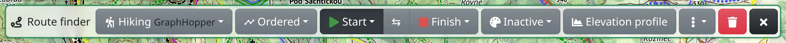
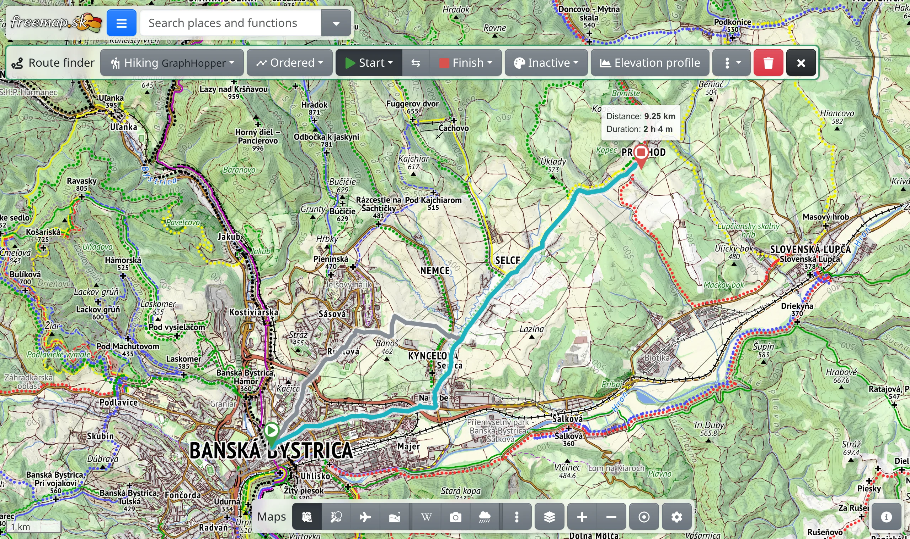

The route finder is for planning a route between places on the map – on foot, by bike or by car – and seeing its length, duration and elevation profile.

## Opening the route finder

Choose :FaRoute: **Route finder** in the main menu, or press <kbd>g</kbd>, then <kbd>r</kbd>. Its toolbar appears at the top of the screen.

You can also start from the map: right-click a place, or press and hold it on a phone, and choose :FaPlay.text-success: **Route from here** or :FaStop.text-danger: **Route to here**. The route finder opens with that place already set.

## Start, finish and stops

With the route finder open, click the map: the first click places the start, the next one the finish, and the route appears. Each further click adds a new finish, and the previous one becomes a stop along the way.

- Under :FaPlay.text-success: **Start** and :FaStop.text-danger: **Finish** in the toolbar you choose :FaMapMarkerAlt: **Select on the map**, :FaBullseye: **Your position** or :FaHome: **Home position**. With the :FaCrosshairs: button next to the home position you pick it on the map.
- ⇆ **Swap start and finish** reverses the route.
- Drag any point to move it. Drag the route line itself to add a stop at that place.
- Click a point to select it. Its toolbar has :FaEllipsisV: with a menu of actions for that place, and :FaTrash: to remove that point.

## Transport and mode

With the first button in the toolbar you choose how you travel: :FaHiking: **Hiking**, :FaWalking: **Walking**, :FaBicycle: **Bicycle**, :FaCar: **Car** and others. Routes of the profiles listed under GraphHopper are planned with the terrain in mind, without needless climbs. Profiles marked :FaFlask: are new and still being tuned; those marked :FaHistory: use someone else's service, which has usage limits. :FaPen: **Straight line** joins the points without routing.

With the second button you choose the mode:

- :MdTimeline: **Ordered** – through the points in the order you placed them.
- :BiShapePolygon: **Roundtrip** – a round trip from the start; in its menu you set the **Approximate distance**, and :FaDiceThree: shows another route.
- :FaBullseye: **Isochrones** – see below.

With the profiles listed under OSRM the modes are :MdTimeline: **Ordered**, :PiGraph: **Visiting places** and :BiShapePolygon: **Visiting places (roundtrip)**; in the last two the route goes through the stops in the best order.

## Route details

The finish shows the route's **Distance** and **Duration**, and the length of toll roads, if the route uses any. Pointing at a stop shows the totals up to it.

Between two points an alternative route may appear as well. Click it to make it the chosen one. How many routes appear at most is set under :FaEllipsisV: → **Max routes to offer**.

The :FaEllipsisV: menu also holds:

- :FaChartArea: **Elevation profile** – a chart of the route's elevation with the total climb and descent. On a wide screen it has its own button in the toolbar.
- :FaMapMarkerAlt: **Milestones** – markers along the route in kilometres or percent.
- :FaPencilAlt: **Convert to drawing** – turns the route into lines you can edit, see [Drawing](#show=manual/drawing).
- :FaPaintBrush: **Route style** – the width and opacity of the line and its markers.

## Colorizing the route

:FaPalette: **Colorize by** paints the route by **Elevation**, **Steepness**, **Surface**, **Road type**, **Hiking difficulty**, **Waymark color** and more – only what is known for the route is offered. Modes marked :FaGem.text-warning: need premium. While a mode is on, **Legend** at the top of the menu shows what the colours mean.

## Clearing, sharing and exporting

- :FaTrash: **Delete** in the toolbar removes the route with all its points.
- The route is part of the page address, so you can share it simply by copying the link from the browser. You can also keep it with your other features in :FaRegMap: **My maps**.
- :FaFileExport: **Map data export** in the main menu saves the found route as a GPX or other file, or sends it to Garmin. :FaPrint: **Map export to image/document** includes it in an image or PDF of the map.

## Isochrones

In the :FaBullseye: **Isochrones** mode, a click on the map sets one point and the map shows how far you can get from it within a **Time limit**, or a **Distance limit** if you fill one in. You set them in the mode menu, together with the number of bands (**Buckets**, up to five); **Travel to the point** turns it round, to where a journey to the point can start from.

## With premium

[Premium](#show=premium) adds to the route finder:

- a different transport for each part of a route – click a part of the route and choose its transport; <kbd>Shift</kbd>+click on the map adds a point joined by a straight line,
- :FaRandom: **Optimize order** of the stops for the shortest travel time,
- all colorizing modes, and an elevation profile read from the detailed terrain model.
