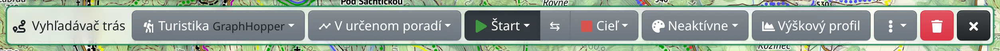
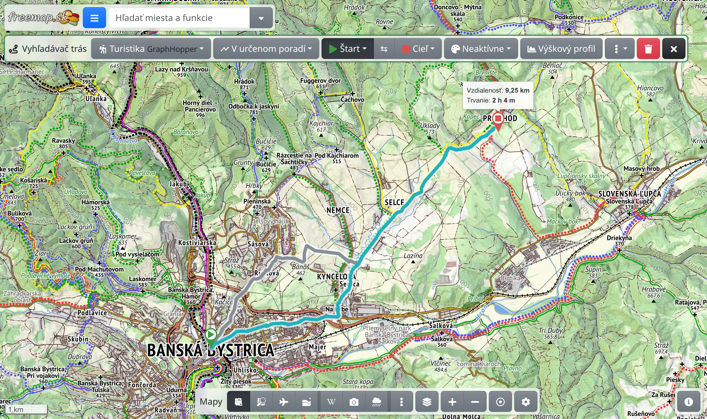

Vyhľadávač trás slúži na naplánovanie trasy medzi miestami na mape – pešo, na bicykli aj autom – a na zobrazenie dĺžky, trvania a výškového profilu tejto trasy.

## Otvorenie nástroja

V hlavnom menu zvoľte :FaRoute: **Vyhľadávač trás** alebo stlačte <kbd>g</kbd> a potom <kbd>r</kbd>. Hore na obrazovke sa zobrazí lišta nástroja.

Začať môžete aj priamo z mapy: kliknite na miesto pravým tlačidlom myši, alebo na telefóne podržte prst na mieste, a zvoľte :FaPlay.text-success: **Navigovať odtiaľto** alebo :FaStop.text-danger: **Navigovať sem**. Miesto sa tak rovno nastaví ako štart alebo cieľ trasy.

## Štart, cieľ a zastávky

Pri otvorenom nástroji vyhľadávania trás kliknite do mapy: prvé kliknutie umiestni štart, druhé cieľ a zobrazí sa trasa. Každé ďalšie kliknutie pridá nový cieľ a ten predchádzajúci sa stane zastávkou na ceste.

- V ponukách :FaPlay.text-success: **Štart** a :FaStop.text-danger: **Cieľ** na lište si zvolíte :FaMapMarkerAlt: **Vybrať na mape**, :FaBullseye: **Vaša poloha** alebo :FaHome: **Domov**. Tlačidlom :FaCrosshairs: vedľa položky Domov si vyberiete domovskú polohu na mape.
- ⇆ **Prehodiť štart a cieľ** otočí smer trasy.
- Ktorýkoľvek bod môžete presunúť ťahaním. Potiahnutím samotnej čiary trasy pridáte na dané miesto zastávku.
- Kliknutím na bod ho vyberiete a na lište výberu nájdete :FaEllipsisV: s ponukou akcií pre toto miesto a :FaTrash: na odstránenie tohto bodu.

## Spôsob dopravy a režim

Prvým tlačidlom na lište určíte, ako sa budete pohybovať: :FaHiking: **Turistika**, :FaWalking: **Pešo**, :FaBicycle: **Bicykel**, :FaCar: **Auto** a ďalšie. Pri profiloch v časti GraphHopper sa pri hľadaní trasy zohľadňuje terén, takže trasa nevedie zbytočnými stúpaniami. Profily označené :FaFlask: sú nové a ešte sa ladia, tie s :FaHistory: využívajú cudziu službu s obmedzeniami používania. :FaPen: **Priama čiara** spojí body bez hľadania cesty.

Druhým tlačidlom určíte režim:

- :MdTimeline: **V určenom poradí** – cez body v poradí, v akom ste ich zadali.
- :BiShapePolygon: **Výlet** – okruh zo štartu; v ponuke režimu zadáte dĺžku okruhu (**Orientačná vzdialenosť**) a :FaDiceThree: zobrazí inú trasu.
- :FaBullseye: **Izochróny** – pozri nižšie.

Pri profiloch v časti OSRM sú namiesto nich režimy :PiGraph: **Návšteva miest** a :BiShapePolygon: **Návšteva miest (okruh)**, v ktorých trasa prejde zastávkami v najvhodnejšom poradí.

## Údaje o trase

Pri cieli sa zobrazuje **Vzdialenosť** a **Trvanie** trasy a tiež dĺžka spoplatnených úsekov na trase. Ukázaním na zastávku uvidíte súčty až po túto zastávku.

Medzi dvoma bodmi sa môže zobraziť aj alternatívna trasa. Kliknutím na alternatívnu trasu ju vyberiete. Koľko trás sa najviac zobrazí, nastavíte v :FaEllipsisV: → **Max. počet ponúkaných trás**.

V ponuke :FaEllipsisV: ďalej nájdete:

- :FaChartArea: **Výškový profil** – graf nadmorskej výšky trasy s celkovým stúpaním a klesaním. Na širokej obrazovke má na lište vlastné tlačidlo.
- :FaMapMarkerAlt: **Kilometrovník** – značky pozdĺž trasy v kilometroch alebo percentách.
- :FaPencilAlt: **Skonvertovať na kreslenie** – z trasy urobí čiary, ktoré môžete upravovať, pozri [Kreslenie](#show=manual/drawing).
- :FaPaintBrush: **Štýl trasy** – hrúbka a krytie čiary trasy a značiek na trase.

## Vyfarbenie trasy

:FaPalette: **Vyfarbiť podľa** zafarbí trasu podľa zvoleného údaju – napríklad **Nadmorská výška**, **Sklon**, **Povrch**, **Typ cesty**, **Náročnosť pešo** či **Farba značky** – ponúka sa len to, čo je o trase známe. Režimy označené :FaGem: vyžadujú prémiový prístup. Kým je režim zapnutý, položka **Legenda** na začiatku ponuky ukáže, čo farby znamenajú.

## Zmazanie, zdieľanie a export

- :FaTrash: **Zmazať** na lište odstráni trasu so všetkými bodmi.
- Trasa je súčasťou adresy stránky, takže ju zdieľate jednoducho skopírovaním odkazu z prehliadača. Môžete si ju tiež uložiť spolu s ostatnými prvkami do :FaRegMap: **Moje mapy**.
- :FaFileExport: **Export mapových dát** v hlavnom menu uloží vyhľadanú trasu do súboru GPX alebo iného formátu, prípadne ju pošle do Garminu. :FaPrint: **Export mapy do obrázka/dokumentu** ju zahrnie do obrázka alebo PDF s mapou.

## Izochróny

V režime :FaBullseye: **Izochróny** kliknutím do mapy zadáte jeden bod a mapa ukáže, kam sa z neho dostanete v zadanom čase (**Časový limit**) alebo na zadanú vzdialenosť (**Limit vzdialenosti**), ak ju vyplníte. Nastavíte ich v ponuke režimu spolu s počtom pásiem (**Počet delení**, najviac päť); **Cesta do bodu** to otočí – ukáže, odkiaľ sa dá do bodu doraziť.

## S prémiovým prístupom

[Prémiový prístup](#show=premium) pridáva do vyhľadávania trás:

- iný spôsob dopravy pre každú časť trasy – kliknite na časť trasy a zvoľte spôsob dopravy pre túto časť; <kbd>Shift</kbd>+kliknutie do mapy pridá bod spojený priamou čiarou,
- :FaRandom: **Optimalizovať poradie** zastávok na najkratší čas cesty,
- všetky režimy vyfarbenia a výškový profil z podrobného modelu terénu.
