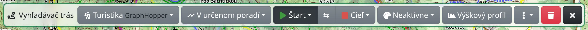
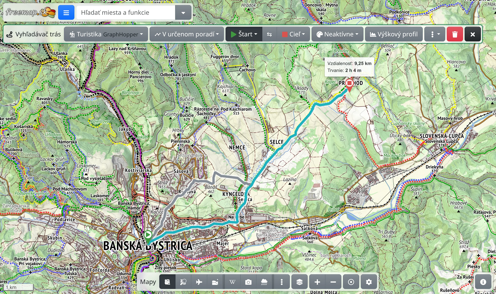
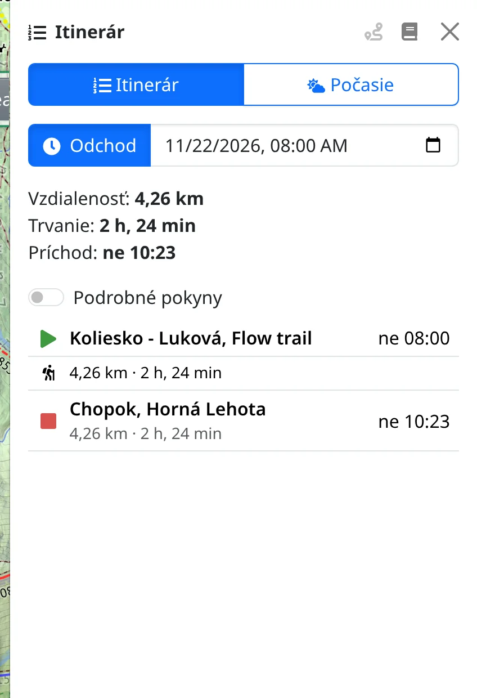
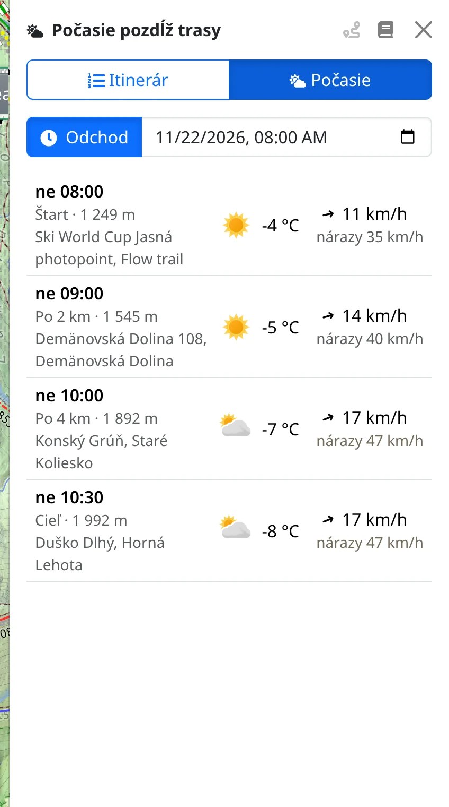

Vyhľadávač trás slúži na naplánovanie trasy medzi miestami na mape – pešo, na bicykli aj autom – a na zobrazenie dĺžky, trvania a výškového profilu tejto trasy.

## Otvorenie nástroja

V hlavnom menu zvoľte :FaRoute: **Vyhľadávač trás** alebo stlačte <kbd>g</kbd> a potom <kbd>r</kbd>. Hore na obrazovke sa zobrazí lišta nástroja.

Začať môžete aj priamo z mapy: kliknite na miesto pravým tlačidlom myši, alebo na telefóne podržte prst na mieste, a zvoľte :FaPlay.text-success: **Navigovať odtiaľto** alebo :FaStop.text-danger: **Navigovať sem**. Miesto sa tak rovno nastaví ako štart alebo cieľ trasy.

## Štart, cieľ a zastávky

Pri otvorenom nástroji vyhľadávania trás kliknite do mapy: prvé kliknutie umiestni štart, druhé cieľ a zobrazí sa trasa. Každé ďalšie kliknutie pridá nový cieľ a ten predchádzajúci sa stane zastávkou na ceste.

- V ponukách :FaPlay.text-success: **Štart** a :FaStop.text-danger: **Cieľ** na lište si zvolíte :FaMapMarkerAlt: **Vybrať na mape**, :FaRegDotCircle: **Vaša poloha** alebo niektoré z :FaMapPin: [vašich miest](#show=manual/account). Kým žiadne nemáte, ponúka sa :FaPlus: **Pridať miesto**.
- ⇆ **Prehodiť štart a cieľ** otočí smer trasy.
- Ktorýkoľvek bod môžete presunúť ťahaním. Potiahnutím samotnej čiary trasy ju usmerníte cez dané miesto: v režime :MdTimeline: **V určenom poradí** tak pribudne malý krúžok s bodkou, pomocný bod. Nemá číslo, zastávku ani čas a trasa sa opisuje, akoby tam nebol. Ak sa trasa na ňom otáča späť, bodka v krúžku zožltne: bod presuňte, alebo, ak ide o miesto, kam idete a vraciate sa, vypnite :FaRegDotCircle: **Pomocný bod**.
- :FaRegDotCircle: **Pomocný bod** v paneli bodu zmení zastávku na pomocný bod alebo naspäť.
- Kliknutím na bod ho vyberiete a na lište výberu nájdete :FaEllipsisV: s ponukou akcií pre toto miesto a :FaTrash: na odstránenie tohto bodu.

## Spôsob dopravy a režim

Prvým tlačidlom na lište určíte, ako sa budete pohybovať: :FaHiking: **Turistika**, :FaWalking: **Pešo**, :FaBicycle: **Bicykel**, :FaCar: **Auto** a ďalšie. Pri profiloch v časti GraphHopper sa pri hľadaní trasy zohľadňuje terén, takže trasa nevedie zbytočnými stúpaniami. Profily označené :FaFlask: sú nové a ešte sa ladia, tie s :FaHistory: využívajú cudziu službu s obmedzeniami používania. :FaPen: **Priama čiara** spojí body bez hľadania cesty.

Druhým tlačidlom určíte režim:

- :MdTimeline: **V určenom poradí** – cez body v poradí, v akom ste ich zadali.
- :BiShapePolygon: **Výlet** – okruh zo štartu; v ponuke režimu zadáte dĺžku okruhu (**Orientačná vzdialenosť**) a :FaDiceThree: zobrazí inú trasu.
- :FaBullseye: **Izochróny** – pozrite nižšie.

Pri profiloch v časti OSRM sú režimy :MdTimeline: **V určenom poradí**, :PiGraph: **Návšteva miest** a :BiShapePolygon: **Návšteva miest (okruh)**; v posledných dvoch trasa prejde zastávkami v najvhodnejšom poradí.

## Údaje o trase

Pri cieli sa zobrazuje vzdialenosť a trvanie trasy vrátane zastávok a pri nastavenom odchode aj príchod. Ukázaním na zastávku uvidíte súčty až po túto zastávku a ukázaním na cieľ ich uvidíte v rovnakej podobe. Ostatné, aj spoplatnené úseky, nájdete v itinerári.

Medzi dvoma bodmi sa môže zobraziť aj alternatívna trasa. Kliknutím na alternatívnu trasu ju vyberiete. Koľko trás sa najviac zobrazí, nastavíte v :FaEllipsisV: → **Max. počet ponúkaných trás**.

V ponuke :FaEllipsisV: ďalej nájdete:

- :FaChartArea: **Výškový profil** – graf nadmorskej výšky trasy s celkovým stúpaním a klesaním. Na širokej obrazovke má na lište vlastné tlačidlo.
- :FaMapMarkerAlt: **Kilometrovník** – značky pozdĺž trasy v kilometroch alebo percentách.
- :FaPencilAlt: **Skonvertovať na kreslenie** – z trasy urobí čiary, ktoré môžete upravovať, pozrite [Kreslenie](#show=manual/drawing).
- :FaPaintBrush: **Štýl trasy** – hrúbka a krytie čiary trasy a značiek na trase.

## Itinerár

V režime :MdTimeline: **V určenom poradí** otvorí :TbListDetails: **Podrobnosti trasy** na lište, alebo kliknutie na popis pri cieli, itinerár trasy vedľa mapy; na začiatku je otvorený. Zostane otvorený aj pre ďalšie trasy, kým ho nezatvoríte, a zobrazuje sa, keď je otvorené vyhľadávanie trás alebo je vybraná zastávka či úsek trasy; :FaRoute: v hlavičke itinerára otvorí vyhľadávanie trás.

V itinerári sú súčty a príchod, potom každá zastávka s časom príchodu, prestávkou alebo nocľahom a časom pokračovania a medzi zastávkami každý úsek s dopravou, vzdialenosťou a trvaním. Pomocné body sa v itinerári nezobrazujú. Kliknutím na riadok vyberiete danú zastávku alebo úsek a uvidíte ho na mape, pričom itinerár zostane otvorený. **Podrobné pokyny** pridajú každé odbočenie na úsekoch s názvom cesty a vzdialenosťou k ďalšiemu odbočeniu; ukázaním na odbočenie sa miesto odbočenia vyznačí na mape a kliknutím ho uvidíte.

## Odchod a zastávky

:FaClock: **Odchod** hore v itinerári odchod zapne alebo vypne; pole vedľa nastaví dátum a čas odchodu. Nájdete ho aj na lište štartu a v ponuke :FaPlay.text-success: **Štart** na lište vyhľadávania trás ako :FaClock: **Čas odchodu**. Bez odchodu itinerár neukazuje časy a počasie pozdĺž trasy nie je k dispozícii.

Kliknite na zastávku a na lište zastávky cez :FaMugHot: **Zastávka** nastavte, ako dlho tam zostanete:

- :FaBan: **Bez zastávky** – trasa pokračuje bez prerušenia.
- :FaMugHot: **Prestávka** – prestávka na zadaný počet minút.
- :FaBed: **Nocľah** – trasa pokračuje v čase **Pokračovať o** po zadanom počte nocí (**Noci**).

Časy na ďalších zastávkach a príchod sa posunú o dĺžku zastávky.

## Počasie pozdĺž trasy

:FaCloudSun: **Počasie** hore v paneli prepne na počasie pozdĺž trasy v časoch, keď tam budete: na štarte, každú hodinu cesty, na najvyššom bode, na každej prestávke alebo nocľahu a v cieli. Každý riadok ukazuje čas zaokrúhlený na štvrťhodinu, nadmorskú výšku a miesto, počasie, teplotu, zrážky a vietor. Ukázaním na riadok sa miesto vyznačí na mape; kliknutím ho uvidíte. Pri bode, kam predpoveď ešte nesiaha, je **Mimo dosahu predpovede**. V iných režimoch ako :MdTimeline: **V určenom poradí** panel obsahuje len počasie.

Počasie potrebuje nastavený odchod. Čo ktorý údaj znamená a predpoveď pre ľubovoľné iné miesto nájdete v kapitole [Predpoveď počasia](#show=manual/weather-forecast).

## Vyfarbenie trasy

:FaPalette: **Vyfarbiť podľa** zafarbí trasu podľa zvoleného údaju – napríklad **Nadmorská výška**, **Sklon**, **Povrch**, **Typ cesty**, **Náročnosť pešo** či **Farba značky** – ponúka sa len to, čo je o trase známe. Režimy označené :FaGem.text-warning: vyžadujú prémiový prístup. Kým je režim zapnutý, položka **Legenda** na začiatku ponuky ukáže, čo farby znamenajú.

## Zmazanie, zdieľanie a export

- :FaTrash: **Zmazať** na lište odstráni trasu so všetkými bodmi.
- Trasa je súčasťou adresy stránky, takže ju zdieľate jednoducho skopírovaním odkazu z prehliadača. Môžete si ju tiež uložiť spolu s ostatnými prvkami v dialógu :FaRegMap: **Moje mapy**.
- :FaFileExport: **Export mapových dát** v hlavnom menu uloží vyhľadanú trasu do súboru GPX alebo iného formátu, prípadne ju pošle do Garminu. :FaPrint: **Export mapy do obrázka/dokumentu** ju zahrnie do obrázka alebo PDF s mapou.

## Izochróny

V režime :FaBullseye: **Izochróny** kliknutím do mapy zadáte jeden bod a mapa ukáže, kam sa z tohto bodu dostanete v zadanom čase (**Časový limit**) alebo na zadanú vzdialenosť (**Limit vzdialenosti**), ak ju vyplníte. Nastavíte ich v ponuke režimu spolu s počtom pásiem (**Počet delení**, najviac päť); **Cesta do bodu** to otočí – ukáže, odkiaľ sa dá do bodu doraziť.

## S prémiovým prístupom

[Prémiový prístup](#show=premium) pridáva do vyhľadávania trás:

- iný spôsob dopravy pre každú časť trasy – kliknite na časť trasy a zvoľte spôsob dopravy pre túto časť; <kbd>Shift</kbd>+kliknutie do mapy pridá bod spojený priamou čiarou,
- :FaRandom: **Optimalizovať poradie** zastávok na najkratší čas cesty,
- prestávky a nocľahy na zastávkach,
- všetky režimy vyfarbenia a výškový profil z podrobného modelu terénu.
