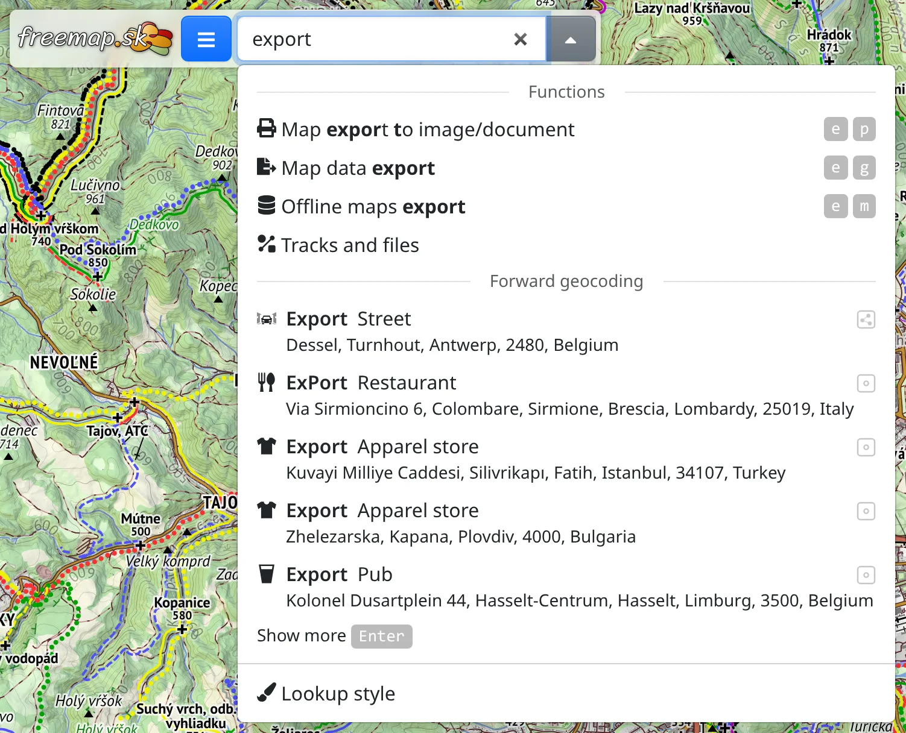

The search box at the top of the screen finds places on the map, and also the app's own functions, maps, types of places and chapters of this manual.

## Finding a place

Type a name into the box – a village, a summit, a street, an address. Suggestions appear from the third character on, nearest to the part of the map you are looking at first. <kbd>Enter</kbd> or :FaSearch: brings up a longer list.

Besides names, the box understands:

- **coordinates**, in the common formats, e.g. `48.15, 17.11` or `N 48°09'00" E 17°06'36"`,
- **an OpenStreetMap element** – `n123`, `w456`, `r789`, `node/123`, or a link to the element's page on openstreetmap.org,
- **a bounding box**, **tile numbers** (`z/x/y`) and pasted **GeoJSON**.

The results are grouped under where they come from. Pointing at a result, or moving onto it with the arrow keys, shows it on the map without moving the map, so you can compare results before picking one.

Without an internet connection only coordinates, a bounding box, tile numbers and GeoJSON can be found.

## A picked result

Picking a result moves the map to it and selects it: it is drawn in the selection colour and its panel opens on the right, or over the lower half of a phone's screen. The panel holds the name, kind, OpenStreetMap tags and other data of the place, as described in [Objects](#show=manual/objects), and above them:

- :FaThumbtack: **Keep on the map** – the result stays on the map when you pick another one, so you can keep several side by side. A kept result is removed with :FaTrash: **Delete**, or with <kbd>Del</kbd>.
- :FaEllipsisV: holds :FaPencilAlt: **Convert to drawing**, which turns the result into a drawing you can edit (see [Drawing](#show=manual/drawing)), and the actions for the place, as in the map's context menu.
- :FaExternalLinkAlt: **Open in…** other maps and apps.

A place found by its name opens no panel, so the map stays in view; clicking the place on the map opens it.

A result you have not kept goes away when you close its panel with × or press <kbd>Esc</kbd>, or select something else. Kept OpenStreetMap elements are part of the link to the map, so whoever opens it sees them too.

How results are drawn is set in :FaPaintBrush: **Lookup style** at the end of the box's list, followed by :FaBook: **Manual**, which opens this chapter; with the box empty, ▾ beside it opens just these two rows.

## Functions, maps and more

From the second character on, the box also lists, above the places:

- **Functions** – tools and dialogs by their name or a related word, e.g. “export”, “route” or “weather”. Picking one does what its menu item does.
- **Maps** – picking a map switches it on.
- **Manual** – the chapters of this manual.
- **Objects (POIs)** – types of places such as “spring” or “shelter”, each with a checkbox that shows all of them on the map (see [Objects](#show=manual/objects)). The list stays open, so you can tick several.

Letters may be skipped and accents left out: “rofi” finds **Route finder**.
