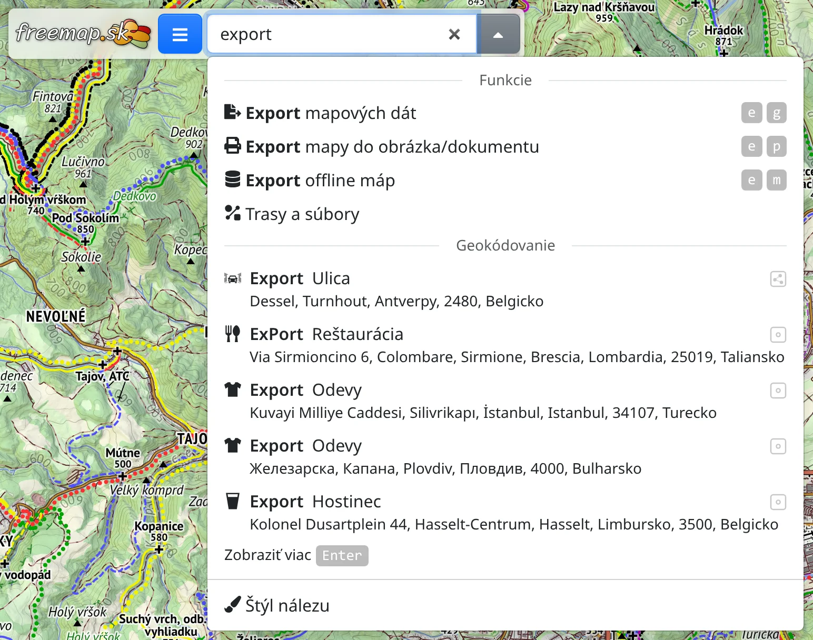

Vyhľadávacie pole hore na obrazovke slúži na hľadanie miest na mape, ale aj funkcií aplikácie, máp, druhov miest a kapitol tejto príručky.

## Hľadanie miesta

Do poľa napíšte názov – obce, vrchu, ulice či adresu. Návrhy sa zobrazujú od tretieho znaku, najprv tie najbližšie k časti mapy, na ktorú sa práve pozeráte. Klávesom <kbd>Enter</kbd> alebo :FaSearch: si vyžiadate dlhší zoznam.

Okrem názvov pole rozumie aj:

- **súradniciam** v bežných zápisoch, napr. `48.15, 17.11` alebo `N 48°09'00" E 17°06'36"`,
- **prvku OpenStreetMap** – `n123`, `w456`, `r789`, `node/123` alebo odkazu na stránku prvku na openstreetmap.org,
- **ohraničujúcemu boxu**, **číslam dlaždíc** (`z/x/y`) a vloženému **GeoJSON**.

Výsledky sú zoskupené podľa toho, odkiaľ pochádzajú. Ukázaním na výsledok alebo prechodom naň šípkami ho uvidíte na mape bez posunutia mapy, takže výsledky môžete porovnať skôr, než niektorý vyberiete.

Bez pripojenia na internet možno nájsť iba súradnice, ohraničujúci box, čísla dlaždíc a GeoJSON.

## Vybraný výsledok

Výberom výsledku sa mapa presunie naň a výsledok sa vyberie: vykreslí sa farbou výberu a otvorí sa jeho panel – vpravo, na telefóne cez dolnú polovicu obrazovky, kde ho :BsChevronDown: a :BsChevronUp: v hlavičke zmenšia na hlavičku alebo zväčšia na celú obrazovku. Panel obsahuje názov, druh, značky OpenStreetMap a ďalšie údaje o mieste, ako ich opisuje kapitola [Objekty](#show=manual/objects), a nad nimi:

- :FaThumbtack: **Ponechať na mape** – výsledok zostane na mape, aj keď vyberiete ďalší, takže ich môžete mať viac vedľa seba. Ponechaný výsledok odstránite tlačidlom :FaTrash: **Zmazať** alebo klávesom <kbd>Del</kbd>.
- :FaEllipsisV: obsahuje :FaPencilAlt: **Skonvertovať na kreslenie**, ktoré z výsledku urobí kresbu na úpravu (pozri [Kreslenie](#show=manual/drawing)), a akcie pre miesto ako v kontextovom menu mapy.
- :FaExternalLinkAlt: **Otvoriť v…** iných mapách a aplikáciách.

Miesto nájdené podľa názvu panel neotvorí, aby mapa zostala na očiach; otvoríte ho kliknutím na miesto v mape.

Výsledok, ktorý ste neponechali, zmizne, keď jeho panel zatvoríte tlačidlom × alebo klávesom <kbd>Esc</kbd>, prípadne keď vyberiete niečo iné. Ponechané prvky OpenStreetMap sú súčasťou odkazu na mapu, takže ich uvidí aj ten, kto ho otvorí.

Ako sa výsledky vykresľujú, nastavíte v :FaPaintBrush: **Štýl nálezu** na konci zoznamu poľa, za ktorým nasleduje :FaBook: **Príručka** otvárajúca túto kapitolu; pri prázdnom poli ▾ vedľa neho otvorí len tieto dva riadky.

## Funkcie, mapy a ďalšie

Od druhého znaku pole nad miestami ponúka aj:

- **Funkcie** – nástroje a dialógy podľa názvu alebo príbuzného slova, napr. „export“, „trasa“ alebo „počasie“. Výber funkcie urobí to isté ako jej položka v menu.
- **Mapy** – výberom mapy ju zapnete.
- **Príručka** – kapitoly tejto príručky.
- **Objekty (POI)** – druhy miest, napr. „prameň“ alebo „útulňa“, každý so zaškrtávacím políčkom, ktoré zobrazí všetky také miesta na mape (pozri [Objekty](#show=manual/objects)). Zoznam zostane otvorený, takže ich môžete zaškrtnúť viac.

Písmená možno vynechávať a diakritiku nepísať: „vytr“ nájde **Vyhľadávač trás**.
