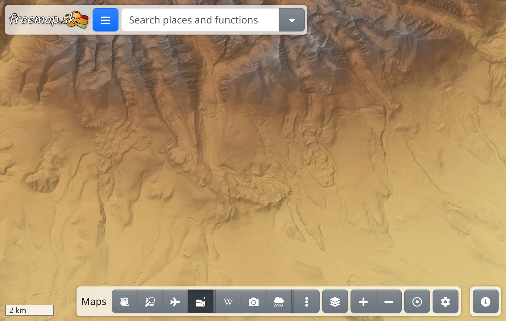
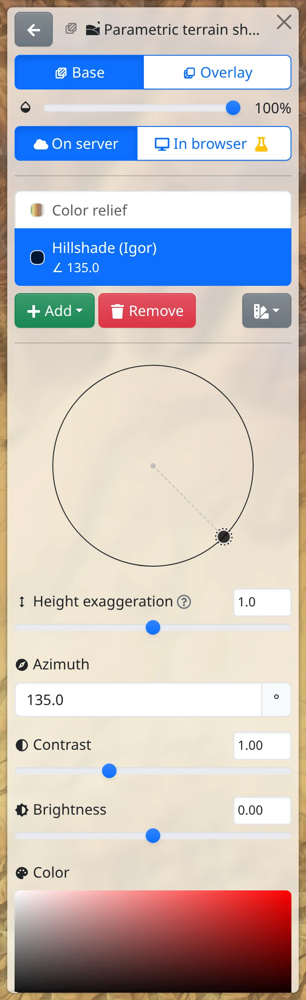
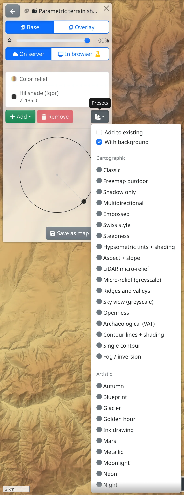

Terrain shading draws the relief of the land as light and shadow, so valleys, ridges, slopes and even small terrain features stand out. It can be a map of its own or lie under or over other maps.

## Shading maps

- :GiHills: **Parametric terrain shading** (<kbd>h</kbd>) – all of Europe. You choose how it looks: the light, the colours, the steepness, contour lines and more. In many countries it is drawn from detailed national terrain models, elsewhere from a 30 m model.
- :GiHills: **Detailed terrain shading** (<kbd>Shift</kbd>+<kbd>h</kbd>) – Slovakia, from the airborne laser scan of the terrain without forest and buildings, with detail up to zoom 20.
- :GiHills: **Surface shading** – Slovakia, the shaded surface including forest and buildings.

Switch them on like any other map, from the map toolbar, its menu or the search box – see [Maps](#show=manual/maps).

## Opening the settings

The look of **Parametric terrain shading** is set in the :FaLayerGroup: **Map layers** panel (the <kbd>.</kbd> key): click the map's name to open its settings.

- :FaCloud: **On server** / :FaDesktop: **In browser** :FaFlask: – where the shading is drawn. On the server, changes show only once you press :FaCheck: **Apply** at the top of the panel; :FaUndo: **Revert** drops them. In the browser (an experimental function that needs a browser with WebGPU), changes show at once.
- The list holds the layers the shading is made of – hillshade, slope, colour relief, contour lines and others – and the **Background**. Click a layer to set it up. :FaPlus: **Add** adds another, :FaTrash: **Remove** removes the selected one.

## Presets

The quickest way to a good picture is :FaSwatchbook: **Presets**, the button beside **Remove**. Choosing a preset replaces the whole shading at once:

- **Cartographic** – e.g. **Classic**, **Freemap outdoor**, **Swiss style**, **Steepness**, **Hypsometric tints + shading** (colours by elevation), **LiDAR micro-relief** or **Contour lines + shading**,
- **Artistic** – e.g. **Night**, **Sepia**, **Watercolour** or **Golden hour**.

For a few presets you first enter values, such as the elevations of the bottom and top colour. With **Add to existing** ticked, the preset's layers are added to the current shading instead. **With background** decides whether the preset gets a background; without one, the map beneath shows through.

## Adjusting a layer

Select a layer in the list to see its settings:

- Light – drag the handle on the dial to set where the light comes from, or type :MdExplore: **Azimuth** and :MdWbTwilight: **Elevation** in degrees. The usual light comes from the north-west.
- :MdHeight: **Height exaggeration** – above 1 the relief looks steeper, below 1 flatter.
- :MdContrast: **Contrast** and :MdBrightness6: **Brightness**.
- :MdPalette: **Color** – the layer's colour (:MdGradient: **Colour gradient** for colour relief and similar layers). A hillshade or slope layer can switch from **Single colour** to **Gradient** in the colour picker, so that its colour changes with the value – e.g. grey on gentle slopes turning red on steep ones.
- **Contour lines** have a **Contour interval** in metres and a **Line width**.
- **Sky view / openness** darkens hollows, ditches and valley floors regardless of where the light comes from, which brings out fine features such as sunken paths or old earthworks. Under **Show** you choose what it shows, and :LuRadius: **Radius** sets how far around each point the terrain is taken into account.

## Combining with other maps

The :TbLayersSelected: **Base** / :TbLayersSelectedBottom: **Overlay** switch at the top of the settings decides whether the shading is a map of its own or lies over the base map, and the :MdOpacity: slider below it sets its opacity. Shading without a background lets the map beneath show through – a half-transparent shading over aerial imagery, for example, makes the relief stand out.

Over a shading base map you can lay **Outdoor map without base** or **Contour lines**, which have no ground of their own.

A shading you like can be kept under a name of its own with :FaSave: **Save as map**; :FaUndo: **Reset to default** brings back the original look. More in [Maps](#show=manual/maps).

## With premium access

At the highest zoom levels – from zoom 16, on a high-resolution screen from zoom 15 – **Parametric terrain shading** and **Detailed terrain shading** need [premium access](#show=premium). Without it, most tiles at these zooms show only a note about premium access.
