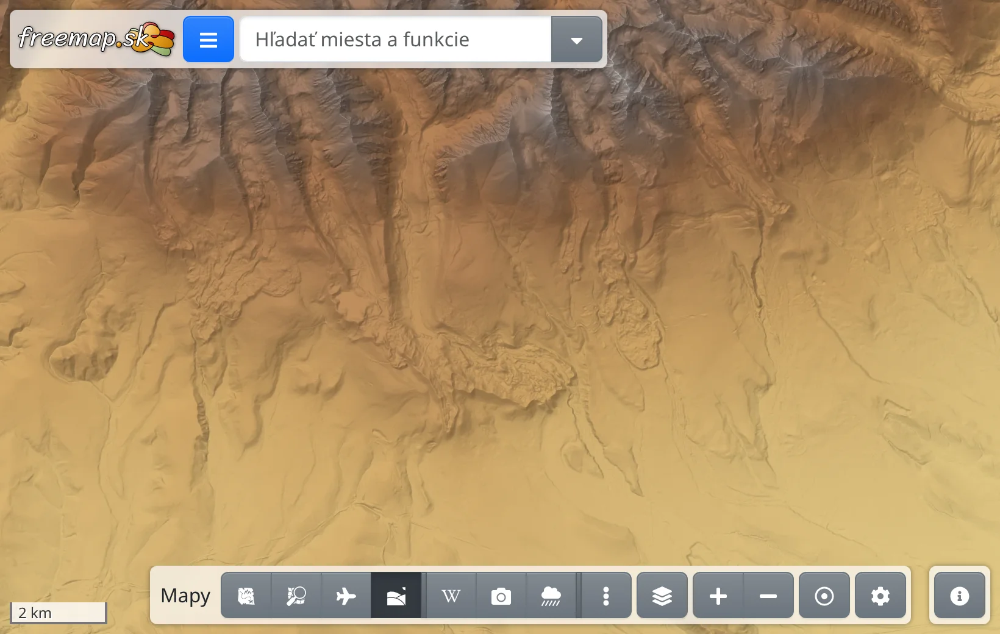
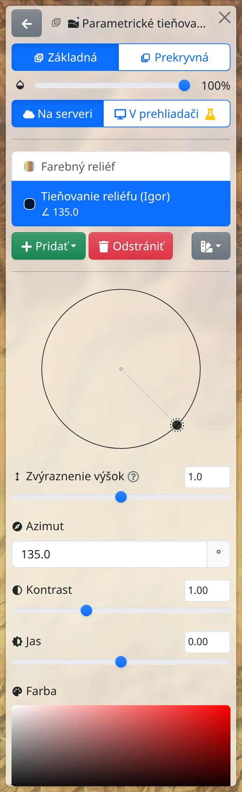
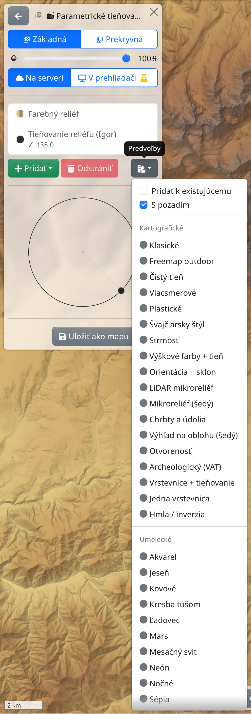

Tieňovanie terénu zobrazuje reliéf krajiny svetlom a tieňom, takže doliny, hrebene, svahy aj drobné terénne útvary vyniknú. Môže slúžiť ako samostatná mapa alebo sa dá kombinovať s inými mapami.

## Mapy tieňovania

- :GiHills: **Parametrické tieňovanie terénu** (<kbd>h</kbd>) – celá Európa. Vzhľad si zvolíte sami: svetlo, farby, strmosť, vrstevnice a ďalšie. V mnohých krajinách sa kreslí z podrobných národných modelov terénu, inde z modelu s rozlíšením 30 m.
- :GiHills: **Detailné tieňovanie terénu** (<kbd>Shift</kbd>+<kbd>h</kbd>) – Slovensko, z leteckého laserového skenovania terénu bez lesa a budov, s detailmi až po priblíženie 20.
- :GiHills: **Tieňovanie povrchu** – Slovensko, tieňovaný povrch vrátane lesa a budov.

Zapínajú sa ako ktorákoľvek iná mapa – na lište máp, v ponuke ďalších máp alebo cez vyhľadávacie pole, pozrite [Mapy](#show=manual/maps).

## Otvorenie nastavení

Vzhľad mapy **Parametrické tieňovanie terénu** sa nastavuje v paneli :FaLayerGroup: **Vrstvy mapy** (kláves <kbd>.</kbd>): kliknutím na názov mapy otvoríte nastavenia tieňovania.

- :FaCloud: **Na serveri** / :FaDesktop: **V prehliadači** :FaFlask: – kde sa tieňovanie kreslí. Pri kreslení na serveri sa zmeny prejavia až po stlačení :FaCheck: **Použiť** v hornej časti panela; :FaUndo: **Vrátiť zmeny** ich zahodí. V prehliadači (experimentálna funkcia, vyžaduje prehliadač s podporou WebGPU) sa zmeny prejavia hneď.
- V zozname sú vrstvy, z ktorých sa tieňovanie skladá – tieňovanie reliéfu, sklon, farebný reliéf, vrstevnice a ďalšie – a **Pozadie**. Kliknutím na vrstvu zobrazíte nastavenia tejto vrstvy. :FaPlus: **Pridať** pridá ďalšiu vrstvu, :FaTrash: **Odstrániť** odstráni vybranú.

## Predvoľby

Najrýchlejšia cesta k peknému výsledku sú :FaSwatchbook: **Predvoľby**, tlačidlo vedľa tlačidla **Odstrániť**. Zvolená predvoľba hneď nahradí celé tieňovanie:

- **Kartografické** – napr. **Klasické**, **Freemap outdoor**, **Švajčiarsky štýl**, **Strmosť**, **Výškové farby + tieň** (farby podľa nadmorskej výšky), **LiDAR mikroreliéf** či **Vrstevnice + tieňovanie**,
- **Umelecké** – napr. **Nočné**, **Sépia**, **Akvarel** či **Zlatá hodinka**.

Pri niektorých predvoľbách najprv zadáte hodnoty, napríklad výšku najnižšej a najvyššej farby. Keď je zaškrtnuté **Pridať k existujúcemu**, vrstvy predvoľby sa pridajú k súčasnému tieňovaniu. Voľba **S pozadím** určuje, či predvoľba dostane pozadie; bez pozadia presvitá mapa pod tieňovaním.

## Nastavenie vrstvy

Po výbere vrstvy v zozname sa zobrazia nastavenia vrstvy:

- Svetlo – ťahaním bodu na kruhu nastavíte, odkiaľ svetlo prichádza, alebo zadáte hodnoty :MdExplore: **Azimut** a :MdWbTwilight: **Výška** v stupňoch. Zvyčajne svetlo prichádza zo severozápadu.
- :MdHeight: **Zvýraznenie výšok** – nad 1 vyzerá reliéf strmší, pod 1 plochší.
- :MdContrast: **Kontrast** a :MdBrightness6: **Jas**.
- :MdPalette: **Farba** – farba vrstvy (:MdGradient: **Farebný prechod** pri farebnom reliéfe a podobných vrstvách). Pri tieňovaní reliéfu a sklone môžete vo výbere farby prepnúť z **Jedna farba** na **Prechod**, aby sa farba menila podľa hodnoty – napr. sivá na miernych svahoch a červená na strmých.
- Vrstvy **Vrstevnice** majú nastavenia **Interval vrstevníc** (v metroch) a **Hrúbka čiary**.
- **Výhľad na oblohu / otvorenosť** stmavuje priehlbiny, priekopy a dná dolín bez ohľadu na smer svetla, a tak zvýrazní jemné útvary, napríklad úvozy či staré valy. V položke **Zobraziť** zvolíte, čo sa zobrazí, a :LuRadius: **Polomer** určuje, do akej vzdialenosti od každého bodu sa terén posudzuje.

## Kombinovanie s inými mapami

Prepínač :TbLayersSelected: **Základná** / :TbLayersSelectedBottom: **Prekryvná** v hornej časti nastavení určuje, či je tieňovanie samostatnou mapou, alebo leží nad podkladovou mapou, a posuvník :MdOpacity: pod prepínačom nastavuje viditeľnosť tieňovania. Ak tieňovanie nemá pozadie, mapa pod tieňovaním presvitá – napríklad polopriehľadné tieňovanie nad leteckou mapou zvýrazní reliéf.

Na tieňovanie ako podkladovú mapu môžete položiť mapy **Outdoorová mapa bez podkladu** alebo **Vrstevnice**, ktoré nemajú vlastný podklad.

Tieňovanie, ktoré sa vám páči, si uložíte pod vlastným názvom tlačidlom :FaSave: **Uložiť ako mapu**; :FaUndo: **Obnoviť predvolené** vráti pôvodný vzhľad. Viac v kapitole [Mapy](#show=manual/maps).

## S prémiovým prístupom

Pri najväčších priblíženiach – od priblíženia 16, na obrazovke s vysokým rozlíšením od priblíženia 15 – vyžadujú **Parametrické tieňovanie terénu** a **Detailné tieňovanie terénu** [prémiový prístup](#show=premium). Bez prémiového prístupu sa pri týchto priblíženiach na väčšine dlaždíc zobrazí len upozornenie na prémiový prístup.
