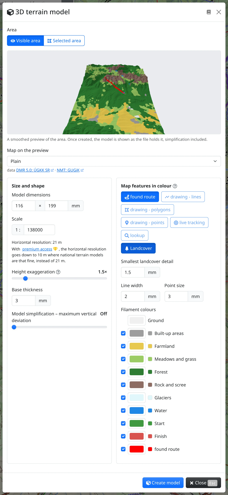

From the terrain of any area you can make a model for a 3D printer – a solid block with the relief on top, flat walls and a flat bottom, sized in millimetres. Open :FaBars: **Main menu** → :FaCube: **3D terrain model** (<kbd>e</kbd> <kbd>3</kbd>). The function is experimental. The model is built in your browser from Freemap's elevation data, so you need to be online.

## Area and preview

- **Area** – :FaEye: **Visible area** is what you see on the screen; with :FaDrawPolygon: **Selected area** the dialog steps aside, you adjust a rectangle on the map and confirm it.
- The 3D preview shows the area as it will come out. Turn it by dragging, zoom with the wheel or by pinching. Until the model is created, the preview is smoothed; it follows the height exaggeration and the base at once.
- **Map on the preview** lays a map over the preview – an aerial photo, for example – so you can tell where you are. It is only for viewing and does not get into the model.

## Size and shape

- **Model dimensions** (width × depth in mm) and **Scale** are one value in three forms: change one and the others follow. The depth follows the shape of the area; a new area starts 200 mm along its longer side.
- **Horizontal resolution** says how far apart on the ground the model's points are. With [premium access](#show=manual/premium) the model can be finer where the national terrain models are that fine; the dialog says how much finer this model would be.
- **Height exaggeration** (1–5×) makes the relief steeper; at 1 it is true to scale. Slight exaggeration helps gentle landscapes stand out.
- **Base thickness** is how much material is under the lowest point.

An area that is too large for a model is refused, with a message; zoom in or select a smaller area.

## Map features in colour

For a multi-colour printer the model can carry the features on the map in colour – the planned route, drawn lines, areas and points, tracked devices and search results – each in the colour it has on the map. **Line width** and **Point size** set how wide they print, in millimetres on the model.

**Landcover** colours the terrain under them by what covers it: farmland, meadows and grass, built-up areas, forest, rock and scree, glaciers and water. **Smallest landcover detail** smooths away strips and spots narrower than this, which would print only as noise.

**Filament colours** lists the ground and every colour used, each with the filament it prints in. Give two colours the same filament and they share it; untick a colour to leave its features off. A model with colours downloads as 3MF, which slicers such as Bambu Studio read with the colours assigned to filaments; without them it is a plain STL.

## Creating and downloading

**Create model** builds the model; the preview then shows it exactly as the file holds it, and the dialog states its height, the number of triangles and the file size. :FaDownload: **Download STL** (or **Download 3MF**) saves it. **Back** returns to the settings.

**Model simplification – maximum vertical deviation** makes the file smaller by merging triangles, as long as the surface stays within that height of the real terrain. Small values cost nothing visible; the largest give the model a deliberately faceted, low-poly look.

## Credits

Under the finished model the dialog lists the sources of the elevation data, and of the other data if the model carries it. When you publish or share the model, credit them as stated there; a mention of Freemap is welcome too.
