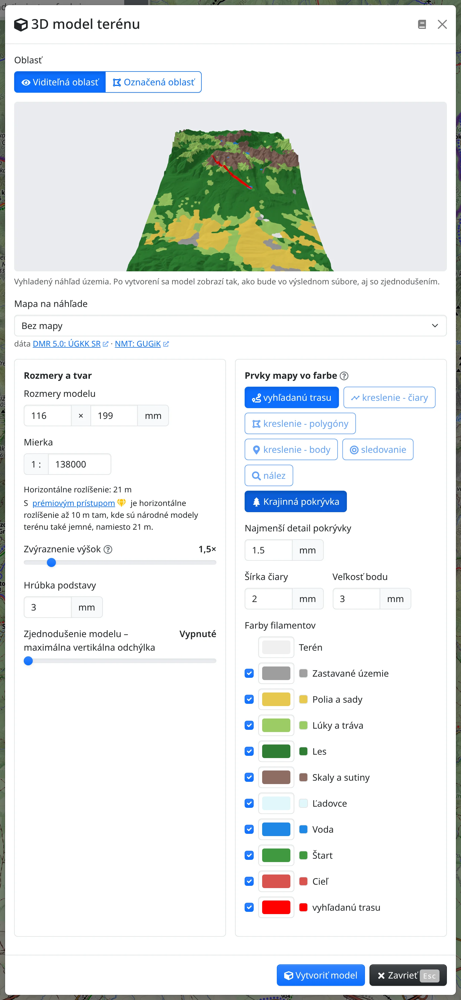

Z terénu ľubovoľného územia si môžete urobiť model na 3D tlačiareň – plný kváder s reliéfom navrchu, rovnými stenami a rovným dnom, s rozmermi v milimetroch. Otvorte :FaBars: **Hlavné menu** → :FaCube: **3D model terénu** (<kbd>e</kbd> <kbd>3</kbd>). Funkcia je experimentálna. Model sa vytvára vo vašom prehliadači z výškových dát Freemapu, preto potrebujete pripojenie na internet.

## Oblasť a náhľad

- **Oblasť** – :FaEye: **Viditeľná oblasť** je to, čo vidíte na obrazovke; pri :FaDrawPolygon: **Označená oblasť** dialóg ustúpi, na mape upravíte obdĺžnik a potvrdíte ho.
- 3D náhľad ukazuje územie tak, ako vyjde. Otáčate ho ťahaním, približujete kolieskom alebo roztiahnutím prstov. Kým model nevytvoríte, náhľad je vyhladený; zvýraznenie výšok a podstavu však sleduje hneď.
- **Mapa na náhľade** položí na náhľad mapu – napríklad letecké snímky –, aby ste sa vyznali, kde ste. Slúži len na prezeranie, do modelu sa nedostane.

## Rozmery a tvar

- **Rozmery modelu** (šírka × hĺbka v mm) a **Mierka** sú jedna hodnota v troch podobách: zmeníte jednu a ostatné sa prepočítajú. Hĺbka sa riadi tvarom oblasti; nová oblasť začína na 200 mm v dlhšej strane.
- **Horizontálne rozlíšenie** hovorí, ako ďaleko od seba sú body modelu v teréne. S [prémiovým prístupom](#show=manual/premium) môže byť model jemnejší tam, kde sú národné modely terénu také jemné; dialóg uvedie, o koľko jemnejší by tento model bol.
- **Zvýraznenie výšok** (1–5×) urobí reliéf strmší; pri 1 je verný mierke. Mierne zvýraznenie pomôže vyniknúť miernej krajine.
- **Hrúbka podstavy** je to, koľko materiálu je pod najnižším bodom.

Príliš veľkú oblasť dialóg odmietne so správou; priblížte mapu alebo označte menšiu oblasť.

## Prvky mapy vo farbe

Pre viacfarebnú tlačiareň môže model niesť prvky z mapy vo farbe – naplánovanú trasu, nakreslené čiary, plochy a body, sledované zariadenia a výsledky vyhľadávania –, každý vo farbe, akú má na mape. **Šírka čiary** a **Veľkosť bodu** určujú, aké široké sa vytlačia, v milimetroch na modeli.

**Krajinná pokrývka** vyfarbí terén pod nimi podľa toho, čo ho pokrýva: polia a sady, lúky a trávu, zastavané územie, les, skaly a sutiny, ľadovce a vodu. **Najmenší detail pokrývky** vyhladí pásy a škvrny užšie než táto hodnota, ktoré by sa vytlačili len ako šum.

**Farby filamentov** uvádzajú terén a každú použitú farbu, každú s filamentom, ktorým sa vytlačí. Ak dvom farbám priradíte ten istý filament, budú ho zdieľať; zrušením zaškrtnutia farby jej prvky z modelu vynecháte. Model s farbami sa stiahne ako 3MF, ktorý slicery ako Bambu Studio načítajú s farbami priradenými filamentom; OrcaSlicer a Snapmaker Orca načítajú, ktorým filamentom sa ktorá časť tlačí, a toľko filamentov aj ich farby nastavíte sami; bez nich je to obyčajný STL.

## Vytvorenie a stiahnutie

**Vytvoriť model** model vytvorí; náhľad ho potom ukáže presne tak, ako bude v súbore, a dialóg uvedie jeho výšku, počet trojuholníkov a veľkosť súboru. :FaDownload: **Stiahnuť STL** (alebo **Stiahnuť 3MF**) ho uloží. **Späť** vás vráti k nastaveniam.

**Zjednodušenie modelu – maximálna vertikálna odchýlka** zmenší súbor zlúčením trojuholníkov, pokiaľ povrch zostane v tejto výške od skutočného terénu. Malé hodnoty nič viditeľné nestoja; najväčšie dajú modelu zámerne hranatý, low-poly vzhľad.

## Zdroje

Pod hotovým modelom dialóg uvedie zdroje výškových dát a ďalších dát, ak ich model obsahuje. Keď model zverejníte alebo zdieľate, uveďte ich tak, ako sú tam napísané; potešíme sa aj zmienke o Freemape.
