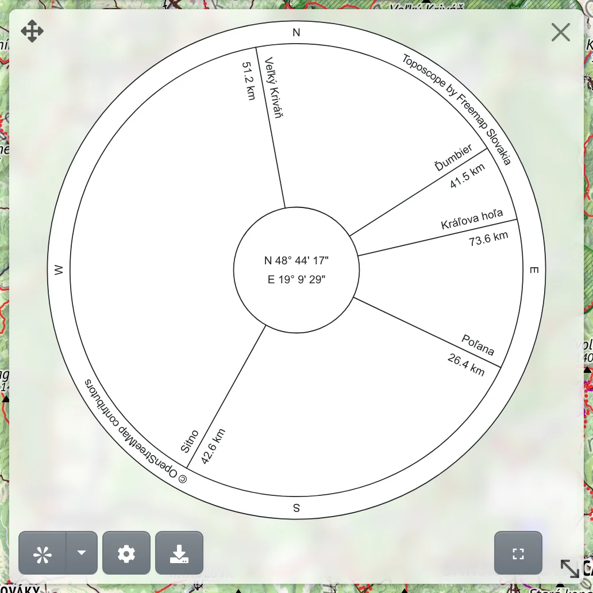

A toposcope is a dial of the surrounding points, like the ones on lookout towers and summits: from its centre, a ray points to each place, with its name and distance. On Freemap you make one from points drawn on the map, and you can download it as an image to print.

## Opening the toposcope

Choose :PiCompassRoseBold: **Toposcope** in the main menu, or press <kbd>g</kbd>, then <kbd>s</kbd>. The dial opens in a panel over the map.

## The centre

The centre is where the toposcope stands. Press **Place the centre**, the first button under the dial, and click the map. Under the arrow next to the button, :FaRegDotCircle: **Centre on my position** places the centre at your GPS position instead. Once the centre is placed, the same button is called **Move the centre**.

If points are already drawn on the map, you can also right-click a place, or press and hold it on a phone, and choose :PiCompassRoseBold: **Toposcope from here**.

The centre is an ordinary drawn point: you can drag it, label it or restyle it in the drawing tool. Its label is written in the middle of the dial – the coordinates of the place to start with. Deleting the centre point ends the toposcope.

## Points on the dial

Every other drawn point becomes a ray of the dial. Add them with the :MdShapeLine: **Drawing and data** tool, for example with :FaMapMarkerAlt: **Point** (<kbd>g</kbd> <kbd>p</kbd>), see [Drawing and measuring](#show=manual/drawing). The toposcope and the drawing tool can be open together, so the dial fills in as you add points.

Above each ray is the point's label, below it the elevation and distance from the centre. The elevation appears only if the point has one.

Click a ray to select its point on the map; if the point is hidden behind the panel or off the screen, the map moves to it. A click in the middle of the dial selects the centre point.

A dial of the peaks visible from a place is easiest to make from the [panorama](#show=manual/panorama), with :PiCompassRoseBold: **Create toposcope from this view**.

## The panel

Drag the panel by :FaArrowsAlt: to move it, and by :LuMoveDiagonal2: at the bottom right to resize it – the whole dial grows or shrinks with it. :MdFullscreen: **Fullscreen** shows the dial on the whole screen, :MdFullscreenExit: or <kbd>Esc</kbd> returns it to the panel.

## Settings

:FaCog: opens the [Toposcope](#show=toposcope-settings) settings, where you set:

- **First line** and **Second line** – what is written above and below each ray; the hint under the fields lists what they can contain,
- **Inscriptions** – four texts along the outer circle, one per quadrant, with the map credit and the portal's name to start with,
- **Scale** of the writing, **Outer circle radius** and **Inner circle radius**,
- **Prevent upside-down text** – turns the labels on the western half so they read the right way up.

The changes show on the dial at once; **Reset to default** restores the original settings.

## Download and sharing

:FaDownload: **Download as SVG** saves the dial as a vector image, which you can print at any size or edit further.

The centre and the other points are drawn points and the dial settings are part of the page address too, so you can share the whole toposcope simply by copying the link from the browser.
