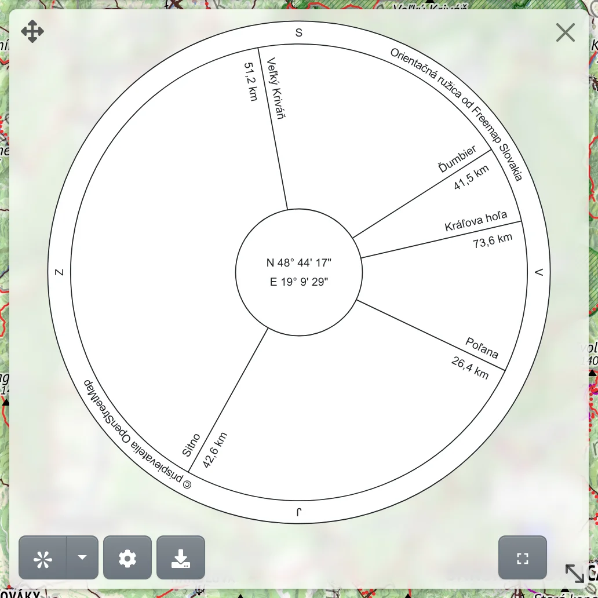

Orientačná ružica je kruhová tabuľa s okolitými bodmi, aká býva na rozhľadniach a vrcholoch: zo stredu vedie ku každému miestu lúč s názvom a vzdialenosťou. Vo Freemape ružicu zostavíte z bodov nakreslených na mape a môžete si ju stiahnuť ako obrázok na tlač.

## Otvorenie ružice

V hlavnom menu zvoľte :PiCompassRoseBold: **Orientačná ružica** alebo stlačte <kbd>g</kbd> a potom <kbd>s</kbd>. Ružica sa otvorí v paneli nad mapou.

## Stred

Stred je miesto, kde ružica stojí. Stlačte **Umiestniť stred**, prvé tlačidlo pod ružicou, a kliknite do mapy. V ponuke pod šípkou vedľa tlačidla položka :FaRegDotCircle: **Vystrediť na moju polohu** umiestni stred na vašu polohu z GPS. Keď je stred umiestnený, tlačidlo sa volá **Presunúť stred**.

Ak sú na mape už nakreslené body, môžete tiež kliknúť na miesto pravým tlačidlom myši, alebo na telefóne podržať prst na mieste, a zvoliť :PiCompassRoseBold: **Orientačná ružica odtiaľto**.

Stred je obyčajný kreslený bod: v nástroji kreslenia ho môžete presunúť, popísať alebo zmeniť štýl bodu. Popis bodu sa vypíše v strede ružice – na začiatku sú to súradnice miesta. Zmazaním stredového bodu ružica zanikne.

## Body na ružici

Z každého ďalšieho kresleného bodu sa stane lúč ružice. Body pridáte nástrojom :MdShapeLine: **Kreslenie a dáta**, napríklad cez :FaMapMarkerAlt: **Bod** (<kbd>g</kbd> <kbd>p</kbd>), pozri [Kreslenie a meranie](#show=manual/drawing). Ružica a nástroj kreslenia môžu byť otvorené naraz, takže lúče pribúdajú hneď, ako pridávate body.

Nad lúčom je popis bodu, pod lúčom nadmorská výška a vzdialenosť od stredu. Výška sa zobrazí, len ak ju bod má.

Kliknutím na lúč vyberiete príslušný bod na mape; ak je bod skrytý za panelom alebo mimo obrazovky, mapa sa k bodu posunie. Kliknutím do stredu ružice vyberiete stredový bod.

Ružicu s vrcholmi viditeľnými z určitého miesta najľahšie vytvoríte z [panorámy](#show=manual/panorama) tlačidlom :PiCompassRoseBold: **Vytvoriť orientačnú ružicu z tohto výhľadu**.

## Panel

Panel presuniete ťahaním za :FaArrowsAlt: a veľkosť zmeníte ťahaním za :LuMoveDiagonal2: vpravo dole – celá ružica sa zväčší alebo zmenší spolu s panelom. :MdFullscreen: **Na celú obrazovku** zobrazí ružicu na celej obrazovke, :MdFullscreenExit: alebo <kbd>Esc</kbd> ju vráti do panela.

## Nastavenia

:FaCog: otvorí nastavenia [Orientačná ružica](#show=toposcope-settings), kde nastavíte:

- **Prvý riadok** a **Druhý riadok** – čo sa píše nad lúč a pod lúč; čo v nich môže byť, uvádza nápoveda pod poľami,
- **Vlastné texty** – štyri texty pozdĺž vonkajšej kružnice, jeden v každej štvrtine; na začiatku je tam zdroj mapy a názov portálu,
- **Mierka** písma, **Polomer vonkajšej kružnice** a **Polomer vnútornej kružnice**,
- **Zabrániť textu dole hlavou** – popisy na západnej polovici sa otočia tak, aby sa dali čítať.

Zmeny sa na ružici prejavia hneď; **Obnoviť predvolené** vráti pôvodné nastavenia.

## Stiahnutie a zdieľanie

:FaDownload: **Stiahnuť ako SVG** uloží ružicu ako vektorový obrázok, ktorý môžete vytlačiť v ľubovoľnej veľkosti alebo ďalej upraviť.

Stred aj ostatné body sú kreslené body a nastavenia ružice sú tiež súčasťou adresy stránky, takže celú ružicu zdieľate jednoducho skopírovaním odkazu z prehliadača.
