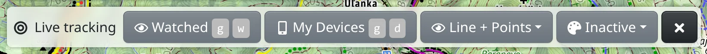

Se sledováním vidíte na mapě, kde se právě nachází telefon nebo GPS tracker, spolu s cestou, kterou urazil. Můžete tak sdílet svou polohu s ostatními a sledovat zařízení, která s vámi sdílejí jiní.

Otevřete ho v :FaBars: hlavním menu jako :FaBullseye: **Sledování** nebo klávesami <kbd>g</kbd> <kbd>t</kbd>.

## Panel nástrojů



- :FaRegEye: **Sledované** – zařízení, která sledujete (<kbd>g</kbd> <kbd>w</kbd>).
- :FaMobileAlt: **Moje zařízení** – vaše vlastní zařízení, která odesílají svou polohu (<kbd>g</kbd> <kbd>d</kbd>). Vyžaduje přihlášení.
- :FaRegEye: **Zobrazení** – trasy se kreslí jako **Body**, **Křivka** nebo **Křivka + body**.
- :FaPalette: **Obarvit podle** – obarví trasy podle zaznamenané hodnoty, například nadmořské výšky, rychlosti nebo času. Nabízejí se jen hodnoty, které trasy obsahují; některé režimy vyžadují prémiový přístup.
- :FaChartArea: **Výškový profil** – zobrazí se, když trasa obsahuje nadmořskou výšku.
- :FaEllipsisV: – :MdShapeLine: **Kopírovat do nástroje Kreslení a data** vytvoří upravitelnou kopii tras, kterou pak můžete exportovat. Sledování pokračuje.

## Sdílení vlastní polohy

1. Přihlaste se a otevřete :FaMobileAlt: **Moje zařízení**.
2. Stiskněte :FaPlus: **Přidat nové** a zadejte **Název**. Pole **Sledovací token** nechte prázdné, vygeneruje se po uložení. **Maximální počet** a **Maximální doba** omezují, kolik poloh se uchovává a jak dlouho.
3. Nastavte telefon nebo tracker s tokenem zařízení – v seznamu je uveden před názvem zařízení. Viz následující část.
4. Má-li vás někdo sledovat, vyberte v menu zařízení :FaKey: **Sledovací tokeny** a stiskněte :FaPlus: **Přidat nové**. **Od** a **Do** omezují období, na které se token vztahuje, a **Poznámka** slouží k zaznamenání toho, komu jste ho dali. Pošlete mu token nebo odkaz, který otevře mapu s vaším zařízením; odkaz zkopírujete tlačítkem :FaClipboard: **Kopírovat URL**.

Token zařízení si nechte pro sebe – kdokoli, kdo ho má, může jménem vašeho zařízení posílat polohy. Sdílejte raději sledovací tokeny: každému můžete vytvořit samostatný a jeho smazáním sdílení ukončíte.

## Nastavení zařízení

### HTTP protokol Freemapu

Použijte ho s aplikacemi jako [Locus Map](https://docs.locusmap.eu/doku.php?id=manual:user_guide:functions:live_tracking#custom_live_tracking) nebo [OsmAnd](https://osmand.net/docs/user/plugins/trip-recording/#recording-settings) (zapněte **Online tracking** v nastavení Trip Recording). Jako URL sledování v aplikaci nastavte:

```
https://backend.freemap.sk/tracking/track/{token}
```

Místo `{token}` dosaďte token zařízení z :FaMobileAlt: [Mých zařízení](#show=tracking-my).

Adresa přijímá HTTP `GET` nebo `POST` s těmito parametry:

| Parametr | Popis |
|---|---|
| `location` | Zeměpisná šířka a délka ve stupních oddělené čárkou **(povinné, nebo `lat` a `lon`)** |
| `lat` | Zeměpisná šířka ve stupních |
| `lon` | Zeměpisná délka ve stupních |
| `time`, `timestamp` | Datum a čas, který umí zpracovat JavaScript, nebo Unix čas v sekundách nebo milisekundách |
| `alt`, `altitude` | Nadmořská výška v metrech |
| `speed` | Rychlost v m/s |
| `speedKmh` | Rychlost v km/h |
| `acc`, `accuracy` | Přesnost v metrech |
| `hdop` | Horizontální DOP |
| `bearing`, `heading` | Směr ve stupních |
| `battery`, `batt` | Úroveň baterie v procentech |
| `gsm_signal` | Síla GSM signálu v procentech |
| `message` | Poznámka / zpráva |

### Traccar

Použijte ho s aplikací [Traccar Client](https://www.traccar.org/client/), s hardwarovými GPS trackery (do auta, ke sledování majetku, pro zvířata) nebo s jinými aplikacemi kompatibilními s Traccarem. Pro Locus Map a OsmAnd se doporučuje HTTP protokol Freemapu uvedený výše.

- **Server:** `traccar.freemap.sk`
- **Port:** standardní port protokolu vašeho zařízení (viz [seznam zařízení Traccar](https://www.traccar.org/devices/) – Traccar podporuje více než 200 protokolů); pro HTTP nebo HTTPS můžete místo 5055 použít port **80** nebo **443**
- **Identifikátor zařízení:** token vašeho zařízení

Pro Traccar Client existuje zkratka: :SiTraccar: **Traccar QR kód** v menu zařízení zobrazí kód; jeho naskenováním v aplikaci ji nastavíte s tokenem vašeho zařízení.

## Sledování zařízení

1. Otevřete :FaRegEye: **Sledované** a stiskněte :FaPlus: **Přidat nové**.
2. Zadejte **Sledovací token**, který jste dostali. Volitelné jsou **Název**, **Barva** a **Šířka** čáry a pole, která určují, které polohy se zobrazí: **Od**, **Maximální doba**, **Maximální počet**. **Rozdělit po vzdálenosti** a **Rozdělit po době** přeruší čáru tam, kde jsou dvě polohy od sebe dál nebo déle, než je zadáno.
3. Stiskněte :FaCheck: **Uložit**. Zařízení se objeví na mapě.

Odkaz, který s vámi někdo sdílel, otevře mapu již se sledováním jeho zařízení. Sledovat můžete i vlastní zařízení: :FaRegEye: **Sledovat** v seznamu sledovacích tokenů zařízení.

Seznam sledovaných zařízení je uložen jen v adrese stránky. Chcete-li si ho ponechat, uložte mapu do :FaRegMap: [Mých map](#show=my-maps).

## Zařízení na mapě

Každé zařízení se kreslí svou barvou, jeho poslední poloha je označena postavičkou a – pokud zařízení posílá přesnost – kruhem přesnosti. Polohy přibývají tak, jak je zařízení odesílá. Po ukázání na polohu se zobrazí její čas a – pokud je zařízení posílá – nadmořská výška, rychlost, signál, baterie a zpráva.

Kliknutím na trasu ji vyberete a na liště výběru najdete :FaPencil: **Upravit**, :FaTrash: **Smazat**, kterým sledování ukončíte, a :FaEllipsisV: ke zkopírování jen této trasy do nástroje Kreslení a data.

## GPS záznamník

Na Androidu slouží :FaCircle: **GPS záznamník** v hlavním menu k nahrávání vaší vlastní trasy pomocí samostatné aplikace Freemap GPS Recorder, takže záznam pokračuje, i když prohlížeč zavřete. Popisuje ho kapitola [GPS záznamník](#show=manual/gps-recorder).
