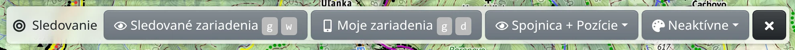

So sledovaním vidíte na mape, kde sa práve nachádza telefón alebo GPS tracker, spolu s cestou, ktorú prešiel. Môžete tak zdieľať svoju polohu s ostatnými a sledovať zariadenia, ktoré s vami zdieľajú iní.

Otvoríte ho v :FaBars: hlavnom menu ako :FaBullseye: **Sledovanie** alebo klávesmi <kbd>g</kbd> <kbd>t</kbd>.

## Nástrojová lišta



- :FaRegEye: **Sledované zariadenia** – zariadenia, ktoré sledujete (<kbd>g</kbd> <kbd>w</kbd>).
- :FaMobileAlt: **Moje zariadenia** – vaše vlastné zariadenia, ktoré odosielajú svoju polohu (<kbd>g</kbd> <kbd>d</kbd>). Vyžaduje prihlásenie.
- :FaRegEye: **Zobrazenie** – trasy sa kreslia ako **Pozície**, **Spojnica** alebo **Spojnica + Pozície**.
- :FaPalette: **Vyfarbiť podľa** – vyfarbí trasy podľa zaznamenanej hodnoty, napríklad nadmorskej výšky, rýchlosti alebo času. Ponúkajú sa len hodnoty, ktoré trasy obsahujú; niektoré režimy vyžadujú prémiový prístup.
- :FaChartArea: **Výškový profil** – zobrazí sa, keď trasa obsahuje nadmorskú výšku.
- :FaEllipsisV: – :MdShapeLine: **Kopírovať do Kreslenie a dáta** vytvorí upraviteľnú kópiu trás, ktorú potom môžete exportovať. Sledovanie pokračuje ďalej.

## Zdieľanie vlastnej polohy

1. Prihláste sa a otvorte :FaMobileAlt: **Moje zariadenia**.
2. Stlačte :FaPlus: **Pridať nové** a zadajte **Názov**. Pole **Token** nechajte prázdne, vygeneruje sa po uložení. **Maximálny počet pozícií** a **Najstaršia pozícia** obmedzujú, koľko pozícií a ako dlho sa uchováva.
3. Nastavte telefón alebo tracker s tokenom zariadenia – v zozname je uvedený pred názvom zariadenia. Pozrite nasledujúcu časť.
4. Ak vás má niekto sledovať, v menu zariadenia vyberte :FaKey: **Sledovacie tokeny** a stlačte :FaPlus: **Pridať nové**. **Od** a **Do** obmedzujú obdobie, na ktoré sa token vzťahuje, a **Poznámka** slúži na zaznamenanie toho, komu ste ho dali. Pošlite mu token alebo odkaz skopírovaný tlačidlom :FaClipboard: **Kopírovať URL**, ktorý otvorí mapu s vaším zariadením.

Token zariadenia si nechajte pre seba – ktokoľvek, kto ho má, môže v mene vášho zariadenia posielať polohy. Zdieľajte radšej sledovacie tokeny: každému môžete vytvoriť samostatný a zmazaním tokenu zdieľanie ukončíte.

## Nastavenie zariadenia

### HTTP protokol Freemapu

Použite ho s aplikáciami ako [Locus Map](https://docs.locusmap.eu/doku.php?id=manual:user_guide:functions:live_tracking#custom_live_tracking) alebo [OsmAnd](https://osmand.net/docs/user/plugins/trip-recording/#recording-settings) (zapnite **Online tracking** v nastaveniach Trip Recording). Ako URL sledovania v aplikácii nastavte:

```
https://backend.freemap.sk/tracking/track/{token}
```

Namiesto `{token}` dosaďte token zariadenia z :FaMobileAlt: [Mojich zariadení](#show=tracking-my).

Adresa prijíma HTTP `GET` alebo `POST` s týmito parametrami:

| Parameter | Popis |
|---|---|
| `location` | Zemepisná šírka a dĺžka v stupňoch oddelené čiarkou **(povinné, alebo `lat` a `lon`)** |
| `lat` | Zemepisná šírka v stupňoch |
| `lon` | Zemepisná dĺžka v stupňoch |
| `time`, `timestamp` | Dátum a čas parsovateľný JavaScriptom alebo Unix čas v sekundách alebo milisekundách |
| `alt`, `altitude` | Nadmorská výška v metroch |
| `speed` | Rýchlosť v m/s |
| `speedKmh` | Rýchlosť v km/h |
| `acc`, `accuracy` | Presnosť v metroch |
| `hdop` | Horizontálna DOP |
| `bearing`, `heading` | Smer v stupňoch |
| `battery`, `batt` | Úroveň batérie v percentách |
| `gsm_signal` | Sila GSM signálu v percentách |
| `message` | Poznámka / správa |

### Traccar

Použite ho s aplikáciou [Traccar Client](https://www.traccar.org/client/), s hardvérovými GPS trackermi (do auta, na majetok, pre zvieratá) alebo s inými aplikáciami kompatibilnými s Traccarom. Pre Locus Map a OsmAnd sa odporúča HTTP protokol Freemapu uvedený vyššie.

- **Server:** `traccar.freemap.sk`
- **Port:** štandardný port protokolu vášho zariadenia (pozrite [zoznam zariadení Traccar](https://www.traccar.org/devices/) – Traccar podporuje viac ako 200 protokolov); pre HTTP alebo HTTPS môžete namiesto 5055 použiť port **80** alebo **443**
- **Identifikátor zariadenia:** token vášho zariadenia

Pre Traccar Client existuje skratka: :SiTraccar: **Traccar QR kód** v menu zariadenia zobrazí kód; naskenovaním kódu v aplikácii ju nastavíte s tokenom vášho zariadenia.

## Sledovanie zariadení

1. Otvorte :FaRegEye: **Sledované zariadenia** a stlačte :FaPlus: **Pridať nové**.
2. Zadajte **Token sledovania**, ktorý ste dostali. Voliteľné sú **Popisok**, **Farba** a **Šírka** čiary a polia, ktoré určujú, ktoré pozície sa zobrazia: **Pozície od**, **Najstaršia pozícia**, **Maximálny počet pozícií**. **Vzdialenosť na rozdelenie** a **Pauza na rozdelenie** prerušia čiaru tam, kde sú dve pozície od seba ďalej alebo dlhšie, než je zadané.
3. Stlačte :FaCheck: **Uložiť**. Zariadenie sa objaví na mape.

Odkaz, ktorý s vami niekto zdieľal, otvorí mapu už so sledovaním jeho zariadenia. Sledovať môžete aj vlastné zariadenia: :FaRegEye: **Sledovať** v zozname sledovacích tokenov zariadenia.

Zoznam sledovaných zariadení je uložený len v adrese stránky. Ak si ho chcete ponechať, uložte mapu do :FaRegMap: [Mojich máp](#show=my-maps).

## Zariadenia na mape

Každé zariadenie sa kreslí svojou farbou, posledná pozícia zariadenia je označená postavičkou a – ak ju zariadenie posiela – kruhom presnosti. Pozície pribúdajú tak, ako ich zariadenie odosiela. Ukázaním na pozíciu sa zobrazí čas pozície a – ak ich zariadenie posiela – nadmorská výška, rýchlosť, signál, batéria a správa.

Kliknutím na trasu ju vyberiete a na lište výberu nájdete :FaPencil: **Upraviť**, :FaTrash: **Zmazať**, ktorým sledovanie ukončíte, a :FaEllipsisV: na skopírovanie len tejto trasy do Kreslenia a dát.

## GPS zaznamenávač

Na Androide slúži :FaCircle: **GPS zaznamenávač** v hlavnom menu na nahrávanie vašej vlastnej trasy pomocou samostatnej aplikácie Freemap GPS Recorder, takže záznam pokračuje, aj keď prehliadač zatvoríte. Ak aplikácia nie je nainštalovaná, môžete ju nainštalovať cez **Nainštalovať zaznamenávač**.

- :FaCircle: **Nahrávať** / :FaPause: **Pozastaviť** spúšťa a pozastavuje záznam.
- :FaStop: **Ukončiť** presunie trasu do Kreslenia a dát, kde ju môžete upraviť a exportovať.
- :FaTrash: **Zmazať záznam** ho zahodí.
- :FaCog: **Nastavenia záznamu** určujú, ako často sa poloha zaznamenáva, ako vyzerá čiara a ďalšie.
