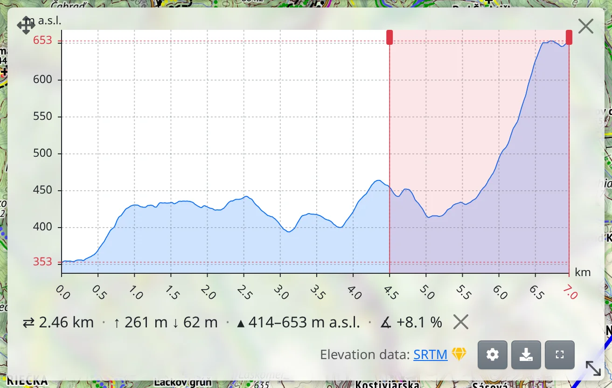
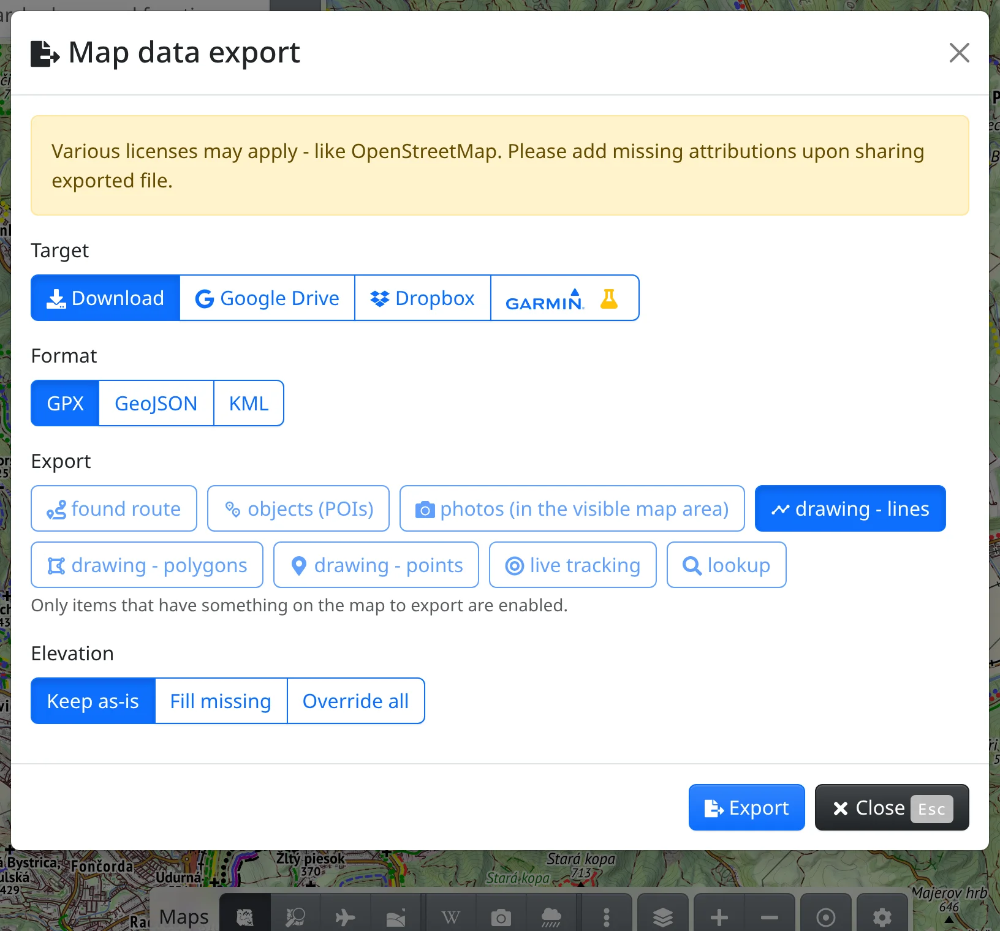

In Freemap you can view tracks from your GPS device, watch or another app, see their elevation profile, color them by elevation or speed and export them again. All of this lives in the :MdShapeLine: **Drawing and data** tool – the same one you draw with, see [Drawing](#show=manual/drawing).

## Opening a file

- Drop the file anywhere on the map.
- Or open :FaBars: **Main menu** → :MdShapeLine: **Drawing and data** (<kbd>g</kbd> <kbd>g</kbd>) and press :FaUpload: **Upload** in its toolbar. In the **Import file** dialog, drop the files or click to pick them.

GPX, KML, KMZ, TCX and GeoJSON files are read, and several can be opened at once. When something is already on the map, you choose whether to **Append** the new data or **Replace** what is there.

## What you see

Tracks are drawn as lines – a recorded track with a start and a finish marker – and waypoints as points with their names. A file with a single track opens with that track selected; any other line is selected by clicking it. The selected line gets a toolbar of its own:

- :FaChartArea: **Elevation profile** – see below.
- :FaInfoCircle: **More info** – distance, total climb and descent, the lowest and highest point and, for a recording, its start and finish time, duration and average speed.

A small track is kept in the page address, so you share it along with the link. A large one stays only in this browser and the toolbar shows the :FaExclamationTriangle.text-warning: warning that it is not saved; you keep it with :FaEllipsisV: → :FaSave: **Save to my maps** (you need to be logged in).

## Elevation profile

:FaChartArea: **Elevation profile** opens a chart of the selected line with its total climb and descent. It stays open until you close it, also when you edit the line.

- Point at the chart, and the place is marked on the map with its distance, elevation, climb so far and steepness. Pointing at the line on the map works the other way round.
- The mouse wheel or a pinch zooms the chart; once zoomed, dragging moves along it.
- Hold <kbd>Shift</kbd> and drag (on a touch screen press, hold, then drag) to mark a **stretch**: you get its length, climb, descent and steepness. Drag its edges to adjust it, the × clears it.

Below the chart are :FaMapMarkerAlt: **Show waypoints**, :FaCog: **Elevation preferences** and :FaDownload: **Download as SVG**.

## Elevation

The elevation of a drawn line, or of one imported without times, always comes from the terrain model. When a recorded track is missing some elevation, you are asked before it is used in the profile or colors: **Override all** from the terrain model, **Fill missing** only, or **Leave unchanged**.

You can change your mind any time in the toolbar's :FaEllipsisV: menu → :FaMountain: **Update elevation**. With [premium access](#show=premium) the elevation comes from detailed national terrain models where they exist.

## Colorizing

:FaPalette: **Colorize by** in the toolbar colors the lines – for example by elevation, steepness, speed or heart rate. Choices the track has no data for are greyed out; **Elevation**, **Speed** and **Time** are free, the ones marked :FaGem.text-warning: need [premium access](#show=premium). **Legend** at the top of the list shows the color scale; point at it to read the exact value.

Surface, road type or hiking difficulty become available once the track has been matched to the path network: :FaEllipsisV: → :FaMagic: **Match to paths** in the line's toolbar. Matching replaces the recorded points, so their times and sensor data are lost.

## Export

With :FaBars: **Main menu** → :FaFileExport: **Map data export** (<kbd>e</kbd> <kbd>g</kbd>) you save what is on the map to a file:

- **Target** – :FaDownload: **Download**, :FaShareAlt: **Share** to another app (where the browser can), Google Drive, Dropbox, or a course to Garmin Connect, for which you need a single line and a connected Garmin account.
- **Format** – GPX, GeoJSON or KML.
- **Export** – what to include; only what is on the map can be chosen. With a feature selected, **Only the selected item** narrows it to that one.
- **Elevation** – **Keep as-is**, **Fill missing** or **Override all** from the terrain model.

Then press :FaFileExport: **Export**. Opened again in Freemap, the file comes back with its colors, icons and labels.
