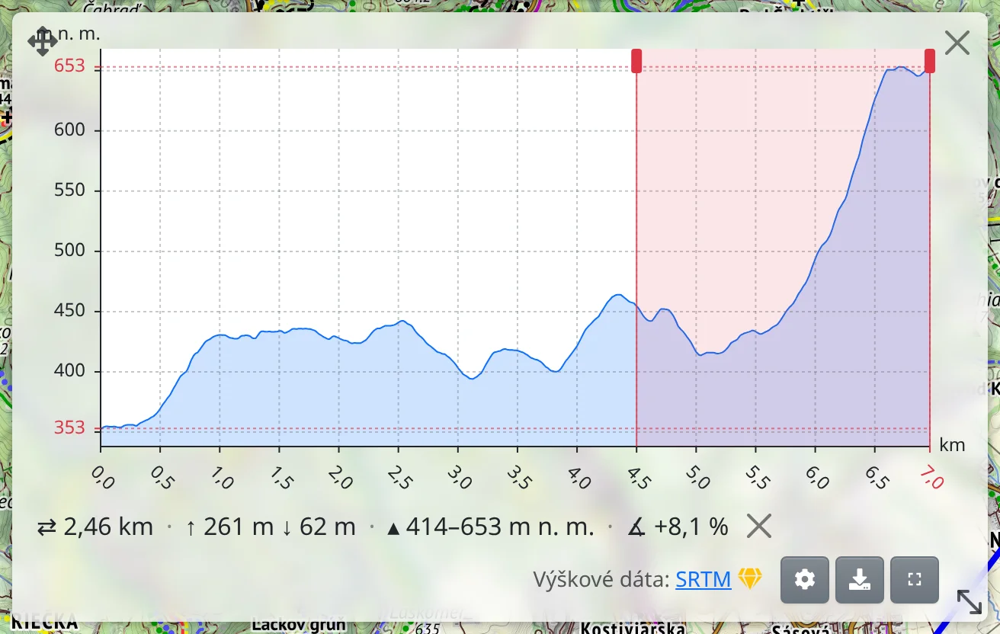
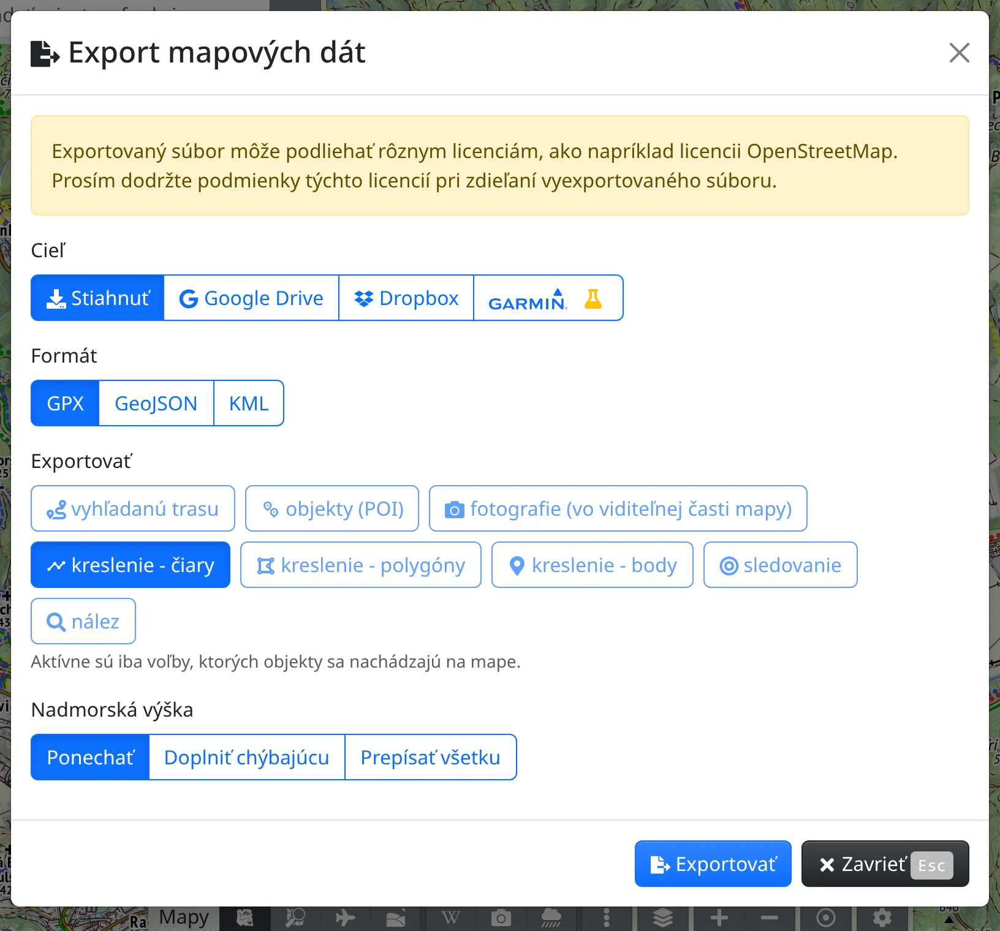

Vo Freemape si môžete zobraziť trasy z GPS prístroja, hodiniek či inej aplikácie, pozrieť si ich výškový profil, vyfarbiť ich podľa výšky alebo rýchlosti a opäť ich vyexportovať. Na to všetko slúži nástroj :MdShapeLine: **Kreslenie a dáta** – ten istý, ktorým sa kreslí, pozri [Kreslenie](#show=manual/drawing).

## Otvorenie súboru

- Pretiahnite súbor kamkoľvek na mapu.
- Alebo otvorte :FaBars: **Hlavné menu** → :MdShapeLine: **Kreslenie a dáta** (<kbd>g</kbd> <kbd>g</kbd>) a na lište nástroja stlačte :FaUpload: **Nahrať**. V dialógu **Importovať súbor** súbory pustite alebo ich vyberte kliknutím.

Otvoriť môžete súbory GPX, KML, KMZ, TCX a GeoJSON, aj viacero naraz. Ak už na mape niečo je, zvolíte, či nové údaje **Pripojiť**, alebo existujúce **Nahradiť**.

## Čo uvidíte

Trasy sa zobrazia ako čiary – záznam trasy so značkou štartu a cieľa – a trasové body ako body s názvami. Súbor s jedinou trasou sa otvorí s touto trasou vybranou; inú čiaru vyberiete kliknutím. K vybranej čiare sa zobrazí jej lišta:

- :FaChartArea: **Výškový profil** – pozri nižšie.
- :FaInfoCircle: **Viac info** – vzdialenosť, celkové stúpanie a klesanie, najnižší a najvyšší bod a pri zázname aj čas štartu a príchodu do cieľa, trvanie a priemerná rýchlosť.

Malá trasa sa uchováva v adrese stránky, takže ju zdieľate spolu s odkazom. Veľká zostáva len v tomto prehliadači a na lište sa zobrazí výstraha :FaExclamationTriangle.text-warning:, že trasa nie je uložená; uchováte ju cez :FaEllipsisV: → :FaSave: **Uložiť do mojich máp** (treba byť prihlásený).

## Výškový profil

:FaChartArea: **Výškový profil** otvorí graf vybranej čiary s celkovým stúpaním a klesaním. Zostane otvorený, kým ho nezatvoríte, aj keď čiaru upravujete.

- Keď ukážete na graf, miesto sa vyznačí na mape spolu so vzdialenosťou, nadmorskou výškou, doterajším stúpaním a sklonom. Ukázanie na čiaru na mape funguje opačne.
- Kolieskom myši alebo roztiahnutím prstov graf priblížite, priblížený posuniete ťahaním.
- Podržte <kbd>Shift</kbd> a potiahnite (na dotykovej obrazovke podržte prst a potom potiahnite) – vyznačíte **úsek** a uvidíte dĺžku, stúpanie, klesanie a sklon úseku. Okraje úseku sa dajú posúvať, × ho zruší.

Pod grafom sú :FaMapMarkerAlt: **Zobraziť trasové body**, :FaCog: **Predvoľby nadmorskej výšky** a :FaDownload: **Stiahnuť ako SVG**.

## Nadmorská výška

Výška nakreslenej čiary, ako aj čiary importovanej bez časov, sa berie vždy z modelu terénu. Keď v zázname trasy časť výšky chýba, pred použitím výšky v profile či vo vyfarbení sa zobrazí otázka: **Prepísať všetko** z modelu terénu, **Doplniť chýbajúce**, alebo **Nič nemeniť**.

Rozhodnutie môžete kedykoľvek zmeniť v ponuke :FaEllipsisV: na lište → :FaMountain: **Aktualizovať výšku**. S [prémiovým prístupom](#show=premium) sa výška berie z podrobných národných modelov terénu, kde existujú.

## Vyfarbenie

:FaPalette: **Vyfarbiť podľa** na lište vyfarbí čiary – napríklad podľa nadmorskej výšky, sklonu, rýchlosti či tepovej frekvencie. Voľby, pre ktoré trasa nemá údaje, sú sivé; **Nadmorská výška**, **Rýchlosť** a **Čas** sú zadarmo, voľby so značkou :FaGem.text-warning: vyžadujú [prémiový prístup](#show=premium). **Legenda** na začiatku zoznamu zobrazí farebnú stupnicu; ukázaním na stupnicu zistíte presnú hodnotu.

Povrch, typ cesty či náročnosť pešo sú k dispozícii, keď trasu priradíte k sieti ciest: :FaEllipsisV: → :FaMagic: **Priradiť k cestám** na lište čiary. Priradenie nahradí zaznamenané body, takže ich časy a údaje zo senzorov sa stratia.

## Export

Cez :FaBars: **Hlavné menu** → :FaFileExport: **Export mapových dát** (<kbd>e</kbd> <kbd>g</kbd>) uložíte to, čo je na mape, do súboru:

- **Cieľ** – :FaDownload: **Stiahnuť**, :FaShareAlt: **Zdieľať** do inej aplikácie (ak to prehliadač dovoľuje), Google Drive, Dropbox alebo kurz do Garmin Connect, na ktorý treba jednu čiaru a pripojený účet Garmin.
- **Formát** – GPX, GeoJSON alebo KML.
- **Exportovať** – čo sa má zahrnúť; vybrať sa dá len to, čo je na mape. Keď je vybraný prvok, **Iba vybraný prvok** obmedzí export na tento prvok.
- **Nadmorská výška** – **Ponechať**, **Doplniť chýbajúcu** alebo **Prepísať všetku** z modelu terénu.

Potom stlačte :FaFileExport: **Exportovať**. Súbor otvorený znova vo Freemape sa vráti s farbami, ikonami aj popismi.
