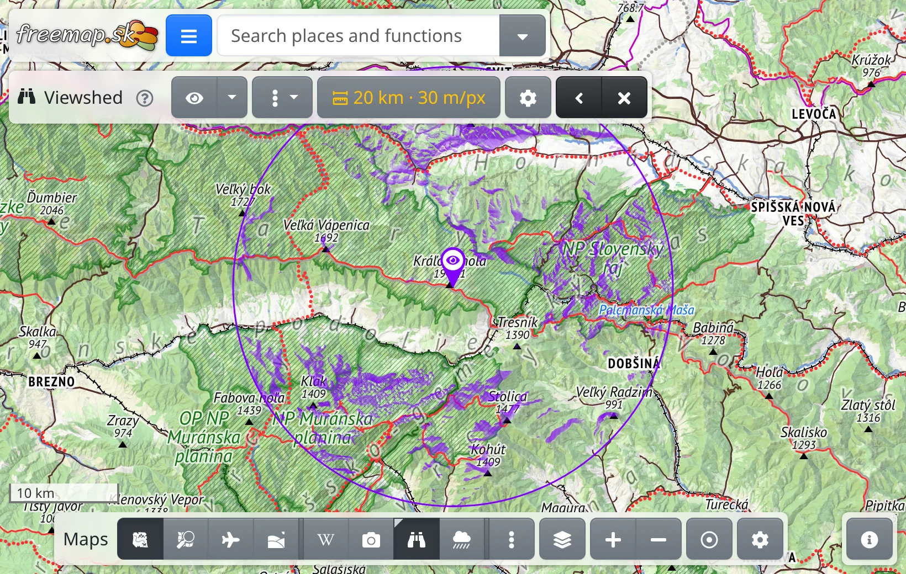
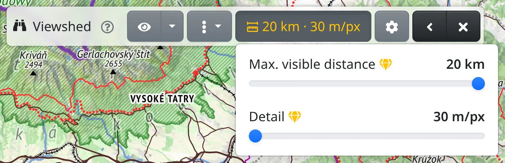

The viewshed shows what can be seen from one point on the map: the ground visible from there is coloured, the hidden ground stays as it is. It is useful for choosing a lookout, checking where a summit can be seen from, or where a mast would be visible from.

The viewshed is computed on the server from the terrain model, so it needs an internet connection and takes a few seconds.

## Switching it on

The viewshed is an overlay. Switch it on in any of these ways:

- in the maps menu :FaEllipsisV: on the maps bar at the bottom, see [Maps](#show=manual/maps),
- with <kbd>Shift</kbd>+<kbd>V</kbd>,
- by typing "viewshed" into the search box,
- from the map: right-click a place, or press and hold it on a phone, and choose :FaBinoculars: **Viewshed from here**. The viewshed is then computed for that place straight away.

When the viewshed has no viewpoint yet, the map shows **Click the map where you want to look from**. Click the place to look from; <kbd>Esc</kbd> cancels.

## The viewpoint

The viewpoint is marked by a pin with an eye, and the circle around it shows how far the viewshed reaches.

- :FaEye: **Pick on the map** in the toolbar lets you click another viewpoint, which is computed straight away. Under the arrow next to it, :FaRegDotCircle: **Viewshed from my position** uses your GPS position.
- Drag the pin to move the viewpoint. Dragging does not compute anything: the circle turns dashed, the previous viewpoint stays on the map faded, and :FaSync: **Update** appears in the toolbar.
- The :FaEllipsisV: menu next to it holds the same actions for the viewpoint as the map's context menu.

The result is very sensitive to the exact viewpoint: a few metres off a summit can hide whole directions. Place the pin right on the top.

## The toolbar

While the viewshed is on, its toolbar is at the top of the screen.

- :TbRulerMeasure: shows the range and the detail, as the ground one pixel covers. Its menu has two sliders: **Max. visible distance** and **Detail**. A finer detail takes longer to compute.
- :FaCog: **Viewshed settings** opens the other settings, see below.
- While computing, the toolbar shows the seconds elapsed, or how many renders are ahead of yours; **Cancel** stops the computation.
- :FaSync: **Update** appears whenever the coloured area belongs to another viewpoint or other settings. Changes to the range, detail or settings take effect only after you press it.
- :FaAngleLeft: collapses the toolbar so it doesn't cover the map, :FaTimes: switches the viewshed off.

:FaRegQuestionCircle: next to the name says what the viewshed doesn't take into account – mainly that the terrain model is bare earth: forests and buildings are not in it, so ground a forest would hide counts as visible.

## Viewshed settings

:FaCog: [**Viewshed settings**](#show=viewshed-settings) holds:

- **Eye height** – how high above the ground you stand, for example on a lookout tower.
- **Target height** – how tall the thing you are looking at is. Raise it to see where a mast or a person on a ridge could be seen from.
- **Strength** – a slope facing you is coloured fully, ground seen almost edge-on very faintly. Raising the strength makes the faint parts more visible.
- **Minimum opacity** – how strongly even the faintest visible ground is coloured. At 100 % the viewshed only says visible or not visible.
- **Colour** of the viewshed, the pin and the circle.

**Save** keeps the changes, **Reset to default** returns the defaults. Saved settings take effect after :FaSync: **Update**.

## Sharing

The viewpoint and the range are part of the page address. Whoever opens the link sees the viewshed from the same place – it is computed again on opening.

## With premium

Without [premium](#show=premium) the range is at most 20 km, and the detail is limited by the range – a shorter viewshed allows a finer detail. Options that need premium are marked :FaGem.text-warning:, and the range button is yellow without premium. Premium adds:

- a range up to 300 km,
- every level of detail at any range.

To see the surroundings as a picture of the skyline instead, use the [Panorama](#show=manual/panorama).
