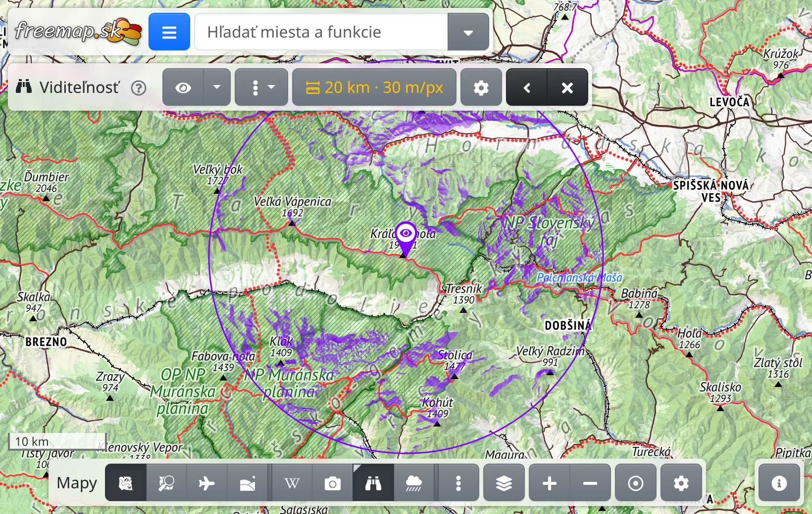
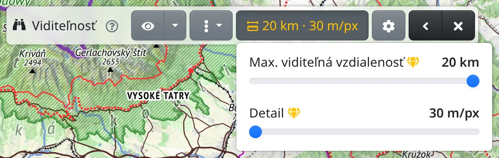

Vrstva Viditeľnosť ukazuje, čo vidno z jedného bodu na mape: viditeľný terén je zafarbený, skrytý terén zostáva bez zmeny. Hodí sa na výber vyhliadky, na zistenie, odkiaľ vidno vrchol, alebo odkiaľ by bolo vidieť stožiar.

Viditeľnosť sa počíta na serveri z modelu terénu, preto vyžaduje pripojenie na internet a výpočet trvá niekoľko sekúnd.

## Zapnutie

Viditeľnosť je prekryvná vrstva. Zapnete ju ktorýmkoľvek z týchto spôsobov:

- v ponuke máp :FaEllipsisV: na lište máp dole, pozri [Mapy](#show=manual/maps),
- klávesmi <kbd>Shift</kbd>+<kbd>V</kbd>,
- zadaním slova „viditeľnosť“ alebo „výhľad“ do vyhľadávacieho poľa,
- priamo z mapy: kliknite na miesto pravým tlačidlom myši, alebo na telefóne podržte prst na mieste, a zvoľte :FaBinoculars: **Viditeľnosť odtiaľto**. Viditeľnosť sa z tohto miesta hneď vypočíta.

Kým vrstva nemá stanovisko, na mape sa zobrazí výzva **Kliknite do mapy tam, odkiaľ sa chcete pozerať**. Kliknite na miesto, odkiaľ sa chcete pozerať; kláves <kbd>Esc</kbd> výber zruší.

## Stanovisko

Stanovisko označuje špendlík s okom a kruh okolo stanoviska ukazuje dosah viditeľnosti.

- :FaEye: **Vybrať v mape** na lište slúži na kliknutie iného stanoviska, z ktorého sa viditeľnosť hneď vypočíta. Pod šípkou vedľa tlačidla je :FaRegDotCircle: **Viditeľnosť z mojej polohy**, ktorá použije vašu polohu z GPS.
- Ťahaním špendlíka stanovisko presuniete. Presunutím sa nič nepočíta: kruh sa zmení na prerušovaný, predchádzajúce stanovisko zostane na mape vyblednuté a na lište sa zobrazí :FaSync: **Aktualizovať**.
- :FaEllipsisV: vedľa tlačidla ponúka pre stanovisko tie isté akcie ako kontextová ponuka mapy.

Výsledok je na presné stanovisko veľmi citlivý: pár metrov vedľa vrcholu môže zakryť celé svetové strany. Špendlík umiestnite presne na vrchol.

## Lišta viditeľnosti

Kým je viditeľnosť zapnutá, hore na obrazovke je lišta viditeľnosti.

- :TbRulerMeasure: ukazuje dosah a detail ako plochu terénu na jeden pixel. Ponuka tohto tlačidla má dva posuvníky: **Max. viditeľná vzdialenosť** a **Detail**. Jemnejší detail sa počíta dlhšie.
- :FaCog: **Nastavenia viditeľnosti** otvára ďalšie nastavenia, pozri nižšie.
- Počas výpočtu lišta ukazuje uplynuté sekundy alebo počet výpočtov pred vami; tlačidlo **Zrušiť** výpočet zastaví.
- :FaSync: **Aktualizovať** sa zobrazí vždy, keď zafarbená plocha patrí inému stanovisku alebo iným nastaveniam. Zmena dosahu, detailu či nastavení sa prejaví až po stlačení tohto tlačidla.
- :FaAngleLeft: lištu zbalí, aby nezakrývala mapu, :FaTimes: viditeľnosť vypne.

:FaRegQuestionCircle: vedľa názvu vrstvy vysvetľuje, s čím viditeľnosť nepočíta – najmä že model terénu je holá zem: lesy ani budovy v modeli nie sú, takže terén, ktorý by les zakryl, sa berie ako viditeľný.

## Nastavenia viditeľnosti

:FaCog: [**Nastavenia viditeľnosti**](#show=viewshed-settings) obsahujú:

- **Výška očí** – ako vysoko nad zemou stojíte, napríklad na rozhľadni.
- **Výška cieľa** – aké vysoké je to, na čo sa pozeráte. Zvýšením zistíte, odkiaľ by bolo vidieť stožiar alebo človeka na hrebeni.
- **Sýtosť** – svah otočený k vám je zafarbený naplno, terén videný takmer zboku len veľmi bledo. Zvýšením sýtosti budú bledé miesta lepšie viditeľné.
- **Najnižšia sýtosť** – ako sýto je zafarbený aj ten najbledší viditeľný terén. Pri 100 % viditeľnosť rozlišuje iba vidno a nevidno.
- **Farba** viditeľnosti, špendlíka aj kruhu.

**Uložiť** zmeny uloží, **Obnoviť predvolené** vráti predvolené hodnoty. Uložené nastavenia sa prejavia po stlačení :FaSync: **Aktualizovať**.

## Zdieľanie

Stanovisko a dosah sú súčasťou adresy stránky. Kto odkaz otvorí, uvidí viditeľnosť z toho istého miesta – pri otvorení sa vypočíta znova.

## S prémiovým prístupom

Bez [prémiového prístupu](#show=premium) je dosah najviac 20 km a detail obmedzuje dosah – pri kratšom dosahu je k dispozícii jemnejší detail. Možnosti, ktoré vyžadujú prémiový prístup, sú označené :FaGem.text-warning: a tlačidlo dosahu je bez prémiového prístupu žlté. Prémiový prístup pridáva:

- dosah až 300 km,
- všetky úrovne detailu pri akomkoľvek dosahu.

Ak chcete okolie vidieť ako obraz horizontu, použite [Panorámu](#show=manual/panorama).
