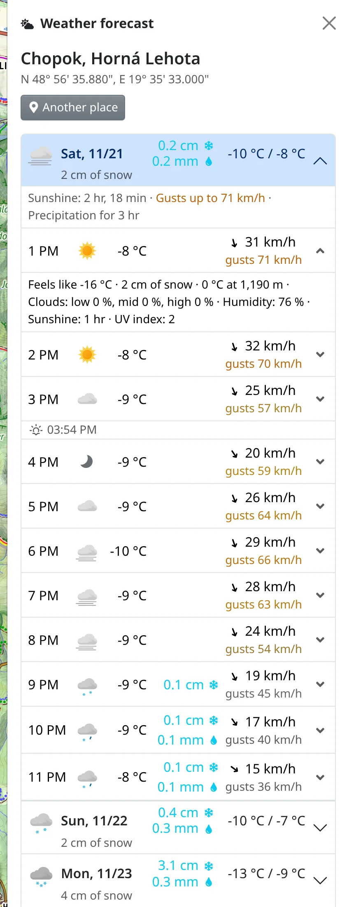

The weather forecast shows the weather hour by hour for the next 16 days at any place in Europe – with new snow, the snow on the ground, gusts and the risk of thunderstorms, for the place's own elevation.

## Opening the forecast

- Choose :FaCloudSun: **Weather forecast** in the main menu, or press <kbd>g</kbd>, then <kbd>f</kbd>, and click the map where you want the forecast. Instead of clicking, you can also find a place in the search box.
- Right-click a place on the map, or press and hold it on a phone, and choose :FaCloudSun: **Weather forecast**.

The forecast opens in a panel beside the map. :FaMapMarkerAlt: **Another place** in it picks a different place. The forecast needs a connection to the internet.

## Days

Each day shows the worst weather of its daytime, the new snow in cm and the rain in mm, and the lowest and highest temperature. Under the date is the snow on the ground.

A click opens the day. At its top is a summary of the day: the hours of sunshine, the strongest gusts, how many hours it rains or snows and the highest chance of it, and the UV index when it is high enough to matter.

## Hours

Each hour of an open day shows the weather, the temperature, the precipitation – new snow in cm, rain in mm, and the chance of it – and the wind: the arrow points where the wind blows, and below it are the gusts. Strong gusts are coloured, from orange to red as they grow. A slim row between two hours marks sunrise or sunset.

A click on an hour opens its details: the height of 0 °C, the clouds low, mid and high, the humidity, and where it applies, the temperature it feels like, the snow on the ground, the height above which it snows, the risk of thunderstorms, the minutes of sunshine, the UV index and visibility under 10 km.

## What time a value is for

An hour row, say **10**, shows values of two kinds: totals over the hour from 10:00 to 11:00, and the state at a moment.

| Value | Time it is for |
|---|---|
| Rain, snow or thunder in the picture | 10:00–11:00 |
| Sun, clouds or fog in the picture | 11:00 |
| Sun or moon in the picture | 10:00 |
| Clouds low, mid and high | 11:00 |
| Rain and new snow, and the chance of it | total over 10:00–11:00 |
| Gusts | strongest over 10:00–11:00 |
| Sunshine | minutes over 10:00–11:00 |
| Temperature, wind, humidity, visibility, UV index | 10:00 |
| Height of 0 °C, snow line, risk of thunderstorms, snow on the ground | 10:00 |

The picture and the clouds always describe the same sky.

## Local time

Days and hours are given in the time of the place. Where it differs from the time of your device, the line under the forecast says by how much, for example **Local time (+1 h)**.

## Elevation and source

The temperatures are for the elevation of the place you clicked, which the line under the forecast gives – on a summit it is colder than the weather model's average for the area. The forecast covers Europe; its data comes from [Open-Meteo](https://open-meteo.com/).

## Along a route and for an event

- With a departure set, the route finder shows the weather along the route at the times you will be there; see [Route finder](#show=manual/route-planner).
- An event in the next 16 days has in its panel the forecast for the event's place on the event's days, with its hours highlighted; see [Events](#show=manual/events).
