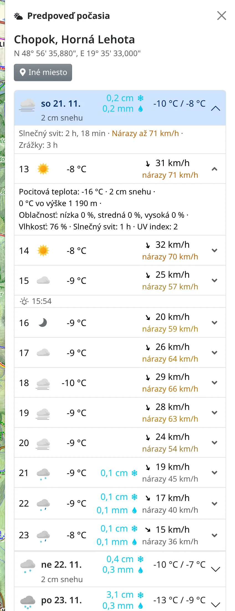

Predpoveď počasia ukazuje počasie po hodinách na najbližších 16 dní na ľubovoľnom mieste v Európe – s novým snehom, snehom na zemi, nárazmi vetra a rizikom búrok, pre nadmorskú výšku daného miesta.

## Otvorenie predpovede

- V hlavnom menu zvoľte :FaCloudSun: **Predpoveď počasia** alebo stlačte <kbd>g</kbd> a potom <kbd>f</kbd> a kliknite na mape tam, kde chcete predpoveď. Namiesto kliknutia môžete miesto aj vyhľadať vo vyhľadávacom poli.
- Kliknite pravým tlačidlom na miesto na mape, na telefóne ho podržte, a zvoľte :FaCloudSun: **Predpoveď počasia**.

Predpoveď sa otvorí v paneli vedľa mapy. Tlačidlom :FaMapMarkerAlt: **Iné miesto** zvolíte iné miesto. Predpoveď potrebuje pripojenie na internet.

## Dni

Pri každom dni je najhoršie počasie počas dňa, nový sneh v cm a dážď v mm a najnižšia a najvyššia teplota. Pod dátumom je sneh na zemi.

Kliknutím deň otvoríte. Na začiatku je súhrn dňa: hodiny slnečného svitu, najsilnejšie nárazy vetra, koľko hodín prší alebo sneží a najvyššia pravdepodobnosť zrážok a UV index, keď je dosť vysoký, aby mal význam.

## Hodiny

Pri každej hodine otvoreného dňa je počasie, teplota, zrážky – nový sneh v cm, dážď v mm a pravdepodobnosť zrážok – a vietor: šípka ukazuje, kam vietor fúka, a pod šípkou sú nárazy. Silné nárazy sú zafarbené, od oranžovej po červenú podľa sily. Úzky riadok medzi dvoma hodinami označuje východ alebo západ slnka.

Kliknutím na hodinu otvoríte podrobnosti: výšku, v ktorej je 0 °C, oblačnosť nízku, strednú a vysokú, vlhkosť a tam, kde to má význam, pocitovú teplotu, sneh na zemi, výšku, nad ktorou sneží, riziko búrok, minúty slnečného svitu, UV index a dohľadnosť pod 10 km.

## Na aký čas údaj platí

Riadok hodiny, napríklad **10**, ukazuje údaje dvoch druhov: súčty za hodinu od 10:00 do 11:00 a stav v určitom okamihu.

| Údaj | Čas, pre ktorý platí |
|---|---|
| Dážď, sneh alebo búrka na obrázku | 10:00 – 11:00 |
| Slnko, oblaky alebo hmla na obrázku | 11:00 |
| Slnko alebo mesiac na obrázku | 10:00 |
| Oblačnosť nízka, stredná a vysoká | 11:00 |
| Dážď a nový sneh a pravdepodobnosť zrážok | súčet za 10:00 – 11:00 |
| Nárazy vetra | najsilnejší za 10:00 – 11:00 |
| Slnečný svit | minúty za 10:00 – 11:00 |
| Teplota, vietor, vlhkosť, dohľadnosť, UV index | 10:00 |
| Výška 0 °C, hranica sneženia, riziko búrok, sneh na zemi | 10:00 |

Obrázok a oblačnosť vždy opisujú tú istú oblohu.

## Miestny čas

Dni a hodiny sú v čase daného miesta. Ak sa líši od času vášho zariadenia, riadok pod predpoveďou uvádza o koľko, napríklad **Miestny čas (+1 h)**.

## Nadmorská výška a zdroj

Teploty platia pre nadmorskú výšku miesta, na ktoré ste klikli – uvádza ju riadok pod predpoveďou. Na vrchole je chladnejšie, než je priemer meteorologického modelu pre okolie. Predpoveď pokrýva Európu; údaje pochádzajú z [Open-Meteo](https://open-meteo.com/).

## Pozdĺž trasy a pre podujatie

- Pri nastavenom odchode ukazuje vyhľadávač trás počasie pozdĺž trasy v časoch, keď tam budete; pozrite [Vyhľadávač trás](#show=manual/route-planner).
- Akcia v najbližších 16 dňoch má v paneli predpoveď pre miesto akcie na dni akcie so zvýraznenými hodinami akcie; pozrite [Akcie](#show=manual/events).
