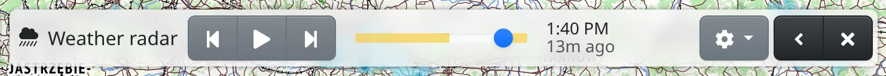

The weather radar shows where it is raining or snowing, as an animation of the last few hours over the map. Use it to see where a shower is heading before you set out.

## Switching the radar on

The radar is an overlay, drawn over whichever base map you have. Switch it on in any of these ways:

- press :FaCloudShowersHeavy: in the map toolbar at the bottom (or find it under :FaEllipsisV:),
- press <kbd>Shift</kbd>+<kbd>r</kbd>,
- type “radar”, “rain” or “weather” into the search box.

How maps and overlays are switched in general is described in [Maps](#show=manual/maps).

The radar covers most of Europe: it is the EUMETNET OPERA composite of the national weather radars, and over Italy the Italian national composite. Its credits are under :FaInfoCircle: at the bottom right.

The radar is drawn semi-transparent so the map stays readable underneath. You change its opacity in the :FaLayerGroup: **Map layers** panel.

## The radar toolbar

When the radar is on, its toolbar appears at the top of the screen.

- :FaStepBackward: **Previous frame** and :FaStepForward: **Next frame** move by one frame; past the last frame they continue from the first.
- :FaPlay: **Play** runs the animation over and over, :FaPause: **Pause** stops it.
- The timeline slider picks a frame directly. Moving it, or stepping, stops the animation.
- Next to the timeline is the time of the frame shown and how long ago it was (“now”, “10m ago”), or how far ahead for a forecast frame (“in 20m”).
- :FaCog: **Radar settings** holds **Show forecast** – see below.
- :FaAngleLeft: **Collapse** shrinks the toolbar to its title, :FaAngleRight: **Expand** brings it back.
- :FaTimes: **Close** switches the radar off. The <kbd>Esc</kbd> key does not close this toolbar.

A new frame is published every 10 minutes. While the radar is on, the list of frames is refreshed every two minutes. When the newest frame is shown, the view moves on to each new frame as it arrives; when you choose an older one, that time stays shown.

## With premium access

Without premium you can view the last **two hours**. [Premium access](#show=premium) adds:

- up to **six hours** of history, as far as the radar data reaches,
- a **forecast** for roughly the next hour, continuing the timeline past “now”. A forecast frame's time is shown in a different colour.

The frames that need premium stay on the timeline, as amber stretches at its ends: older history on the left, the forecast on the right. The slider does not go into them; clicking one opens the premium offer.

With premium, the forecast part of the timeline is blue, and **Show forecast** in :FaCog: **Radar settings** switches the forecast frames on or off. Without premium the item is marked :FaGem.text-warning: and opens the premium offer.
