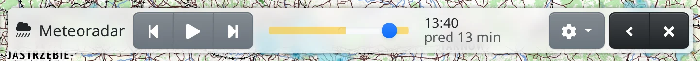

Meteoradar ukazuje, kde prší alebo sneží, ako animáciu posledných hodín nad mapou. Pred výletom tak vidíte, kam sa prehánka posúva.

## Zapnutie radaru

Meteoradar je prekryvná vrstva, ktorá sa kreslí nad ľubovoľnú podkladovú mapu. Zapnete ho ktorýmkoľvek z týchto spôsobov:

- tlačidlom :FaCloudShowersHeavy: v lište máp dole (prípadne v ponuke :FaEllipsisV:),
- klávesmi <kbd>Shift</kbd>+<kbd>R</kbd>,
- zadaním slova „radar“, „dážď“ alebo „počasie“ do vyhľadávacieho poľa.

Ako sa vo všeobecnosti prepínajú mapy a vrstvy, popisuje kapitola [Mapy](#show=manual/maps).

Meteoradar pokrýva väčšinu Európy: ide o kompozit národných meteorologických radarov EUMETNET OPERA, nad Talianskom o taliansky národný kompozit. Zdroje údajov nájdete pod :FaInfoCircle: vpravo dole.

Radar sa kreslí polopriehľadne, aby mapa pod radarom zostala čitateľná. Priehľadnosť radaru zmeníte v paneli :FaLayerGroup: **Vrstvy mapy**.

## Lišta radaru

Keď je meteoradar zapnutý, hore na obrazovke sa zobrazí lišta radaru.

- :FaStepBackward: **Predchádzajúca snímka** a :FaStepForward: **Nasledujúca snímka** posunú zobrazenie o jednu snímku; za poslednou snímkou pokračujú od prvej.
- :FaPlay: **Prehrať** spustí animáciu dookola, :FaPause: **Pozastaviť** ju zastaví.
- Posuvníkom časovej osi vyberiete snímku priamo. Posunutím posuvníka alebo krokovaním sa animácia zastaví.
- Vedľa časovej osi je čas zobrazenej snímky a údaj, ako je stará („teraz“, „pred 10 min“), pri snímke predpovede o koľko je vpred („o 20 min“).
- :FaCog: **Nastavenia radaru** obsahujú položku **Zobraziť predpoveď** – pozri nižšie.
- :FaAngleLeft: **Zbaliť** zmenší lištu na samotný názov, :FaAngleRight: **Rozbaliť** ju vráti.
- :FaTimes: **Zavrieť** meteoradar vypne. Kláves <kbd>Esc</kbd> túto lištu nezatvára.

Nová snímka pribúda každých 10 minút. Kým je meteoradar zapnutý, zoznam snímok sa obnovuje každé dve minúty. Ak je zobrazená najnovšia snímka, zobrazenie sa posúva na každú novú snímku; ak si vyberiete staršiu, zostane zobrazený zvolený čas.

## S prémiovým prístupom

Bez prémiového prístupu si môžete pozrieť posledné **dve hodiny**. [Prémiový prístup](#show=premium) pridáva:

- históriu až **šesť hodín** dozadu, pokiaľ siahajú údaje radaru,
- **predpoveď** približne na najbližšiu hodinu, ktorá pokračuje na časovej osi za „teraz“. Čas snímky predpovede je zobrazený inou farbou.

Snímky, ktoré vyžadujú prémiový prístup, zostávajú na časovej osi ako oranžovožlté úseky na koncoch: staršia história vľavo, predpoveď vpravo. Posuvník do týchto úsekov nezájde; kliknutím na takýto úsek sa otvorí ponuka prémiového prístupu.

S prémiovým prístupom je úsek predpovede na časovej osi modrý a položkou **Zobraziť predpoveď** v ponuke :FaCog: **Nastavenia radaru** snímky predpovede zapnete alebo vypnete. Bez prémiového prístupu je položka označená :FaGem.text-warning: a otvára ponuku prémiového prístupu.
